Every course page on this site now opens with a new picture. At first glance they look like a single, playful family: white objects that seem to be made of warm porcelain, rivers of blue, red and green, a purple cloud here and there, and, more than once, a clock that has started to melt. But if we look at them the way an art historian looks at a series of paintings, they turn out to be something more interesting: eleven small allegories, each one translating the central idea of a course into images.

This post is a short guided tour. I will read each illustration as if it were hanging in a gallery, and explain what it says about the course behind it.

## A shared visual language

Before looking at individual pictures, it is worth noticing what they have in common, because a series is always more than the sum of its parts.

**The soft world.** Tables, drawers, bridges and machines in these images are never quite solid. Their edges drip and flow, as if the furniture were made of icing. This is the vocabulary of Surrealism, and above all of Salvador Dalí. His most famous painting, *The Persistence of Memory* (1931), shows pocket watches hanging limply over a branch and the edge of a table. In our series the melting clock returns again and again, and it is never decoration: in a computer science course, time is literally the thing we measure.

**Architecture as a stage.** Several pictures are framed by white arches and arcades that lead nowhere. They recall the "metaphysical" squares painted by Giorgio de Chirico in the 1910s: empty, calm, slightly dreamlike spaces where objects become symbols. A floating island with a castle on top, which appears in the AI illustration, is a direct echo of René Magritte's *The Castle of the Pyrenees* (1959), a fortress resting on a rock that hovers above the sea.

**A four-colour code.** The palette is strictly limited: blue, red, green and purple on a white ground. The colours behave like a code rather than like decoration. Data flows in blue and red, results often appear in green, and purple marks the abstract, the "thinking" part of the scene. Because every picture follows the same rules, the eye learns to read the whole series, much as medieval viewers learned that a saint in a blue mantle was the Virgin.

**Watercolour and ink.** Finally, the technique: fine ink lines filled with soft, transparent washes. It gives the pictures the feeling of book illustration rather than of technical diagrams, which suits their purpose. They are invitations, not explanations.

## Computer Fundamentals and Introduction to Programming

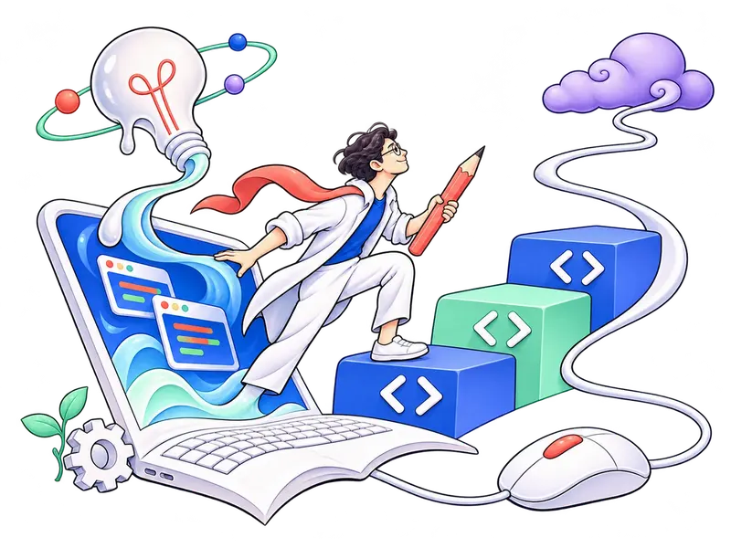

The first picture is a portrait of a beginning. A young student in a white coat and a red scarf steps out of a laptop screen and climbs a staircase of blocks, each marked with the angle brackets of code. In one hand there is an oversized pencil, the oldest symbol of learning. Above the laptop a light bulb, ringed by orbiting particles like a small atom, pours an idea down into the screen as if it were water.

Notice the direction of movement: from the machine towards the cloud in the upper right, connected by the mouse cable that turns into a winding road. This is the whole course in one gesture. You start with the computer in front of you, you learn to build with small blocks, and you climb towards larger and more abstract things. The little plant and the gear in the lower left corner are the two halves of the subject: growth and mechanism.

[Course page](/teaching/computer-and-introduction-to-programming/)

## Guide to AI and Data Courses

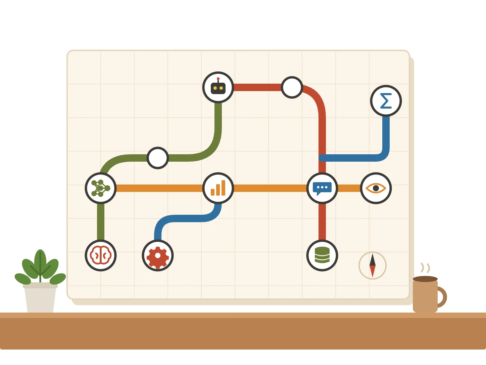

Here the student has become a traveller. Standing on the pages of an enormous open book, with a backpack and a compass, they look at three roads that rise into the sky over a landscape of white viaducts. The blue road leads to a giant eye surrounded by photographs: computer vision. The red road ends at a network of connected spheres: neural networks and graphs. The green road climbs to a bar chart and a database: the world of data.

This is a classic composition of choice, a modern version of the old allegory of the crossroads, in which a young hero must decide which path to follow. The compass is the key detail. The course does not choose for the student; it gives them the means to orient themselves. And the open book under their feet reminds us that every road starts from the same foundations.

[Course page](/teaching/ai-courses/)

## Microprocessors

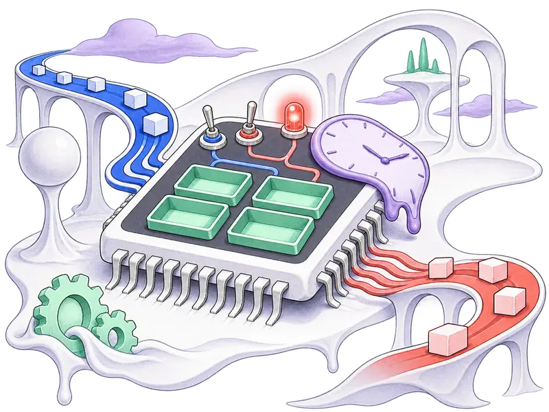

The microprocessor is shown as a monument. A large chip stands at the centre, its metal legs gripping a soft white landscape. On its surface there are four green compartments, like the registers inside a processor, two toggle switches and a glowing red light. A blue conveyor belt carries small white cubes into the chip; a red one carries them out. Data in, data out: the fetch–execute cycle reduced to a single image.

Draped over the edge of the chip is the melting clock, closer to Dalí here than anywhere else in the series. In a microprocessor course this is not a dreamy symbol but a technical one. Everything in a processor happens to the rhythm of a clock signal, and the clock is the heart of the machine. The gears in the lower left corner complete the picture: this is the course where computing becomes physical.

[Course page](/teaching/microprocessors/)

## Programming with C

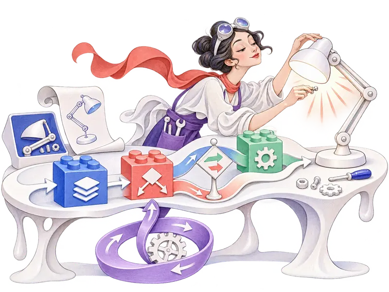

This is the most narrative picture in the series, and it reads from left to right like a sentence. On the left there is a blueprint of a desk lamp. Then comes a chain of blocks connected by arrows: a blue block with layers, a red block with branching arrows, a road sign that points in two directions, and a green block with a gear. On the right, a woman with workshop goggles in her hair is fitting the last small screw into a real lamp, which is already shining.

Anyone who has learned C will recognise the logic. A program is a sequence of steps; some steps make a decision (the red block and the road sign), others are repeated, which is exactly what the purple loop under the table shows, with a gear turning inside it. The picture celebrates the procedural way of thinking: you start from a plan, follow it step by step, and at the end something that did not exist before switches on. The craftswoman's calm, satisfied face says the rest.

[Course page](/teaching/programming-with-c/)

## Object Oriented Programming with Java

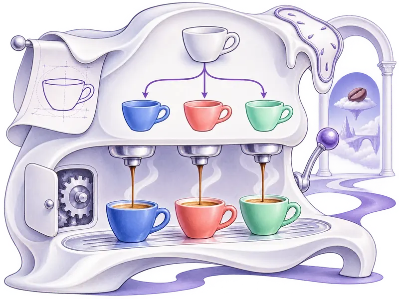

For object-oriented programming the illustrator chose a coffee machine, a sly reference to Java, whose name and logo come from coffee. On the left, a sheet of paper hangs from the machine with a technical drawing of a cup: this is the class, the plan. At the top of the machine sits one white cup, and from it three arrows lead to three coloured cups: blue, red and green. Below, three spouts fill three real cups of coffee.

It is a remarkably precise diagram disguised as a still life. One class, many objects; each object has the same shape but its own state, here its own colour. The small door on the side, half open to show a gear inside, is the idea of encapsulation: the mechanism is hidden, and you only use the machine through its handles. Through the arch on the right, a coffee bean floats above a cloud, like Magritte's castle: the raw material from which everything is made.

[Course page](/teaching/object-oriented-programming-with-java/)

## Operating Systems

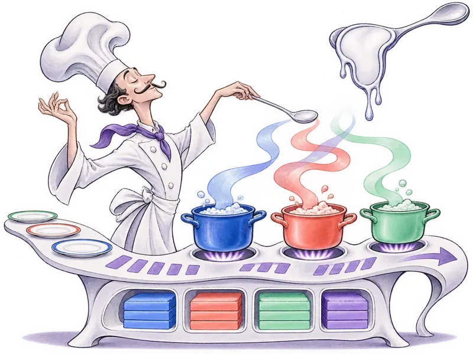

The operating system is a chef. Tall hat, purple neckerchief and an upturned moustache that any admirer of Dalí will recognise, he stands behind a long, curving counter and conducts the kitchen like an orchestra. Three pots, blue, red and green, are boiling at the same time on three burners. Their steam rises in coloured ribbons, and the chef tastes one of them with a long spoon while his other hand makes a gesture of approval.

The allegory is old and good: a kitchen is a system with limited resources and many tasks. The three pots are processes that run "at the same time" although the cook has only two hands, so his attention moves between them, the idea of scheduling. The empty plates waiting on the left are tasks in the queue. The stacked blocks under the counter, sorted by colour, are memory, divided into regions for each process. Along the front of the counter runs a row of purple marks with an arrow at the end: a timeline, sliced into the small periods during which each pot gets the chef's attention.

[Course page](/teaching/operating-systems/)

## Data Structures and Algorithms with C

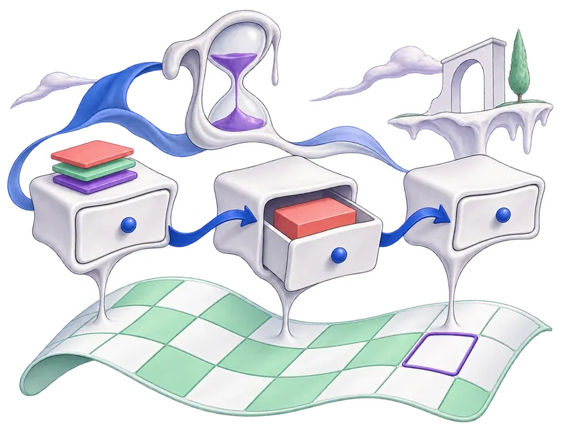

This picture is quieter and more abstract. Three white drawers stand on thin, melting legs, connected by curved blue arrows. The first holds a small stack of coloured tiles, the second is open and shows a single red block, the third is closed. Below them a chequered floor in green and white waves like a carpet, and one square is outlined in purple.

For a C programmer this is almost a technical drawing. The drawers are nodes, the arrows are pointers, and the chain is a linked list. The chequered floor is memory itself, a grid of cells, and the purple square is one address being pointed at. Above everything floats an hourglass that has begun to melt: the question of running time, which follows every data structure. The white ribbon that runs through the sky and the floating ruin on the right give the scene the stillness of a de Chirico square, where ordinary objects become strangely meaningful.

[Course page](/teaching/data-structures-and-algorithms-with-c/)

## Advanced Algorithms

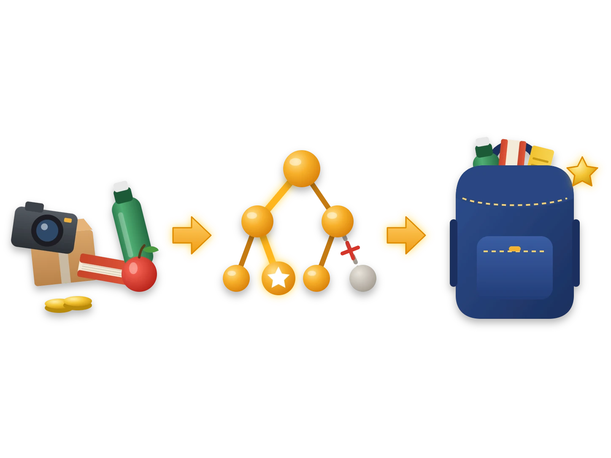

Two famous problems share this canvas. On the left grows a tree, but its branches end in small platforms that hold coloured gems: a blue octahedron, a red polyhedron, a green cube, a sphere. A purple path climbs through the tree, choosing one branch at a time. Low on the left, a dry branch with a grey stone is being cut by a pair of red scissors. On the right stands a large soft backpack, already full of gems, with a balance scale hanging from its clasp.

This is the knapsack problem, one of the classic examples of the course: choose the items that give the greatest value without exceeding the weight limit. The tree is the space of all possible choices, and the scissors are a beautiful visual metaphor for pruning, the technique of cutting off branches that cannot lead to a better answer (as in backtracking and branch and bound). The scale on the backpack is the constraint. In one image we see the whole drama of hard problems: too many possibilities, and the art of not exploring all of them.

[Course page](/teaching/advanced-algorithms/)

## Algorithms

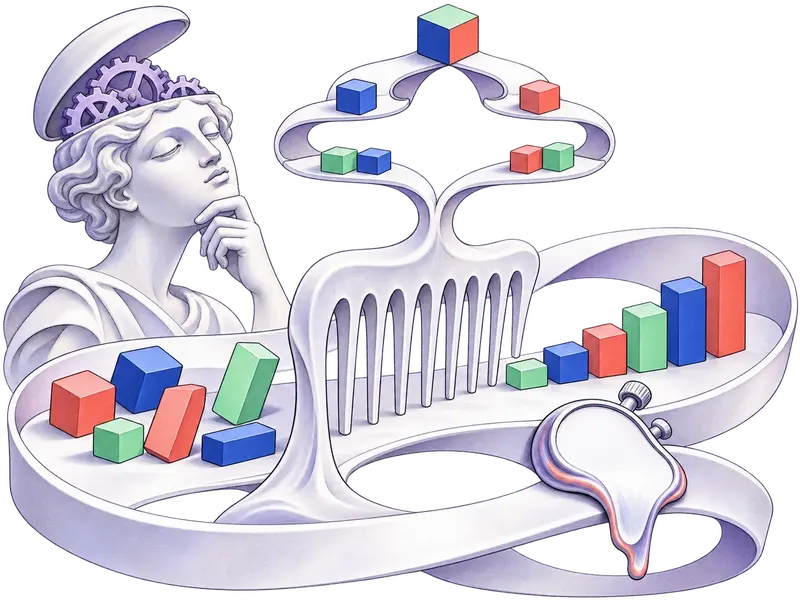

Here the series quotes classical sculpture. A marble bust, in the calm style of Greek and Roman portraits, rests its chin on its hand in the pose that Auguste Rodin made famous with *The Thinker*. The top of its head is lifted like a lid, and inside we see purple gears turning. Thought is presented as a mechanism, which is a fair definition of an algorithm.

In front of the thinker a white ribbon twists into a loop that recalls the Möbius strips of M. C. Escher. On it, coloured blocks travel from left to right. At the start they lie in disorder; they pass through a giant comb; and at the end they stand in a neat row, from the shortest to the tallest. This is sorting, the first great topic of any algorithms course. Above the comb, the blocks split into smaller and smaller groups on a branching shelf, a picture of divide and conquer. And at the edge of the ribbon lies a melting stopwatch: the cost of the whole process, measured in time.

[Course page](/teaching/algorithms/)

## Data Structures

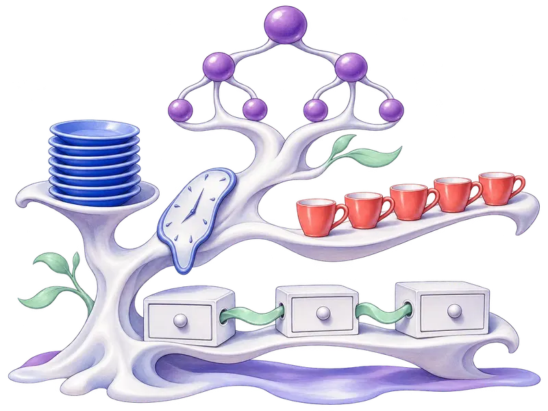

If the C course picture is a single drawing, this one is a whole cabinet of curiosities. A soft white tree carries, on its branches, almost every structure the course teaches. On the left, a pile of blue plates: a stack, where only the top plate can be taken. On the right, a row of red cups waiting on a shelf: a queue, first come, first served. At the bottom, three drawers joined by green ribbons: a linked list. At the very top, the tree divides into purple spheres, two by two: a binary tree, drawn as an actual tree.

The choice of everyday objects is not accidental. Teachers of data structures have always used plates and queues of people to explain abstract ideas, and the illustration turns that classroom habit into a still life. Over the trunk hangs the soft clock once more, a reminder that each of these structures is chosen for how quickly it lets us do something. The small green leaves show that the tree is alive: these are not museum pieces, but tools that grow into bigger programs.

[Course page](/teaching/data-structures/)

## Algorithmic Game Theory

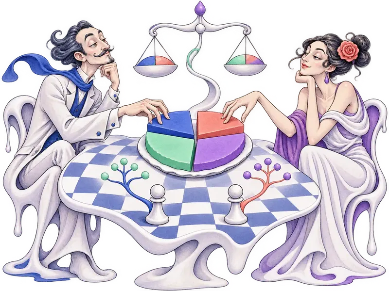

The last picture is the only true double portrait in the series, and the most theatrical. At a chequered table with melting legs sit two figures. On the left, a man in a white suit and a blue scarf, with an extravagant curled moustache, rests his chin on his hand and watches his opponent. On the right, a woman in a flowing purple dress, with a red rose in her dark hair, smiles back with the same calculating look. Between them lies a round cake cut into four coloured slices, and both of them have a hand on it.

The scene is a game in every sense. The chequerboard table suggests chess; two white pawns stand on it, and next to each pawn grows a small branching tree, the game tree that each player uses to think ahead. Above the cake hangs a balance scale whose two pans hold different shares of colour. This is the question at the heart of the course: how should rational players divide something they both want, and what outcome is fair or stable? The romantic, slightly ironic staging, which owes a great deal to the surrealists' love of masks and couples, reminds us that game theory is really about people, even when it is written in mathematics.

[Course page](/teaching/algorithmic-game-theory/)

## Why pictures at all?

A course page could easily do without an illustration. But there is an old tradition in which images are not ornaments but doors. Medieval manuscripts opened each chapter with a decorated initial; Renaissance books placed an allegorical frontispiece before the title page, so that the reader would understand the spirit of the book before reading a word.

These eleven pictures work in the same way. Each one compresses a course into a single scene that you can take in at a glance and then, slowly, decode. And like all good allegories, they reward a second look: the scissors in the tree, the half-open door of the coffee machine, the purple square on the chequered floor. If a student smiles at the melting clock and later remembers it when the lecturer says "running time", the picture has done its job.
