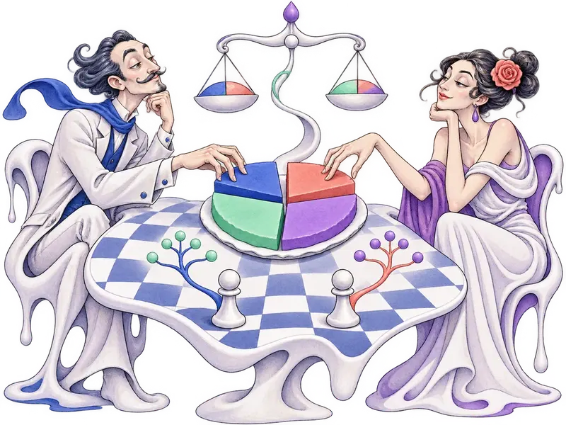

{: .align-left width="200" height="150" style="float: left; margin-right: 10px;"} 
Algorithmic game theory studies strategic interaction through the lens of computation. It combines game-theoretic models with algorithms and complexity analysis to examine equilibria, auctions, market mechanisms, routing, online platforms, fairness, and the behavior of self-interested agents.

---

## Ders Kitabı

[📕 Algoritmik Oyun Kuramı (PDF, 15 MB)](https://sercankulcu.github.io/courses-pdfs/agt/Algoritmik-Oyun-Kurami.pdf)

---

## Başlangıç Kaynakları

* [Algoritmik Oyun Kuramında Önemli İsimler (HTML)](/files/agt/Algorithmic_Game_Theory_Important_People.html)
* [Algoritmik Oyun Kuramı İçin Ön Bilgiler (HTML)](/files/agt/Algorithmic_Game_Theory_Prerequisites.html)
* [Dersin Haritası (HTML)](/files/agt/Ders_Haritasi.html)
* [Terim Sözlüğü (HTML)](/files/agt/Sozluk.html)
* [Canlı Sınıf Oyunları (HTML)](/files/agt/canli/)

---

## Kısım I: Araçlar ve Temeller

### Bölüm 0: Hazırlık

Derste gerçekten kullanılan matematik, oyun örnekleri üzerinden yeniden ele alınır: küme ve fonksiyon gösterimi, toplam sembolü, max ve argmax, olasılık ve beklenen değer, karışık strateji fikri, kazanç matrisinin okunması, en iyi tepki, kayıtsızlık denkleminin çözümü ve oyun ağacında geriye doğru çıkarım.

- [🖼️ Sunum](/files/agt/sunumlar/Bolum_00_Hazirlik.html) · [📄 PDF](https://sercankulcu.github.io/courses-pdfs/agt/pdf/Bolum_00_Hazirlik.pdf) · [📖 Ders notu](/files/agt/notlar/Bolum_00_Hazirlik_Ders_Notu.html) · [📝 Sorular](/files/agt/sunumlar/Bolum_00_Hazirlik_Calisma_Sorulari.html) · [💻 Kod (Python)](https://github.com/sercankulcu/algorithmic-game-theory-python/tree/main/Bolum00)

---

### Bölüm 1: Karar Kuramı

Stratejik etkileşimden önce tek bir karar verici incelenir. Beklenen fayda ve von Neumann–Morgenstern aksiyomları, fayda ölçeğinin hangi dönüşümlere kadar tek olduğu, Allais ve Ellsberg paradoksları, risk tutumları ve kesinlik eşdeğeri, belirsizlik altında karar ölçütleri, Bayesçi karar, karar ağaçlarında geriye doğru çıkarım ve bilginin değeri bu bölümün konularıdır.

- [🖼️ Sunum](/files/agt/sunumlar/Bolum_01_Karar_Kurami.html) · [📄 PDF](https://sercankulcu.github.io/courses-pdfs/agt/pdf/Bolum_01_Karar_Kurami.pdf) · [📖 Ders notu](/files/agt/notlar/Bolum_01_Karar_Kurami_Ders_Notu.html) · [📝 Sorular](/files/agt/sunumlar/Bolum_01_Karar_Kurami_Calisma_Sorulari.html) · [💻 Kod (Python)](https://github.com/sercankulcu/algorithmic-game-theory-python/tree/main/Bolum01)
- 🕹️ **Oyunlar ve simülatörler:** [Bayesçi Karar Laboratuvarı](/files/agt/sunumlar/Bolum_01_Bayesian-Decision-Lab.html) · [Blackjack Karar Laboratuvarı](/files/agt/sunumlar/Bolum_01_Blackjack.html) · [Poker Oyunu](/files/agt/sunumlar/Bolum_01_Poker.html) · [Tavla YZ](/files/agt/sunumlar/Bolum_01_Backgammon.html) · [Mayın Tarlası](/files/agt/sunumlar/Bolum_01_Minesweeper.html) · [Pişti](/files/agt/sunumlar/Bolum_01_Pisti.html) · [Hokm](/files/agt/sunumlar/Bolum_01_Hokm.html)

---

### Bölüm 2: Oyunlar ve Temsiller

Bir oyunun ne olduğu ve nasıl yazıldığı: oyuncular, stratejiler, kazançlar ve bilgi; normal form ve genişletilmiş form; oyunların sınıflandırılması; Mahkûmun İkilemi ve Pareto optimallik; klasik 2×2 oyunlar; 2/3 ortalaması oyunu ve seviye-k düşünme; kombinatoryal oyunlar ve minimaks; minimaksı hızlandıran alfa-beta budaması, derinlik sınırlı arama ve değerlendirme fonksiyonları; sıralı oyunlar, geriye doğru çıkarım, alt oyun mükemmel denge ve tetik stratejisi.

- **Oyunlar ve Temsiller** — [🖼️ Sunum](/files/agt/sunumlar/Bolum_02_Oyunlar_ve_Temsiller.html) · [📄 PDF](https://sercankulcu.github.io/courses-pdfs/agt/pdf/Bolum_02_Oyunlar_ve_Temsiller.pdf) · [📖 Ders notu](/files/agt/notlar/Bolum_02_Oyunlar_ve_Temsiller_Ders_Notu.html) · [📝 Sorular](/files/agt/sunumlar/Bolum_02_Oyunlar_ve_Temsiller_Calisma_Sorulari.html) · [💻 Kod (Python)](https://github.com/sercankulcu/algorithmic-game-theory-python/tree/main/Bolum02)
- **Minimaks ve Alfa-Beta Budaması** — [🖼️ Sunum](/files/agt/sunumlar/Bolum_02_Minimaks_ve_Budama.html) · [📄 PDF](https://sercankulcu.github.io/courses-pdfs/agt/pdf/Bolum_02_Minimaks_ve_Budama.pdf) · [📝 Sorular](/files/agt/sunumlar/Bolum_02_Minimaks_ve_Budama_Calisma_Sorulari.html)
- 🕹️ **Oyunlar ve simülatörler:** [2/3 Ortalaması Oyunu](/files/agt/sunumlar/Bolum_02_Guess_Average.html) · [Minimaks XOX](/files/agt/sunumlar/Bolum_02_TicTacToe.html) · [Nim](/files/agt/sunumlar/Bolum_02_Nim.html) · [21'i Söyleme](/files/agt/sunumlar/Bolum_02_Dont-Say-21.html) · [Dörtlü Bağla](/files/agt/sunumlar/Bolum_02_Connect-Four.html) · [Hex](/files/agt/sunumlar/Bolum_02_Hex.html) · [Othello](/files/agt/sunumlar/Bolum_02_Othello.html) · [Mangala](/files/agt/sunumlar/Bolum_02_Mangala.html) · [Satranç (YZ'ye karşı)](/files/agt/sunumlar/Bolum_02_Chess.html) · [Dama](/files/agt/sunumlar/Bolum_02_Checkers.html) · [Tilki ve Kazlar](/files/agt/sunumlar/Bolum_02_Fox-and-Geese.html) · [Dokuz Taş](/files/agt/sunumlar/Bolum_02_Nine-Mens-Morris.html)

---

### Bölüm 3: Nash Dengesi

Nash dengesi, hiçbir oyuncunun tek başına sapmakla kazançlı çıkamadığı strateji profilidir. Bölümde en iyi tepki, Cournot ve Bertrand rekabeti, baskılanan stratejilerin art arda elenmesi, karışık strateji dengeleri ve kayıtsızlık ilkesi, Nash'in varlık teoremi, denge seçimi, korelasyonlu denge, sıfır toplamlı oyunlarda minimaks, güvenlik oyunları ve denge hesaplamanın PPAD karmaşıklığı ele alınır.

- [🖼️ Sunum](/files/agt/sunumlar/Bolum_03_Nash_Dengesi.html) · [📄 PDF](https://sercankulcu.github.io/courses-pdfs/agt/pdf/Bolum_03_Nash_Dengesi.pdf) · [📖 Ders notu](/files/agt/notlar/Bolum_03_Nash_Dengesi_Ders_Notu.html) · [📝 Sorular](/files/agt/sunumlar/Bolum_03_Nash_Dengesi_Calisma_Sorulari.html) · [💻 Kod (Python)](https://github.com/sercankulcu/algorithmic-game-theory-python/tree/main/Bolum03)
- 🕹️ **Oyunlar ve simülatörler:** [Mahkûmun İkilemi Simülatörü](/files/agt/sunumlar/Bolum_03_Prisoners_Dilemma.html) · [Matris Oyunu ve Nash Dengesi Laboratuvarı](/files/agt/sunumlar/Bolum_03_Matrix-Nash.html) · [Taş Kağıt Makas](/files/agt/sunumlar/Bolum_03_Rock_Scissors_Paper.html) · [Albay Blotto](/files/agt/sunumlar/Bolum_03_Colonel-Blotto.html)

---

## Kısım II: Mekanizmalar

### Bölüm 4: Mekanizma Tasarımı

Mekanizma tasarımı soruyu tersine çevirir: Hedef belli olduğunda, kendi çıkarını gözeten katılımcıları bu hedefe doğru davranmaya hangi kurallar yöneltir? Sosyal seçim fonksiyonları, açıklama ilkesi, teşvik uyumluluğu ve bireysel rasyonellik, Myerson lemması, VCG mekanizması, Gale–Shapley kararlı eşleştirme, medyan mekanizması, En İyi Takas Döngüleri (TTC) ve Bayesçi oyunlar.

- [🖼️ Sunum](/files/agt/sunumlar/Bolum_04_Mekanizma_Tasarimi.html) · [📄 PDF](https://sercankulcu.github.io/courses-pdfs/agt/pdf/Bolum_04_Mekanizma_Tasarimi.pdf) · [📖 Ders notu](/files/agt/notlar/Bolum_04_Mekanizma_Tasarimi_Ders_Notu.html) · [📝 Sorular](/files/agt/sunumlar/Bolum_04_Mekanizma_Tasarimi_Calisma_Sorulari.html) · [💻 Kod (Python)](https://github.com/sercankulcu/algorithmic-game-theory-python/tree/main/Bolum04)
- 🕹️ **Oyunlar ve simülatörler:** [Ültimatom Oyunu](/files/agt/sunumlar/Bolum_04_Ultimatum-Game.html) · [Kararlı Eşleştirme Simülatörü](/files/agt/sunumlar/Bolum_04_Stable-Matching.html) · [Teşvik Uyumluluğu Laboratuvarı](/files/agt/sunumlar/Bolum_04_Incentive-Compatibility-Lab.html)

---

### Bölüm 5: Açık Artırmalar

Açık artırmalar, malların dağıtılmasında ve fiyatların belirlenmesinde en yaygın kullanılan mekanizmalardır. Dört temel biçim (İngiliz, Hollanda, birinci fiyat ve ikinci fiyat kapalı zarf), denge teklif stratejileri, gelir eşdeğerliği ve bilginin rolü, alıcıların da satıcıların da teklif verdiği çift taraflı açık artırma piyasaları.

- [🖼️ Sunum](/files/agt/sunumlar/Bolum_05_Acik_Artirmalar.html) · [📄 PDF](https://sercankulcu.github.io/courses-pdfs/agt/pdf/Bolum_05_Acik_Artirmalar.pdf) · [📖 Ders notu](/files/agt/notlar/Bolum_05_Acik_Artirmalar_Ders_Notu.html) · [📝 Sorular](/files/agt/sunumlar/Bolum_05_Acik_Artirmalar_Calisma_Sorulari.html) · [💻 Kod (Python)](https://github.com/sercankulcu/algorithmic-game-theory-python/tree/main/Bolum05)
- 🕹️ **Oyunlar ve simülatörler:** [Vickrey Açık Artırması](/files/agt/sunumlar/Bolum_05_second-price-sealed-bid-auction.html) · [İngiliz Açık Artırması](/files/agt/sunumlar/Bolum_05_english-auction-simulator.html) · [Hollanda Açık Artırması](/files/agt/sunumlar/Bolum_05_dutch-auction-simulator.html) · [Birinci Fiyat Kapalı Zarf Açık Artırması](/files/agt/sunumlar/Bolum_05_first-price-auction-simulator.html) · [Çift Taraflı Açık Artırma Piyasası](/files/agt/sunumlar/Bolum_05_Double-Auction-Market-Simulator.html) · [Monopoly (isteğe bağlı)](/files/agt/sunumlar/Bolum_05_Monopoly.html)

---

### Bölüm 6: Çevrim İçi Platformlar

Dijital platformlar kendi çıkarını gözeten kullanıcıları bir araya getirir ve aralarındaki oyunun kurallarını koyar. İki taraflı pazarlar, ağ etkisi ve kritik kitle, iki taraflı fiyatlandırma, sponsorlu arama açık artırmaları (GSP ve VCG), bütçe kısıtlı çevrim içi tahsis, itibar sistemleri ve platformlar arası rekabet.

- [🖼️ Sunum](/files/agt/sunumlar/Bolum_06_Cevrim_Ici_Platformlar.html) · [📄 PDF](https://sercankulcu.github.io/courses-pdfs/agt/pdf/Bolum_06_Cevrim_Ici_Platformlar.pdf) · [📖 Ders notu](/files/agt/notlar/Bolum_06_Cevrim_Ici_Platformlar_Ders_Notu.html) · [📝 Sorular](/files/agt/sunumlar/Bolum_06_Cevrim_Ici_Platformlar_Calisma_Sorulari.html) · [💻 Kod (Python)](https://github.com/sercankulcu/algorithmic-game-theory-python/tree/main/Bolum06)
- 🕹️ **Oyunlar ve simülatörler:** [İki Taraflı Platform Fiyatlama](/files/agt/sunumlar/Bolum_06_Two-Sided-Platform-Pricing.html) · [Sponsorlu Arama Açık Artırması](/files/agt/sunumlar/Bolum_06_Sponsored-Search-Ad-Auction-Game.html)

---

### Bölüm 7: Sosyal Seçim ve Oylama

Sosyal seçim, bireysel tercihlerin ortak bir karara nasıl dönüştürüldüğünü inceler. Aynı tercih profili üzerinde sayılan çoğunluk, çoğulluk, Borda, onay, anında ikinci tur ve Condorcet kuralları, Condorcet döngüsü, stratejik oy ile Arrow, Gibbard–Satterthwaite ve May teoremleri.

- [🖼️ Sunum](/files/agt/sunumlar/Bolum_07_Sosyal_Secim_ve_Oylama.html) · [📄 PDF](https://sercankulcu.github.io/courses-pdfs/agt/pdf/Bolum_07_Sosyal_Secim_ve_Oylama.pdf) · [📖 Ders notu](/files/agt/notlar/Bolum_07_Sosyal_Secim_ve_Oylama_Ders_Notu.html) · [📝 Sorular](/files/agt/sunumlar/Bolum_07_Sosyal_Secim_ve_Oylama_Calisma_Sorulari.html) · [💻 Kod (Python)](https://github.com/sercankulcu/algorithmic-game-theory-python/tree/main/Bolum07)
- 🕹️ **Oyunlar ve simülatörler:** [Oylama Kuralları ve Manipülasyon](/files/agt/sunumlar/Bolum_07_Voting-Rules.html) · [Condorcet Paradoksu](/files/agt/sunumlar/Bolum_07_Condorcet-Voting-Paradox.html) · [Tesis Yerleşimi](/files/agt/sunumlar/Bolum_07_Facility_Location.html)

---

## Kısım III: Ağlar ve Verimlilik

### Bölüm 8: Ağ Tasarımı ve Yönlendirme

Her sürücü ya da paket kendi yolunu seçtiğinde ortaya çıkan sonuç, merkezî bir planlayıcının seçeceğinden farklı olabilir. Yönlendirmenin temelleri, bencil yönlendirme, Wardrop dengesi ile sistem optimumunun karşılaştırılması, Braess paradoksu, tıkanıklık oyunları ve Rosenthal potansiyeli, ağ oluşturma oyunları.

- [🖼️ Sunum](/files/agt/sunumlar/Bolum_08_Ag_Tasarimi_ve_Yonlendirme.html) · [📄 PDF](https://sercankulcu.github.io/courses-pdfs/agt/pdf/Bolum_08_Ag_Tasarimi_ve_Yonlendirme.pdf) · [📖 Ders notu](/files/agt/notlar/Bolum_08_Ag_Tasarimi_ve_Yonlendirme_Ders_Notu.html) · [📝 Sorular](/files/agt/sunumlar/Bolum_08_Ag_Tasarimi_ve_Yonlendirme_Calisma_Sorulari.html) · [💻 Kod (Python)](https://github.com/sercankulcu/algorithmic-game-theory-python/tree/main/Bolum08)
- 🕹️ **Oyunlar ve simülatörler:** [Braess Paradoksu](/files/agt/sunumlar/Bolum_08_Braess-Paradox-Visualizer.html) · [Bencil Yönlendirme ve PoA](/files/agt/sunumlar/Bolum_08_Selfish-Routing.html) · [Ağ Oluşturma Oyunu](/files/agt/sunumlar/Bolum_08_Network-Formation.html)

---

### Bölüm 9: Anarşinin Bedeli

Anarşinin Bedeli, en kötü dengeyi optimumla karşılaştırarak bencil davranış yüzünden ne kadar verim kaybedildiğini ölçer; İstikrarın Bedeli aynı karşılaştırmayı en iyi denge için yapar. İki yollu ağda ve Pigou ağında bu oranlar, doğrusal gecikmelerde 4/3 sınırı, pürüzsüzlük, Braess ağı, yük dengeleme, İstikrarın Bedeli için logaritmik sınır, tıkanıklık ücreti ve öteki müdahaleler.

- [🖼️ Sunum](/files/agt/sunumlar/Bolum_09_Anarsinin_Bedeli.html) · [📄 PDF](https://sercankulcu.github.io/courses-pdfs/agt/pdf/Bolum_09_Anarsinin_Bedeli.pdf) · [📖 Ders notu](/files/agt/notlar/Bolum_09_Anarsinin_Bedeli_Ders_Notu.html) · [📝 Sorular](/files/agt/sunumlar/Bolum_09_Anarsinin_Bedeli_Calisma_Sorulari.html) · [💻 Kod (Python)](https://github.com/sercankulcu/algorithmic-game-theory-python/tree/main/Bolum09)
- 🕹️ **Oyunlar ve simülatörler:** [Yük Dengeleme ve PoA](/files/agt/sunumlar/Bolum_09_Load-Balancing-Price-of-Anarchy-Game.html)

---

## Kısım IV: İşbirliği ve Toplum

### Bölüm 10: Çoklu Ajan Sistemleri

Çoklu ajan sistemleri, ortak bir ortamda işbirliği yapan ya da birbiriyle rekabet eden özerk ajanlardan oluşur. Ajanların özellikleri, işbirliği ve rekabet, sözleşme ağıyla görev dağıtımı, koalisyon oyunları, Shapley değeri, çekirdek ve kamu mallarında beleşçilik.

- [🖼️ Sunum](/files/agt/sunumlar/Bolum_10_Coklu_Ajan_Sistemleri.html) · [📄 PDF](https://sercankulcu.github.io/courses-pdfs/agt/pdf/Bolum_10_Coklu_Ajan_Sistemleri.pdf) · [📖 Ders notu](/files/agt/notlar/Bolum_10_Coklu_Ajan_Sistemleri_Ders_Notu.html) · [📝 Sorular](/files/agt/sunumlar/Bolum_10_Coklu_Ajan_Sistemleri_Calisma_Sorulari.html) · [💻 Kod (Python)](https://github.com/sercankulcu/algorithmic-game-theory-python/tree/main/Bolum10)
- 🕹️ **Oyunlar ve simülatörler:** [Shapley Koalisyon Oyunu](/files/agt/sunumlar/Bolum_10_Shapley-Coalition-Game.html)

---

### Bölüm 11: Algoritmik Adalet ve Etik

Algoritmik kararlar ve dağıtımlar bireyleri ve grupları farklı biçimlerde etkiler. Karışıklık matrisinden hesaplanan adalet ölçütleri (demografik eşitlik, eşitlenmiş olasılıklar, tahmin eşitliği, kalibrasyon) ve bu ölçütlerin neden aynı anda sağlanamadığı; kes-ve-seç, orantılılık ve kıskançsızlık ile adil bölüşüm; etik ilkeler ve algoritmik denetim.

- [🖼️ Sunum](/files/agt/sunumlar/Bolum_11_Algoritmik_Adalet_ve_Etik.html) · [📄 PDF](https://sercankulcu.github.io/courses-pdfs/agt/pdf/Bolum_11_Algoritmik_Adalet_ve_Etik.pdf) · [📖 Ders notu](/files/agt/notlar/Bolum_11_Algoritmik_Adalet_ve_Etik_Ders_Notu.html) · [📝 Sorular](/files/agt/sunumlar/Bolum_11_Algoritmik_Adalet_ve_Etik_Calisma_Sorulari.html) · [💻 Kod (Python)](https://github.com/sercankulcu/algorithmic-game-theory-python/tree/main/Bolum11)
- 🕹️ **Oyunlar ve simülatörler:** [Adil Bölüşüm Oyunu](/files/agt/sunumlar/Bolum_11_Fair-Division-Game.html)

---

### Bölüm 12: Davranışsal ve Kolektif Karar

Gerçek insanlar rasyonel modelden sapar; gruplar da tek tek bireylerin karşılaşmadığı ikilemlerle yüz yüze gelir. Sınırlı rasyonellik, beklenti kuramı, kayıptan kaçınma ve çerçeveleme, ortak mallar trajedisi ve en iyi tepki dinamiği, vergi, kota ve yaptırım gibi kurumsal çözümler, kamu malı deneyleri ve sosyal refah ölçütleri.

- [🖼️ Sunum](/files/agt/sunumlar/Bolum_12_Davranissal_ve_Kolektif_Karar.html) · [📄 PDF](https://sercankulcu.github.io/courses-pdfs/agt/pdf/Bolum_12_Davranissal_ve_Kolektif_Karar.pdf) · [📖 Ders notu](/files/agt/notlar/Bolum_12_Davranissal_ve_Kolektif_Karar_Ders_Notu.html) · [📝 Sorular](/files/agt/sunumlar/Bolum_12_Davranissal_ve_Kolektif_Karar_Calisma_Sorulari.html) · [💻 Kod (Python)](https://github.com/sercankulcu/algorithmic-game-theory-python/tree/main/Bolum12)
- 🕹️ **Oyunlar ve simülatörler:** [Kamu Malı Oyunu](/files/agt/sunumlar/Bolum_12_Public-Goods-Game.html)

---

## Kısım V: Dinamikler ve Gelecek

### Bölüm 13: Öğrenme ve Adaptasyon

Deneyimden öğrenen ajanlar dengeye nasıl ulaşır, ya da neden ulaşamaz? En iyi tepki dinamiği, kurgusal oyun, pişmanlık ve çarpımsal ağırlıklar, çok kollu haydut problemleri (ε-açgözlü ve UCB), replikatör dinamiği ve tekrarlı Mahkûmun İkilemi.

- [🖼️ Sunum](/files/agt/sunumlar/Bolum_13_Ogrenme_ve_Adaptasyon.html) · [📄 PDF](https://sercankulcu.github.io/courses-pdfs/agt/pdf/Bolum_13_Ogrenme_ve_Adaptasyon.pdf) · [📖 Ders notu](/files/agt/notlar/Bolum_13_Ogrenme_ve_Adaptasyon_Ders_Notu.html) · [📝 Sorular](/files/agt/sunumlar/Bolum_13_Ogrenme_ve_Adaptasyon_Calisma_Sorulari.html) · [💻 Kod (Python)](https://github.com/sercankulcu/algorithmic-game-theory-python/tree/main/Bolum13)
- 🕹️ **Oyunlar ve simülatörler:** [Çok Kollu Haydut Öğrenme Oyunu](/files/agt/sunumlar/Bolum_13_Multi-Armed-Bandit.html) · [Tekrarlı Mahkûmun İkilemi Turnuvası](/files/agt/sunumlar/Bolum_13_Repeated-Prisoners-Dilemma-Tournament.html) · [Replikatör Dinamiği ve Evrimsel Oyun Laboratuvarı](/files/agt/sunumlar/Bolum_13_Replicator-Dynamics.html)

---

### Bölüm 14: Gelecek Yönelimler

Alanın sınırındaki açık problemler: yapay zekâ ajanları ve algoritmik danışıklılık, veriden öğrenilen mekanizmalar ve örneklem karmaşıklıkları, diferansiyel mahremiyet, blokzincirlerde işlem ücreti mekanizmaları ve MEV. Bölüm, dersin genel haritasıyla kapanır.

- [🖼️ Sunum](/files/agt/sunumlar/Bolum_14_Gelecek_Yonelimler.html) · [📄 PDF](https://sercankulcu.github.io/courses-pdfs/agt/pdf/Bolum_14_Gelecek_Yonelimler.pdf) · [📖 Ders notu](/files/agt/notlar/Bolum_14_Gelecek_Yonelimler_Ders_Notu.html) · [📝 Sorular](/files/agt/sunumlar/Bolum_14_Gelecek_Yonelimler_Calisma_Sorulari.html) · [💻 Kod (Python)](https://github.com/sercankulcu/algorithmic-game-theory-python/tree/main/Bolum14)
- 🕹️ **Oyunlar ve simülatörler:** [YZ Ajanı Strateji Turnuvası](/files/agt/sunumlar/Bolum_14_Ai-Agent-Strategy-Tournament.html) · [Age of Çotanak (isteğe bağlı)](/files/agt/sunumlar/Bolum_14_Age-of-Cotanak.html)

---

## Part I: Tools and Foundations

### Chapter 0: Preliminaries

This chapter reviews the mathematics the course actually uses, always through small game examples. It covers set and function notation, the summation sign, max and argmax, probability and expected value, and the idea of a mixed strategy. Students then practice reading a payoff matrix, finding best responses, solving indifference equations and applying backward induction on a game tree.

- [🖼️ Slides](/files/agt/slides/Chapter_00_Preliminaries.html)

---

### Chapter 1: Decision Theory

Before turning to strategic interaction, we study a single decision maker. Topics include expected utility and the von Neumann–Morgenstern axioms, the transformations under which a utility scale is unique, and the Allais and Ellsberg paradoxes. The chapter continues with risk attitudes and certainty equivalents, decision criteria under uncertainty, Bayesian decision making, backward induction in decision trees and the value of information.

- [🖼️ Slides](/files/agt/slides/Chapter_01_Decision_Theory.html)

---

### Chapter 2: Games and Representations

This chapter defines what a game is and how to write one down: players, strategies, payoffs and information, in normal and extensive form, along with a classification of games. It covers the Prisoner's Dilemma and Pareto optimality, the classic 2×2 games, the guess-2/3-of-the-average game and level-k reasoning, and combinatorial games solved by minimax. Alpha-beta pruning, depth-limited search and evaluation functions show how minimax is made fast, and sequential games lead to backward induction, subgame-perfect equilibrium and trigger strategies. A supplementary deck treats minimax and alpha-beta pruning in more depth.

- **Games and Representations** — [🖼️ Slides](/files/agt/slides/Chapter_02_Games_and_Representations.html)
- **Minimax and Alpha-Beta Pruning** — [🖼️ Slides](/files/agt/slides/Chapter_02_Minimax_and_Alpha_Beta_Pruning.html)

---

### Chapter 3: Nash Equilibrium

A Nash equilibrium is a strategy profile from which no player can gain by deviating alone. The chapter develops best responses, Cournot and Bertrand competition, iterated elimination of dominated strategies, and mixed-strategy equilibria with the indifference principle. It then covers Nash's existence theorem, equilibrium selection, correlated equilibrium, minimax in zero-sum games, security games and the PPAD complexity of computing an equilibrium.

- [🖼️ Slides](/files/agt/slides/Chapter_03_Nash_Equilibrium.html)

---

## Part II: Mechanisms

### Chapter 4: Mechanism Design

Mechanism design turns the question around: once the goal is fixed, which rules lead self-interested participants to act toward it? We study social choice functions, the revelation principle, incentive compatibility and individual rationality, Myerson's lemma and the VCG mechanism. Applications include Gale–Shapley stable matching, the median mechanism and Top Trading Cycles (TTC), and the chapter closes with Bayesian games.

- [🖼️ Slides](/files/agt/slides/Chapter_04_Mechanism_Design.html)

---

### Chapter 5: Auctions

Auctions are the most widely used mechanisms for allocating goods and setting prices. We compare the four basic formats (English, Dutch, first-price and second-price sealed-bid), derive equilibrium bidding strategies, and examine revenue equivalence and the role of information. The chapter ends with double-auction markets, in which both buyers and sellers submit bids.

- [🖼️ Slides](/files/agt/slides/Chapter_05_Auctions.html)

---

### Chapter 6: Online Platforms

Digital platforms bring self-interested users together and set the rules of the game they play. The chapter covers two-sided markets, network effects and critical mass, and two-sided pricing. It then analyzes sponsored-search auctions (GSP and VCG), budget-constrained online allocation, reputation systems and competition between platforms.

- [🖼️ Slides](/files/agt/slides/Chapter_06_Online_Platforms.html)

---

### Chapter 7: Social Choice and Voting

Social choice studies how individual preferences are turned into a collective decision. Working from a single preference profile, we count the majority, plurality, Borda, approval, instant-runoff and Condorcet rules and see how their winners differ. The chapter then examines Condorcet cycles and strategic voting, and closes with the theorems of Arrow, Gibbard–Satterthwaite and May.

- [🖼️ Slides](/files/agt/slides/Chapter_07_Social_Choice_and_Voting.html)

---

## Part III: Networks and Efficiency

### Chapter 8: Network Design and Routing

When every driver or packet picks its own route, the outcome can differ from what a central planner would choose. We start with the basics of routing and selfish routing, then compare Wardrop equilibrium with the system optimum. Braess's paradox, congestion games with Rosenthal's potential, and network formation games complete the chapter.

- [🖼️ Slides](/files/agt/slides/Chapter_08_Network_Design_and_Routing.html)

---

### Chapter 9: The Price of Anarchy

The price of anarchy measures how much efficiency selfish behavior costs by comparing the worst equilibrium with the optimum; the price of stability makes the same comparison for the best equilibrium. We compute both ratios on a two-road network and on Pigou's network, prove the 4/3 bound for linear latencies and introduce smoothness arguments. The chapter also covers the Braess network, load balancing, the logarithmic bound on the price of stability, congestion pricing and other interventions.

- [🖼️ Slides](/files/agt/slides/Chapter_09_Price_of_Anarchy.html)

---

## Part IV: Cooperation and Society

### Chapter 10: Multi-Agent Systems

Multi-agent systems consist of autonomous agents that cooperate or compete in a shared environment. The chapter describes the properties of agents, cooperation and competition, and task allocation with the contract net protocol. It then introduces coalitional games, the Shapley value and the core, and closes with free riding in public goods.

- [🖼️ Slides](/files/agt/slides/Chapter_10_Multi_Agent_Systems.html)

---

### Chapter 11: Algorithmic Fairness and Ethics

Algorithmic decisions and allocations affect individuals and groups in different ways. We define fairness criteria computed from the confusion matrix (demographic parity, equalized odds, predictive parity and calibration) and show why they cannot all hold at once. The chapter then treats fair division through cut-and-choose, proportionality and envy-freeness, and ends with ethical principles and algorithmic auditing.

- [🖼️ Slides](/files/agt/slides/Chapter_11_Algorithmic_Fairness_and_Ethics.html)

---

### Chapter 12: Behavioral and Collective Decisions

Real people depart from the rational model, and groups face dilemmas that no single individual meets on their own. Topics include bounded rationality, prospect theory, loss aversion and framing, and the tragedy of the commons with best-response dynamics. We then look at institutional remedies such as taxes, quotas and sanctions, public goods experiments and measures of social welfare.

- [🖼️ Slides](/files/agt/slides/Chapter_12_Behavioral_and_Collective_Decisions.html)

---

## Part V: Dynamics and the Future

### Chapter 13: Learning and Adaptation

How do agents that learn from experience reach an equilibrium, and why do they sometimes fail to? The chapter studies best-response dynamics, fictitious play, regret and multiplicative weights. It continues with multi-armed bandit problems (epsilon-greedy and UCB), replicator dynamics and the repeated Prisoner's Dilemma.

- [🖼️ Slides](/files/agt/slides/Chapter_13_Learning_and_Adaptation.html)

---

### Chapter 14: Future Directions

The final chapter surveys open problems at the frontier of the field: AI agents and algorithmic collusion, mechanisms learned from data and their sample complexity, and differential privacy. It also covers transaction-fee mechanisms on blockchains and MEV. The course closes with an overall map that ties its topics together.

- [🖼️ Slides](/files/agt/slides/Chapter_14_Future_Directions.html)

