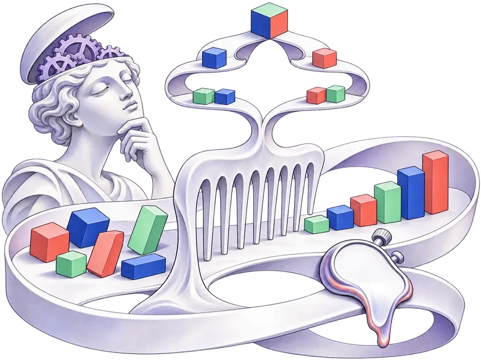

{: .align-left width="200" style="float: left; margin-right: 10px;"} 
An algorithm is a finite and well-defined sequence of steps for solving a problem or performing a computation. Algorithms form the foundation of software systems and are used in tasks ranging from sorting and searching to graph processing, optimization, text analysis, and scientific computing. This course lays the foundations: how to measure an algorithm's running time and memory use with asymptotic notation, recurrences and the Master Theorem, and how these tools apply to fundamental problems. It covers sorting and searching, graph algorithms (traversal, shortest paths, minimum spanning trees and network flow) and string algorithms (pattern matching, compression and tries), comparing alternative solutions by correctness, complexity and practical trade-offs. Algorithm-design paradigms, hard problems and other models of computation continue in [Advanced Algorithms](/teaching/advanced-algorithms/).

---

## Ders Kitabı

[📕 Algoritmalar (PDF, 12 MB)](https://sercankulcu.github.io/courses-pdfs/algorithms/Algoritmalar.pdf)

---

## Başlangıç Kaynakları

* [Algoritmalarda Önemli İsimler (HTML)](/files/algorithms/Algorithms_Important_People.html)
* [Algoritmalar İçin Ön Bilgiler (HTML)](/files/algorithms/Algorithms_Prerequisites.html)
* [Dersin Haritası (HTML)](/files/algorithms/ders_haritasi.html)
* [Terim Sözlüğü (HTML)](/files/algorithms/sozluk.html)

---

## Kısım I: Temeller

### Bölüm 1: Giriş

Algoritma, bir problemi sonlu sayıda ve iyi tanımlanmış adımla çözen yöntemdir. Bölümde algoritma kavramı ve bir algoritmanın taşıması gereken özellikler gündelik örneklerle tanıtılır; algoritmadan koda geçiş ve algoritma türleri ele alınır. Girdi boyutu, satır satır işlem sayımı ve büyüme tablosuyla sabit, doğrusal, karekök, kübik, faktöriyel ve üstel zaman alan örnekler üzerinden çalışma süresinin girdi boyutuyla nasıl büyüdüğü gösterilir ve Öklid algoritmasının neden hızlı olduğu açıklanır.

- [🖼️Sunum-Giriş (HTML)](/files/algorithms/slides/Bolum_01_Giris.html)
- [📄Sunum-Giriş (PDF)](https://sercankulcu.github.io/courses-pdfs/algorithms/pdf/Bolum_01_Giris.pdf)
- [📖Ders Notu - Giriş (HTML)](/files/algorithms/notlar/Bolum_01_Giris_Ders_Notu.html)
- [📝Çalışma Soruları - Giriş (HTML)](/files/algorithms/slides/Bolum_01_Giris_Calisma_Sorulari.html)
- [💻Kod Örnekleri (GitHub)](https://github.com/sercankulcu/algorithms-java/tree/main/Bolum01/src)

- [🕹️Algoritma Karmaşıklığı Analizi (HTML)](/files/algorithms/slides/Bolum_01_Algorithm_Complexity.html)

---

### Bölüm 2: Algoritma Karmaşıklığı

Bölümde adım sayma, en iyi, en kötü ve ortalama durum, alan karmaşıklığı ile Büyük O, Omega ve Teta gösterimleri ele alınır. Döngülerin toplam formülleriyle çözümlenmesi, yineleme bağıntılarının açma yöntemi ve özyineleme ağacıyla kurulup Ana Teorem ile çözülmesi örnek fonksiyonlar üzerinde işlenir; amortize analize de kısaca değinilir.

- [🖼️Sunum-Algoritma Karmaşıklığı (HTML)](/files/algorithms/slides/Bolum_02_Algoritma_Karmasikligi.html)
- [📄Sunum-Algoritma Karmaşıklığı (PDF)](https://sercankulcu.github.io/courses-pdfs/algorithms/pdf/Bolum_02_Algoritma_Karmasikligi.pdf)
- [📖Ders Notu - Algoritma Karmaşıklığı (HTML)](/files/algorithms/notlar/Bolum_02_Algoritma_Karmasikligi_Ders_Notu.html)
- [📝Çalışma Soruları - Algoritma Karmaşıklığı (HTML)](/files/algorithms/slides/Bolum_02_Algoritma_Karmasikligi_Calisma_Sorulari.html)
- [💻Kod Örnekleri (GitHub)](https://github.com/sercankulcu/algorithms-java/tree/main/Bolum02/src)

- [🕹️Asimptotik Büyüme Gezgini (HTML)](/files/algorithms/slides/Bolum_02_Asymptotic_Growth_Explorer.html)
- [🕹️Özyineleme ve Ana Teorem (HTML)](/files/algorithms/slides/Bolum_02_Recurrence_Master_Theorem.html)

---

### Bölüm 3: Sıralama Algoritmaları

Sıralama, verinin belirli bir düzene sokulmasıdır ve pek çok algoritmanın ön adımını oluşturur. Bölümde kabarcık, eklemeli, seçimli ve Shell sıralaması gibi temel yöntemler ile birleştirme sıralaması, hızlı sıralama ve heap sort adım adım izlenir ve Java kodlarıyla çözümlenir. Karşılaştırmaya dayalı sıralamanın Ω(n log n) alt sınırı gösterilir; saymalı, basamak ve kova sıralaması gibi doğrusal zamanlı yöntemlerle gerçek kütüphanelerde kullanılan Timsort tanıtılır. Algoritmalar kararlılık, ek bellek ve karmaşıklık bakımından karşılaştırılır.

- [🖼️Sunum-Sıralama Algoritmaları (HTML)](/files/algorithms/slides/Bolum_03_Siralama_Algoritmalari.html)
- [📄Sunum-Sıralama Algoritmaları (PDF)](https://sercankulcu.github.io/courses-pdfs/algorithms/pdf/Bolum_03_Siralama_Algoritmalari.pdf)
- [📖Ders Notu - Sıralama Algoritmaları (HTML)](/files/algorithms/notlar/Bolum_03_Siralama_Algoritmalari_Ders_Notu.html)
- [📝Çalışma Soruları - Sıralama Algoritmaları (HTML)](/files/algorithms/slides/Bolum_03_Siralama_Algoritmalari_Calisma_Sorulari.html)
- [💻Kod Örnekleri (GitHub)](https://github.com/sercankulcu/algorithms-java/tree/main/Bolum03/src)

- [🕹️Sıralama Algoritmaları (HTML)](/files/algorithms/slides/Bolum_03_Sorting.html)
- [🕹️Sıralama Yarışı (HTML)](/files/algorithms/slides/Bolum_03_Sorting_Race.html)
- [🕹️Sıralama Özellikleri Laboratuvarı (HTML)](/files/algorithms/slides/Bolum_03_Sorting_Properties_Lab.html)

---

### Bölüm 4: Arama Algoritmaları

Arama, bir veri kümesinde istenen öğenin yerini bulma problemidir. Bölümde bekçili sürümüyle birlikte doğrusal arama, sıralı dizide ikili arama ve bu yöntemin örtük bir ikili arama ağacı olarak yorumu, tekrarlı öğelerde ilk konumun bulunması anlatılır. Hash fonksiyonları, doğrusal yoklama ve zincirleme ile hash tablosunda arama ve yük faktörünün maliyete etkisi incelenir. Ara değer arama, atlayarak arama ve üstel arama da ele alınır; algoritmalar aynı dizideki yoklama sayılarıyla karşılaştırılır ve hangi durumda hangisinin uygun olduğu tartışılır.

- [🖼️Sunum-Arama Algoritmaları (HTML)](/files/algorithms/slides/Bolum_04_Arama_Algoritmalari.html)
- [📄Sunum-Arama Algoritmaları (PDF)](https://sercankulcu.github.io/courses-pdfs/algorithms/pdf/Bolum_04_Arama_Algoritmalari.pdf)
- [📖Ders Notu - Arama Algoritmaları (HTML)](/files/algorithms/notlar/Bolum_04_Arama_Algoritmalari_Ders_Notu.html)
- [📝Çalışma Soruları - Arama Algoritmaları (HTML)](/files/algorithms/slides/Bolum_04_Arama_Algoritmalari_Calisma_Sorulari.html)
- [💻Kod Örnekleri (GitHub)](https://github.com/sercankulcu/algorithms-java/tree/main/Bolum04/src)

- [🕹️Arama Algoritmaları (HTML)](/files/algorithms/slides/Bolum_04_Search.html)
- [🕹️Hash ve Ara Değer Arama (HTML)](/files/algorithms/slides/Bolum_04_Hash_Interpolation_Search.html)
- [🕹️Üstel Arama (HTML)](/files/algorithms/slides/Bolum_04_Exponential_Search.html)

---

## Kısım II: Çizge Algoritmaları

### Bölüm 5: Çizge Gezinme Algoritmaları

Çizgeler, yol ağlarından sosyal ağlara kadar düğümler ve bağlantılarla ifade edilebilen her yapıyı modellemekte kullanılır. Bölüm, çizgenin bellekte komşuluk listesi ve matrisiyle gösterimi, derinlik öncelikli (DFS) ve genişlik öncelikli (BFS) gezinme ile başlar. Ardından Tarjan ve Kosaraju algoritmalarıyla güçlü bağlantılı bileşenler, Kahn algoritması ve DFS ile topolojik sıralama ve iki parçalılık testi işlenir.

- [🖼️Sunum-Çizge Gezinme Algoritmaları (HTML)](/files/algorithms/slides/Bolum_05_Cizge_Gezinme_Algoritmalari.html)
- [📄Sunum-Çizge Gezinme Algoritmaları (PDF)](https://sercankulcu.github.io/courses-pdfs/algorithms/pdf/Bolum_05_Cizge_Gezinme_Algoritmalari.pdf)
- [📖Ders Notu - Çizge Gezinme Algoritmaları (HTML)](/files/algorithms/notlar/Bolum_05_Cizge_Gezinme_Algoritmalari_Ders_Notu.html)
- [📝Çalışma Soruları - Çizge Gezinme Algoritmaları (HTML)](/files/algorithms/slides/Bolum_05_Cizge_Gezinme_Algoritmalari_Calisma_Sorulari.html)
- [💻Kod Örnekleri (GitHub)](https://github.com/sercankulcu/algorithms-java/tree/main/Bolum05/src)

- [🕹️Çizge Gezinme Simülatörü (HTML)](/files/algorithms/slides/Bolum_05_Graph_Traversal.html)
- [🕹️Çizge Yapısı Algoritmaları Simülatörü (HTML)](/files/algorithms/slides/Bolum_05_Graph_Structure_Algorithms.html)
- [🕹️İki Parçalılık, Döngü ve Köprü Simülatörü (HTML)](/files/algorithms/slides/Bolum_05_Bipartite_Cycle_Bridge.html)

---

### Bölüm 6: En Kısa Yol Algoritmaları

Bölümde en kısa yol problem türleri ve hepsinin üzerine kurulduğu gevşetme işlemi tanıtılır. Dijkstra algoritması öncelikli kuyrukla, negatif kenarlara izin veren Bellman-Ford algoritması negatif döngü tespitiyle, tüm çiftler arası en kısa yollar Floyd-Warshall algoritmasıyla çözülür. Sezgisel fonksiyonlarla yönlendirilen A* araması ve ağırlıksız çizgede BFS de ele alınır; algoritmalar örnek çizgeler üzerinde karşılaştırılır.

- [🖼️Sunum-En Kısa Yol Algoritmaları (HTML)](/files/algorithms/slides/Bolum_06_En_Kisa_Yol_Algoritmalari.html)
- [📄Sunum-En Kısa Yol Algoritmaları (PDF)](https://sercankulcu.github.io/courses-pdfs/algorithms/pdf/Bolum_06_En_Kisa_Yol_Algoritmalari.pdf)
- [📖Ders Notu - En Kısa Yol Algoritmaları (HTML)](/files/algorithms/notlar/Bolum_06_En_Kisa_Yol_Algoritmalari_Ders_Notu.html)
- [📝Çalışma Soruları - En Kısa Yol Algoritmaları (HTML)](/files/algorithms/slides/Bolum_06_En_Kisa_Yol_Algoritmalari_Calisma_Sorulari.html)
- [💻Kod Örnekleri (GitHub)](https://github.com/sercankulcu/algorithms-java/tree/main/Bolum06/src)

- [🕹️En Kısa Yol Algoritmaları Simülatörü (HTML)](/files/algorithms/slides/Bolum_06_Shortest_Path.html)
- [🕹️A* Yol Bulma Simülatörü (HTML)](/files/algorithms/slides/Bolum_06_AStar.html)

---

### Bölüm 7: Minimum Kapsayan Ağaç Algoritmaları

Minimum kapsayan ağaç, bir çizgenin bütün düğümlerini en düşük toplam ağırlıkla birbirine bağlar. Bölümde kesim ve döngü özellikleri ile bunlara dayanan Kruskal, Prim, Borůvka ve ters silme algoritmaları işlenir. Kruskal için ayrık kümeler (union-find) yapısı yol kısaltma ve rütbeye göre birleştirmeyle anlatılır; Prim algoritmasının dizi ve öncelikli kuyruk sürümleri ile Dijkstra algoritmasından farkı gösterilir.

- [🖼️Sunum-Minimum Kapsayan Ağaç Algoritmaları (HTML)](/files/algorithms/slides/Bolum_07_Minimum_Kapsayan_Agac_Algoritmalari.html)
- [📄Sunum-Minimum Kapsayan Ağaç Algoritmaları (PDF)](https://sercankulcu.github.io/courses-pdfs/algorithms/pdf/Bolum_07_Minimum_Kapsayan_Agac_Algoritmalari.pdf)
- [📖Ders Notu - Minimum Kapsayan Ağaç Algoritmaları (HTML)](/files/algorithms/notlar/Bolum_07_Minimum_Kapsayan_Agac_Algoritmalari_Ders_Notu.html)
- [📝Çalışma Soruları - Minimum Kapsayan Ağaç Algoritmaları (HTML)](/files/algorithms/slides/Bolum_07_Minimum_Kapsayan_Agac_Algoritmalari_Calisma_Sorulari.html)
- [💻Kod Örnekleri (GitHub)](https://github.com/sercankulcu/algorithms-java/tree/main/Bolum07/src)

- [🕹️Minimum Kapsayan Ağaç Simülatörü (HTML)](/files/algorithms/slides/Bolum_07_MST.html)

---

### Bölüm 8: Ağ Akışı

Ağ akışı, kapasiteli bir ağda kaynaktan hedefe gönderilebilecek en büyük akışı arar. Bölümde kapasite ve korunum kısıtları, artık ağ, artış yolu ve darboğaz kavramları ile maksimum akış–minimum kesim teoremi anlatılır. Ford-Fulkerson yöntemi ile Edmonds-Karp, Dinic ve itme–yeniden etiketleme algoritmaları karmaşıklıkları ve uygulamalarıyla birlikte ele alınır.

- [🖼️Sunum-Ağ Akışı (HTML)](/files/algorithms/slides/Bolum_08_Ag_Akisi.html)
- [📄Sunum-Ağ Akışı (PDF)](https://sercankulcu.github.io/courses-pdfs/algorithms/pdf/Bolum_08_Ag_Akisi.pdf)
- [📖Ders Notu - Ağ Akışı (HTML)](/files/algorithms/notlar/Bolum_08_Ag_Akisi_Ders_Notu.html)
- [📝Çalışma Soruları - Ağ Akışı (HTML)](/files/algorithms/slides/Bolum_08_Ag_Akisi_Calisma_Sorulari.html)
- [💻Kod Örnekleri (GitHub)](https://github.com/sercankulcu/algorithms-java/tree/main/Bolum08/src)

- [🕹️Ağ Akışı Simülatörü (HTML)](/files/algorithms/slides/Bolum_08_Network_Flow.html)

---

## Kısım III: Dizgi Algoritmaları

### Bölüm 9: Dizgi Eşleştirme ve Sıkıştırma

Dizgi algoritmaları metin arama, veri sıkıştırma ve biyolojik dizi çözümlemesi gibi alanların temelini oluşturur. Bölümün ilk kısmında kaba kuvvet, Knuth-Morris-Pratt, Boyer-Moore ve Rabin-Karp örüntü eşleştirme algoritmaları işlenir ve karşılaştırılır. İkinci kısımda kayıpsız sıkıştırma; çalışma uzunluğu kodlaması (RLE), LZW ve LZ78 yöntemleriyle anlatılır.

- [🖼️Sunum-Dizgi Eşleştirme ve Sıkıştırma (HTML)](/files/algorithms/slides/Bolum_09_Dizgi_Eslestirme_ve_Sikistirma.html)
- [📄Sunum-Dizgi Eşleştirme ve Sıkıştırma (PDF)](https://sercankulcu.github.io/courses-pdfs/algorithms/pdf/Bolum_09_Dizgi_Eslestirme_ve_Sikistirma.pdf)
- [📖Ders Notu - Dizgi Eşleştirme ve Sıkıştırma (HTML)](/files/algorithms/notlar/Bolum_09_Dizgi_Eslestirme_ve_Sikistirma_Ders_Notu.html)
- [📝Çalışma Soruları - Dizgi Eşleştirme ve Sıkıştırma (HTML)](/files/algorithms/slides/Bolum_09_Dizgi_Eslestirme_ve_Sikistirma_Calisma_Sorulari.html)
- [💻Kod Örnekleri (GitHub)](https://github.com/sercankulcu/algorithms-java/tree/main/Bolum09/src)

- [🕹️Dizgi Eşleştirme Algoritmaları (HTML)](/files/algorithms/slides/Bolum_09_String_Matching.html)
- [🕹️Önek Fonksiyonu ve Z Algoritması (HTML)](/files/algorithms/slides/Bolum_09_Prefix_Z_Algorithms.html)
- [🕹️Dizgi Sıkıştırma Algoritmaları (HTML)](/files/algorithms/slides/Bolum_09_String_Compression.html)

---

### Bölüm 10: İleri Dizgi Algoritmaları

Bölüm, sözlüksel sıra ile LSD ve MSD basamak sıralamasıyla dizgi sıralamadan başlar. Düzenli ifadeler, sonlu durum makineleri ve örüntü eşleme otomatı, Levenshtein düzenleme uzaklığının dinamik programlamayla hesaplanması, sonek dizisi ve Burrows–Wheeler dönüşümü işlenir.

- [🖼️Sunum-İleri Dizgi Algoritmaları (HTML)](/files/algorithms/slides/Bolum_10_Ileri_Dizgi_Algoritmalari.html)
- [📄Sunum-İleri Dizgi Algoritmaları (PDF)](https://sercankulcu.github.io/courses-pdfs/algorithms/pdf/Bolum_10_Ileri_Dizgi_Algoritmalari.pdf)
- [📖Ders Notu - İleri Dizgi Algoritmaları (HTML)](/files/algorithms/notlar/Bolum_10_Ileri_Dizgi_Algoritmalari_Ders_Notu.html)
- [📝Çalışma Soruları - İleri Dizgi Algoritmaları (HTML)](/files/algorithms/slides/Bolum_10_Ileri_Dizgi_Algoritmalari_Calisma_Sorulari.html)
- [💻Kod Örnekleri (GitHub)](https://github.com/sercankulcu/algorithms-java/tree/main/Bolum10/src)

- [🕹️Dizgi Sıralama: LSD Basamak Sıralaması (HTML)](/files/algorithms/slides/Bolum_10_String_Sorting.html)
- [🕹️Sonlu Durum Makinesiyle Dizgi Ayrıştırma (HTML)](/files/algorithms/slides/Bolum_10_String_Parsing.html)
- [🕹️Dizgi Benzerliği: Levenshtein Uzaklığı (HTML)](/files/algorithms/slides/Bolum_10_String_Similarity.html)
- [🕹️Dizgi Dönüşümü: Burrows–Wheeler Dönüşümü (HTML)](/files/algorithms/slides/Bolum_10_String_Transformation.html)

---

### Bölüm 11: Trie Veri Yapısı

Önek ağacı (trie), dizgileri ortak öneklerini paylaşarak saklar. Bölümde trie ekleme, arama, silme ve otomatik tamamlama işlemleriyle anlatılır; joker karakterli arama ve yazım denetimi örnekleri verilir. Üçlü arama trie'si, sıkıştırılmış trie, sonek trie'si ve birçok örüntüyü tek geçişte arayan Aho–Corasick algoritması da tanıtılır.

- [🖼️Sunum-Trie Veri Yapısı (HTML)](/files/algorithms/slides/Bolum_11_Trie_Veri_Yapisi.html)
- [📄Sunum-Trie Veri Yapısı (PDF)](https://sercankulcu.github.io/courses-pdfs/algorithms/pdf/Bolum_11_Trie_Veri_Yapisi.pdf)
- [📖Ders Notu - Trie Veri Yapısı (HTML)](/files/algorithms/notlar/Bolum_11_Trie_Veri_Yapisi_Ders_Notu.html)
- [📝Çalışma Soruları - Trie Veri Yapısı (HTML)](/files/algorithms/slides/Bolum_11_Trie_Veri_Yapisi_Calisma_Sorulari.html)
- [💻Kod Örnekleri (GitHub)](https://github.com/sercankulcu/algorithms-java/tree/main/Bolum11/src)

- [🕹️Trie ve Sonek Algoritmaları (HTML)](/files/algorithms/slides/Bolum_11_Trie_Suffix_Algorithms.html)

---

## Devamı: İleri Algoritmalar

Tasarım paradigmaları (böl ve fethet, açgözlü algoritmalar, dinamik programlama), zor problemler (geri izleme, dal sınır, yaklaşım algoritmaları) ve diğer hesaplama modelleri (rastgele, çevrim içi ve paralel algoritmalar) [İleri Algoritmalar](/teaching/advanced-algorithms/) dersinde işlenir.
