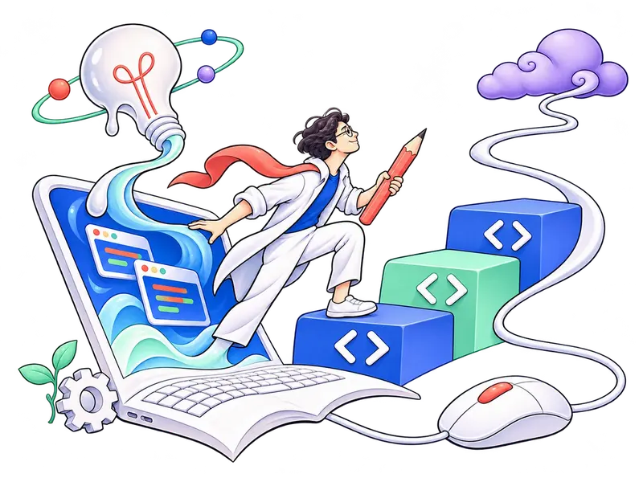

{: .align-left width="200" style="float: left; margin-right: 10px;"} 
Modern computing encompasses a vast ecosystem of interconnected technologies and tools that have become integral to our daily lives. Computers are sophisticated electronic devices managed by operating systems, which serve as the interface between hardware and software. The Internet has transformed these individual machines into a global network, enabling instantaneous communication and access to unlimited information and services. In our professional lives, we regularly interact with office programs such as word processors, spreadsheets, and presentation software, which have digitized and streamlined workplace tasks. Behind all these tools lies the art of programming - the fundamental skill of creating software by writing instructions in various programming languages. 

---

## Ders Kitabı

[📕 Bilgisayar ve Programlamaya Giriş (PDF, 24 MB)](https://sercankulcu.github.io/courses-pdfs/computer/Bilgisayar-ve-Programlamaya-Giris.pdf)

---

## Başlangıç Kaynakları

* [Bilgisayar ve Programlamada Önemli İsimler (HTML)](/files/computer/Computer_and_Programming_Important_People.html)
* [Bilgisayar ve Programlamaya Giriş İçin Ön Bilgiler (HTML)](/files/computer/Computer_and_Programming_Prerequisites.html)
* [Dersin Haritası (HTML)](/files/computer/Ders_Haritasi.html)
* [Terim Sözlüğü (HTML)](/files/computer/Sozluk.html)

---

## Kısım I: Bilgisayar ve Bilgi Teknolojileri

### Bölüm 1: Bilgisayar Temelleri ve Hesaplamalı Düşünme

Bilgisayar, veriyi kesin talimatlarla işleyerek problem çözen bir makinedir. Bölüm beş sunumdan oluşur. Temel Kavramlar verinin bitlerle nasıl temsil edildiğini ve bilgisayarın temel çalışma döngüsünü anlatır. Bilgisayar Donanımı sunumu işlemciyi, bellek hiyerarşisini, depolamayı, giriş ve çıkış birimlerini tanıtır. Bilgisayarlar ikiye tümleyen, kayan noktalı sayılar, karakter kodlamaları, mantık kapıları ve getir–çöz–yürüt döngüsüyle bilgisayar mimarisini ele alır. İnternet sunumu IP adresi, DNS, HTTP/HTTPS ve güvenli kullanımı; Hesaplama sunumu ise hesaplama kavramını, Turing makinesini ve hesaplamalı düşünmeyi anlatır.

- **1.1 Temel Kavramlar** — [🖼️ Sunum](/files/computer/sunumlar/Bolum_01_01_Temel_Kavramlar.html) · [📄 PDF](https://sercankulcu.github.io/courses-pdfs/computer/pdf/Bolum_01_01_Temel_Kavramlar.pdf) · [📖 Ders notu](/files/computer/notlar/Bolum_01_01_Temel_Kavramlar_Ders_Notu.html) · [📝 Sorular](/files/computer/sunumlar/Bolum_01_01_Temel_Kavramlar_Calisma_Sorulari.html)
- **1.2 Bilgisayar Donanımı** — [🖼️ Sunum](/files/computer/sunumlar/Bolum_01_02_Bilgisayar_Donanimi.html) · [📄 PDF](https://sercankulcu.github.io/courses-pdfs/computer/pdf/Bolum_01_02_Bilgisayar_Donanimi.pdf) · [📖 Ders notu](/files/computer/notlar/Bolum_01_02_Bilgisayar_Donanimi_Ders_Notu.html) · [📝 Sorular](/files/computer/sunumlar/Bolum_01_02_Bilgisayar_Donanimi_Calisma_Sorulari.html)
- **1.3 Bilgisayarlar** — [🖼️ Sunum](/files/computer/sunumlar/Bolum_01_03_Bilgisayarlar.html) · [📄 PDF](https://sercankulcu.github.io/courses-pdfs/computer/pdf/Bolum_01_03_Bilgisayarlar.pdf) · [📖 Ders notu](/files/computer/notlar/Bolum_01_03_Bilgisayarlar_Ders_Notu.html) · [📝 Sorular](/files/computer/sunumlar/Bolum_01_03_Bilgisayarlar_Calisma_Sorulari.html)
- **1.4 İnternet** — [🖼️ Sunum](/files/computer/sunumlar/Bolum_01_04_Internet.html) · [📄 PDF](https://sercankulcu.github.io/courses-pdfs/computer/pdf/Bolum_01_04_Internet.pdf) · [📖 Ders notu](/files/computer/notlar/Bolum_01_04_Internet_Ders_Notu.html) · [📝 Sorular](/files/computer/sunumlar/Bolum_01_04_Internet_Calisma_Sorulari.html)
- **1.5 Hesaplama ve Hesaplamalı Düşünme** — [🖼️ Sunum](/files/computer/sunumlar/Bolum_01_05_Hesaplama_ve_Hesaplamali_Dusunme.html) · [📄 PDF](https://sercankulcu.github.io/courses-pdfs/computer/pdf/Bolum_01_05_Hesaplama_ve_Hesaplamali_Dusunme.pdf) · [📖 Ders notu](/files/computer/notlar/Bolum_01_05_Hesaplama_ve_Hesaplamali_Dusunme_Ders_Notu.html) · [📝 Sorular](/files/computer/sunumlar/Bolum_01_05_Hesaplama_ve_Hesaplamali_Dusunme_Calisma_Sorulari.html)
- 🕹️ **Simülatörler:** [Sayı Tabanı Dönüştürücü](/files/computer/sunumlar/Bolum_01_Number-Base-Converter.html) · [Mantık Kapıları](/files/computer/sunumlar/Bolum_01_Logic-Gates.html) · [Basit CPU: Getir–Çöz–Yürüt](/files/computer/sunumlar/Bolum_01_Simple-CPU.html) · [Bir Web İsteğinin Yolculuğu](/files/computer/sunumlar/Bolum_01_Packet-Journey.html) · [Turing Makinesi](/files/computer/sunumlar/Bolum_01_Turing-Machine.html)

---

### Bölüm 2: İşletim Sistemleri

İşletim sistemi donanım kaynaklarını yönetir ve uygulamalara hizmet sunar. İlk sunum yazılım türleri ve lisans modelleriyle başlar; önyükleme, çekirdek ve sistem çağrıları, süreç ve iş parçacığı, zaman paylaşımı, bellek yönetimi ve sanal bellek, dosya sistemleri, aygıt sürücüleri ve kullanıcı yetkilerini ele alır. İkinci sunum Windows üzerinde masaüstü, pencere ve dosya yönetimini, mutlak ve göreli dosya yollarını, ayarları, güvenliği ve sistem bakımını uygulamalı olarak gösterir.

- **2.1 Yazılım ve İşletim Sistemleri** — [🖼️ Sunum](/files/computer/sunumlar/Bolum_02_01_Yazilim_ve_Isletim_Sistemleri.html) · [📄 PDF](https://sercankulcu.github.io/courses-pdfs/computer/pdf/Bolum_02_01_Yazilim_ve_Isletim_Sistemleri.pdf) · [📖 Ders notu](/files/computer/notlar/Bolum_02_01_Yazilim_ve_Isletim_Sistemleri_Ders_Notu.html) · [📝 Sorular](/files/computer/sunumlar/Bolum_02_01_Yazilim_ve_Isletim_Sistemleri_Calisma_Sorulari.html)
- **2.2 Windows İşletim Sistemi** — [🖼️ Sunum](/files/computer/sunumlar/Bolum_02_02_Windows_Isletim_Sistemi.html) · [📄 PDF](https://sercankulcu.github.io/courses-pdfs/computer/pdf/Bolum_02_02_Windows_Isletim_Sistemi.pdf) · [📖 Ders notu](/files/computer/notlar/Bolum_02_02_Windows_Isletim_Sistemi_Ders_Notu.html) · [📝 Sorular](/files/computer/sunumlar/Bolum_02_02_Windows_Isletim_Sistemi_Calisma_Sorulari.html)
- 🕹️ **Simülatörler:** [Süreç Çizelgeleme](/files/computer/sunumlar/Bolum_02_CPU-Scheduler.html)

---

### Bölüm 3: Ofis Uygulamaları

Ofis uygulamaları belge hazırlamayı, veri çözümlemeyi ve bilgi sunmayı kolaylaştırır. Word sunumu stilleri, sayfa düzenini, bölüm sonlarını, içindekiler tablosunu, kaynakçayı ve adres mektup birleştirmeyi anlatır. Excel sunumu hücre başvurularını, formül ve işlevleri, sıralama ve filtrelemeyi, özet tabloyu ve grafikleri ele alır. PowerPoint sunumu ise sunu planlamayı, asıl slaydı, görsel tasarımı, geçiş ve animasyonları ve etkili sunum yapmayı gösterir.

- **3.1 Microsoft Word** — [🖼️ Sunum](/files/computer/sunumlar/Bolum_03_01_Microsoft_Word.html) · [📄 PDF](https://sercankulcu.github.io/courses-pdfs/computer/pdf/Bolum_03_01_Microsoft_Word.pdf) · [📖 Ders notu](/files/computer/notlar/Bolum_03_01_Microsoft_Word_Ders_Notu.html) · [📝 Sorular](/files/computer/sunumlar/Bolum_03_01_Microsoft_Word_Calisma_Sorulari.html)
- **3.2 Microsoft Excel** — [🖼️ Sunum](/files/computer/sunumlar/Bolum_03_02_Microsoft_Excel.html) · [📄 PDF](https://sercankulcu.github.io/courses-pdfs/computer/pdf/Bolum_03_02_Microsoft_Excel.pdf) · [📖 Ders notu](/files/computer/notlar/Bolum_03_02_Microsoft_Excel_Ders_Notu.html) · [📝 Sorular](/files/computer/sunumlar/Bolum_03_02_Microsoft_Excel_Calisma_Sorulari.html)
- **3.3 Microsoft PowerPoint** — [🖼️ Sunum](/files/computer/sunumlar/Bolum_03_03_Microsoft_PowerPoint.html) · [📄 PDF](https://sercankulcu.github.io/courses-pdfs/computer/pdf/Bolum_03_03_Microsoft_PowerPoint.pdf) · [📖 Ders notu](/files/computer/notlar/Bolum_03_03_Microsoft_PowerPoint_Ders_Notu.html) · [📝 Sorular](/files/computer/sunumlar/Bolum_03_03_Microsoft_PowerPoint_Calisma_Sorulari.html)
- 🕹️ **Simülatörler:** [Word Stilleri ve İçindekiler](/files/computer/sunumlar/Bolum_03_Word-Styles.html) · [Excel Hücre Başvuruları](/files/computer/sunumlar/Bolum_03_Excel-References.html) · [PowerPoint Animasyon Zaman Çizelgesi](/files/computer/sunumlar/Bolum_03_PowerPoint-Animation.html)

---

## Kısım II: Algoritmadan Programa

### Bölüm 4: Algoritmalar ve Programlamaya Giriş

Programlama, problem çözme adımlarını bilgisayarın yürütebileceği talimatlara dönüştürmektir. Algoritmalar sunumu problem tanımını, sözde kodu, iyi bir algoritmanın özelliklerini, faktöriyel, Fibonacci ve asal sayı gibi örnekleri, doğrusal ve ikili aramayı, seçimli, kabarcık, eklemeli ve birleştirme sıralamasını izleme tablolarıyla anlatır. Akış Diyagramları sıralı, koşullu ve tekrarlı akışı, sayaç ve biriktiriciyi gösterir. Programlamaya Giriş ise programlama dillerini, derleyici ve yorumlayıcıyı, programlama paradigmalarını, yazılım geliştirme sürecini ve hata ayıklamayı tanıtır.

- **4.1 Algoritmalar** — [🖼️ Sunum](/files/computer/sunumlar/Bolum_04_01_Algoritmalar.html) · [📄 PDF](https://sercankulcu.github.io/courses-pdfs/computer/pdf/Bolum_04_01_Algoritmalar.pdf) · [📖 Ders notu](/files/computer/notlar/Bolum_04_01_Algoritmalar_Ders_Notu.html) · [📝 Sorular](/files/computer/sunumlar/Bolum_04_01_Algoritmalar_Calisma_Sorulari.html)
- **4.2 Akış Diyagramları** — [🖼️ Sunum](/files/computer/sunumlar/Bolum_04_02_Akis_Diyagramlari.html) · [📄 PDF](https://sercankulcu.github.io/courses-pdfs/computer/pdf/Bolum_04_02_Akis_Diyagramlari.pdf) · [📖 Ders notu](/files/computer/notlar/Bolum_04_02_Akis_Diyagramlari_Ders_Notu.html) · [📝 Sorular](/files/computer/sunumlar/Bolum_04_02_Akis_Diyagramlari_Calisma_Sorulari.html)
- **4.3 Programlamaya Giriş** — [🖼️ Sunum](/files/computer/sunumlar/Bolum_04_03_Programlamaya_Giris.html) · [📄 PDF](https://sercankulcu.github.io/courses-pdfs/computer/pdf/Bolum_04_03_Programlamaya_Giris.pdf) · [📖 Ders notu](/files/computer/notlar/Bolum_04_03_Programlamaya_Giris_Ders_Notu.html) · [📝 Sorular](/files/computer/sunumlar/Bolum_04_03_Programlamaya_Giris_Calisma_Sorulari.html) · [💻 Kod](https://github.com/sercankulcu/computer-programming-java/tree/main/Bolum04/src)
- 🕹️ **Simülatörler:** [Sıralama Algoritmaları Görselleştirici](/files/computer/sunumlar/Bolum_04_Sorting-Visualizer.html) · [Akış Diyagramı Yürütücü](/files/computer/sunumlar/Bolum_04_Flowchart-Runner.html)

---

### Bölüm 5: Java'ya Giriş ve İlk Program

Java programı düz metin kaynak kod olarak yazılır, bytecode'a derlenir ve JVM üzerinde çalışır. Bu bölüm geliştirme araçlarını, Java kaynak dosyasının yapısını, ilk programın derlenip çalıştırılmasını, main metodunu, print, println ve kaçış dizilerini, ifade, deyim ve blok kavramlarını, açıklamaları ve derleme, çalışma ve mantık hatalarını ele alır.

- [🖼️ Sunum](/files/computer/sunumlar/Bolum_05_Javaya_Giris_ve_Ilk_Program.html) · [📄 PDF](https://sercankulcu.github.io/courses-pdfs/computer/pdf/Bolum_05_Javaya_Giris_ve_Ilk_Program.pdf) · [📖 Ders notu](/files/computer/notlar/Bolum_05_Javaya_Giris_ve_Ilk_Program_Ders_Notu.html) · [📝 Sorular](/files/computer/sunumlar/Bolum_05_Javaya_Giris_ve_Ilk_Program_Calisma_Sorulari.html) · [💻 Kod](https://github.com/sercankulcu/computer-programming-java/tree/main/Bolum05/src)
- 🕹️ **Simülatörler:** [Java Derleme ve Çalıştırma](/files/computer/sunumlar/Bolum_05_Java-Compile-Run.html)

---

## Kısım III: Java ile Programlama

### Bölüm 6: Değişkenler, Veri Tipleri ve İşleçler

Değişkenler programın kullandığı ve değiştirdiği değerleri saklar. Bölümde Java'nın ilkel veri tipleri, bildirim ve atama, taşma, tip dönüşümü, aritmetik, karşılaştırma ve mantıksal işleçler, işleç önceliği ve kısa devre değerlendirme anlatılır. Scanner ile girdi okuma ve printf ile biçimli çıktı küçük örneklerle gösterilir.

- [🖼️ Sunum](/files/computer/sunumlar/Bolum_06_Degiskenler_Veri_Tipleri_ve_Islecler.html) · [📄 PDF](https://sercankulcu.github.io/courses-pdfs/computer/pdf/Bolum_06_Degiskenler_Veri_Tipleri_ve_Islecler.pdf) · [📖 Ders notu](/files/computer/notlar/Bolum_06_Degiskenler_Veri_Tipleri_ve_Islecler_Ders_Notu.html) · [📝 Sorular](/files/computer/sunumlar/Bolum_06_Degiskenler_Veri_Tipleri_ve_Islecler_Calisma_Sorulari.html) · [💻 Kod](https://github.com/sercankulcu/computer-programming-java/tree/main/Bolum06/src)
- 🕹️ **Simülatörler:** [İfade Değerlendirici](/files/computer/sunumlar/Bolum_06_Expression-Evaluator.html)

---

### Bölüm 7: Koşullu İfadeler

Koşullu ifadeler programın farklı eylemler arasında seçim yapmasını sağlar. Bölüm boolean koşulları, if, else if ve else yapılarını, iç içe kararları ve sarkan else sorununu, mantıksal işleçleri ve De Morgan kurallarını, koşul işlecini, String karşılaştırmasını ve switch ifadesini kısa örneklerle anlatır.

- [🖼️ Sunum](/files/computer/sunumlar/Bolum_07_Kosullu_Ifadeler.html) · [📄 PDF](https://sercankulcu.github.io/courses-pdfs/computer/pdf/Bolum_07_Kosullu_Ifadeler.pdf) · [📖 Ders notu](/files/computer/notlar/Bolum_07_Kosullu_Ifadeler_Ders_Notu.html) · [📝 Sorular](/files/computer/sunumlar/Bolum_07_Kosullu_Ifadeler_Calisma_Sorulari.html) · [💻 Kod](https://github.com/sercankulcu/computer-programming-java/tree/main/Bolum07/src)
- 🕹️ **Simülatörler:** [Karar İzleyici](/files/computer/sunumlar/Bolum_07_Decision-Tracer.html)

---

### Bölüm 8: Döngüler

Döngüler bir kod bloğunu koşul doğru kaldığı sürece ya da belirli sayıda tekrarlar. Bölümde for, while ve do-while döngüleri, break ve continue, sayaç ve biriktirici, sınır hataları ve döngü değişmezi, iç içe döngüler ile basamak sayısı, asal sayı, Fibonacci ve desen yazdırma gibi örnekler yer alır.

- [🖼️ Sunum](/files/computer/sunumlar/Bolum_08_Donguler.html) · [📄 PDF](https://sercankulcu.github.io/courses-pdfs/computer/pdf/Bolum_08_Donguler.pdf) · [📖 Ders notu](/files/computer/notlar/Bolum_08_Donguler_Ders_Notu.html) · [📝 Sorular](/files/computer/sunumlar/Bolum_08_Donguler_Calisma_Sorulari.html) · [💻 Kod](https://github.com/sercankulcu/computer-programming-java/tree/main/Bolum08/src)
- 🕹️ **Simülatörler:** [Döngü İzleyici](/files/computer/sunumlar/Bolum_08_Loop-Tracer.html)

---

### Bölüm 9: Metotlar

Metotlar programı yeniden kullanılabilir işlemlere böler. Bölüm metot tanımını ve çağrısını, çağrı yığınını, değer ile parametre aktarımını, dönüş değerlerini, aşırı yüklemeyi, değişken sayıda argümanı, kapsamı ve iyi metot tasarımını küçük metot örnekleriyle anlatır.

- [🖼️ Sunum](/files/computer/sunumlar/Bolum_09_Metotlar.html) · [📄 PDF](https://sercankulcu.github.io/courses-pdfs/computer/pdf/Bolum_09_Metotlar.pdf) · [📖 Ders notu](/files/computer/notlar/Bolum_09_Metotlar_Ders_Notu.html) · [📝 Sorular](/files/computer/sunumlar/Bolum_09_Metotlar_Calisma_Sorulari.html) · [💻 Kod](https://github.com/sercankulcu/computer-programming-java/tree/main/Bolum09/src)
- 🕹️ **Simülatörler:** [Metot Çağrı Yığını](/files/computer/sunumlar/Bolum_09_Method-Call-Stack.html)

---

### Bölüm 10: Diziler

Dizi, aynı tipte sabit sayıda değeri saklar ve her öğeye indisle erişim sağlar. Bölümde dizi oluşturma ve gezinme, toplam, en büyük ve en küçük gibi temel işlemler, dizi kopyalama ve Arrays yardımcıları, arama ve sıralama algoritmalarının Java kodu, iki boyutlu diziler ve matris işlemleri ile sınır dışı erişim hataları ele alınır.

- [🖼️ Sunum](/files/computer/sunumlar/Bolum_10_Diziler.html) · [📄 PDF](https://sercankulcu.github.io/courses-pdfs/computer/pdf/Bolum_10_Diziler.pdf) · [📖 Ders notu](/files/computer/notlar/Bolum_10_Diziler_Ders_Notu.html) · [📝 Sorular](/files/computer/sunumlar/Bolum_10_Diziler_Calisma_Sorulari.html) · [💻 Kod](https://github.com/sercankulcu/computer-programming-java/tree/main/Bolum10/src)
- 🕹️ **Simülatörler:** [Dizi Laboratuvarı](/files/computer/sunumlar/Bolum_10_Array-Lab.html)

---

### Bölüm 11: Dizgiler

Dizgiler karakter dizilerini temsil eder ve metin işlemede kullanılır. Bölüm String oluşturmayı, değiştirilemezliği, indislemeyi, sık kullanılan String metotlarını, içerik karşılaştırmasını ve Türkçe karakterlerdeki tuzakları, dizgi havuzunu, StringBuilder ile verimli birleştirmeyi ve biçimli çıktıyı uygulamalarla anlatır.

- [🖼️ Sunum](/files/computer/sunumlar/Bolum_11_Dizgiler.html) · [📄 PDF](https://sercankulcu.github.io/courses-pdfs/computer/pdf/Bolum_11_Dizgiler.pdf) · [📖 Ders notu](/files/computer/notlar/Bolum_11_Dizgiler_Ders_Notu.html) · [📝 Sorular](/files/computer/sunumlar/Bolum_11_Dizgiler_Calisma_Sorulari.html) · [💻 Kod](https://github.com/sercankulcu/computer-programming-java/tree/main/Bolum11/src)
- 🕹️ **Simülatörler:** [Dizgi Laboratuvarı](/files/computer/sunumlar/Bolum_11_String-Lab.html)

---

### Bölüm 12: Özyineleme

Özyinelemeli bir metot, problemi daha küçük bir girdiyle kendini çağırarak çözer. Bölüm taban durumunu ve özyinelemeli durumu, çağrı yığınının davranışını, özyinelemeli çalışmaların izlenmesini, faktöriyel, EBOB, Hanoi kuleleri ve ikili arama gibi örnekleri, özyineleme ile döngünün karşılaştırılmasını ve belleklemeyi ele alır.

- [🖼️ Sunum](/files/computer/sunumlar/Bolum_12_Ozyineleme.html) · [📄 PDF](https://sercankulcu.github.io/courses-pdfs/computer/pdf/Bolum_12_Ozyineleme.pdf) · [📖 Ders notu](/files/computer/notlar/Bolum_12_Ozyineleme_Ders_Notu.html) · [📝 Sorular](/files/computer/sunumlar/Bolum_12_Ozyineleme_Calisma_Sorulari.html) · [💻 Kod](https://github.com/sercankulcu/computer-programming-java/tree/main/Bolum12/src)
- 🕹️ **Simülatörler:** [Özyineleme Görselleştirici](/files/computer/sunumlar/Bolum_12_Recursion-Visualizer.html)

---

## Part I: Computers and Information Technology

### Chapter 1: Computer Fundamentals and Computational Thinking

A computer is a machine that solves problems by processing data according to precise instructions, and this chapter is taught in five decks. Basic Concepts explains how data is represented in bits and how the basic operating cycle of a computer works, while Computer Hardware surveys the processor, the memory hierarchy, storage, and input and output devices. Computers turns to architecture: two's complement, floating-point numbers, character encodings, logic gates and the fetch–decode–execute cycle. The Internet deck covers IP addresses, DNS, HTTP and HTTPS and safe use of the web, and the last deck introduces computation, the Turing machine and computational thinking.

- **1.1 Basic Concepts** — [🖼️ Slides](/files/computer/slides/Chapter_01_01_Basic_Concepts.html)
- **1.2 Computer Hardware** — [🖼️ Slides](/files/computer/slides/Chapter_01_02_Computer_Hardware.html)
- **1.3 Computers** — [🖼️ Slides](/files/computer/slides/Chapter_01_03_Computers.html)
- **1.4 The Internet** — [🖼️ Slides](/files/computer/slides/Chapter_01_04_The_Internet.html)
- **1.5 Computation and Computational Thinking** — [🖼️ Slides](/files/computer/slides/Chapter_01_05_Computation_and_Computational_Thinking.html)

---

### Chapter 2: Operating Systems

The operating system manages hardware resources and provides services to applications. The first deck starts with kinds of software and licensing models, then covers booting, the kernel and system calls, processes and threads, time sharing, memory management and virtual memory, file systems, device drivers and user permissions. The second deck is hands-on with Windows: the desktop, windows and file management, absolute and relative paths, settings, security and system maintenance.

- **2.1 Software and Operating Systems** — [🖼️ Slides](/files/computer/slides/Chapter_02_01_Software_and_Operating_Systems.html)
- **2.2 The Windows Operating System** — [🖼️ Slides](/files/computer/slides/Chapter_02_02_The_Windows_Operating_System.html)

---

### Chapter 3: Office Applications

Office applications make it easier to prepare documents, analyze data and present information. The Word deck covers styles, page layout, section breaks, tables of contents, bibliographies and mail merge. The Excel deck deals with cell references, formulas and functions, sorting and filtering, pivot tables and charts. The PowerPoint deck shows how to plan a presentation, use the slide master, design visuals, add transitions and animations, and deliver an effective talk.

- **3.1 Microsoft Word** — [🖼️ Slides](/files/computer/slides/Chapter_03_01_Microsoft_Word.html)
- **3.2 Microsoft Excel** — [🖼️ Slides](/files/computer/slides/Chapter_03_02_Microsoft_Excel.html)
- **3.3 Microsoft PowerPoint** — [🖼️ Slides](/files/computer/slides/Chapter_03_03_Microsoft_PowerPoint.html)

---

## Part II: From Algorithm to Program

### Chapter 4: Algorithms and Introduction to Programming

Programming means turning the steps of a solution into instructions a computer can carry out. The Algorithms deck covers problem definition, pseudocode and the qualities of a good algorithm, works through examples such as factorial, Fibonacci and prime numbers, and traces linear and binary search as well as selection, bubble, insertion and merge sort. The Flowcharts deck shows sequential, conditional and repeated flow, along with counters and accumulators. Introduction to Programming presents programming languages, compilers and interpreters, programming paradigms, the software development process and debugging.

- **4.1 Algorithms** — [🖼️ Slides](/files/computer/slides/Chapter_04_01_Algorithms.html)
- **4.2 Flowcharts** — [🖼️ Slides](/files/computer/slides/Chapter_04_02_Flowcharts.html)
- **4.3 Introduction to Programming** — [🖼️ Slides](/files/computer/slides/Chapter_04_03_Introduction_to_Programming.html)

---

### Chapter 5: Getting Started with Java

A Java program is written as plain-text source code, compiled to bytecode and run on the JVM. This chapter introduces the development tools, the structure of a Java source file, and how to compile and run a first program. It covers the main method, print, println and escape sequences, expressions, statements and blocks, comments, and the difference between compile-time, run-time and logic errors.

- [🖼️ Slides](/files/computer/slides/Chapter_05_Getting_Started_with_Java.html)

---

## Part III: Programming in Java

### Chapter 6: Variables, Data Types and Operators

Variables hold the values a program uses and changes. The chapter covers Java's primitive types, declaration and assignment, overflow, type conversion, arithmetic, comparison and logical operators, operator precedence and short-circuit evaluation. Reading input with Scanner and producing formatted output with printf are shown through small examples.

- [🖼️ Slides](/files/computer/slides/Chapter_06_Variables_Data_Types_and_Operators.html)

---

### Chapter 7: Conditionals

Conditionals let a program choose between different actions. Through short examples, the chapter covers boolean conditions, if, else if and else, nested decisions and the dangling-else problem, logical operators and De Morgan's laws, the conditional operator, comparing Strings and the switch statement.

- [🖼️ Slides](/files/computer/slides/Chapter_07_Conditionals.html)

---

### Chapter 8: Loops

Loops repeat a block of code while a condition holds or a fixed number of times. The chapter covers for, while and do-while loops, break and continue, counters and accumulators, off-by-one errors and loop invariants, and nested loops. Examples include counting digits, testing for primes, generating Fibonacci numbers and printing patterns.

- [🖼️ Slides](/files/computer/slides/Chapter_08_Loops.html)

---

### Chapter 9: Methods

Methods break a program into reusable operations. Using small examples, the chapter covers defining and calling methods, the call stack, pass-by-value parameters, return values, overloading, variable-length argument lists, scope and the principles of good method design.

- [🖼️ Slides](/files/computer/slides/Chapter_09_Methods.html)

---

### Chapter 10: Arrays

An array stores a fixed number of values of the same type and gives indexed access to each element. The chapter covers creating and traversing arrays, basic operations such as sum, maximum and minimum, copying arrays and the Arrays utility class, and Java code for searching and sorting. Two-dimensional arrays, matrix operations and out-of-bounds errors complete the chapter.

- [🖼️ Slides](/files/computer/slides/Chapter_10_Arrays.html)

---

### Chapter 11: Strings

Strings represent sequences of characters and are the basis of text processing. Through applications, the chapter covers creating Strings, immutability, indexing, the most common String methods, comparing contents and the pitfalls of locale-specific characters, the string pool, efficient concatenation with StringBuilder, and formatted output.

- [🖼️ Slides](/files/computer/slides/Chapter_11_Strings.html)

---

### Chapter 12: Recursion

A recursive method solves a problem by calling itself on a smaller input. The chapter covers base cases and recursive cases, how the call stack behaves, and how to trace recursive executions. Examples include factorial, the greatest common divisor, the Towers of Hanoi and binary search, followed by a comparison of recursion with iteration and an introduction to memoization.

- [🖼️ Slides](/files/computer/slides/Chapter_12_Recursion.html)

