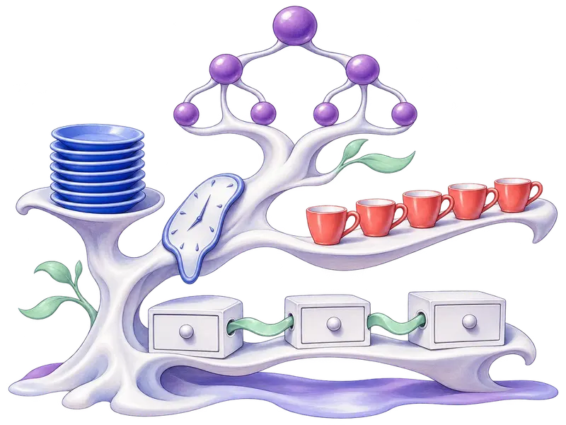

{: .align-left width="200" height="150" style="float: left; margin-right: 10px;"} 
This course studies data structures and algorithms through their memory representation and their implementation in C. Each topic is developed from the abstract data type to a working C99/C11 implementation with pointers, dynamic memory, and structures, together with its complexity analysis. The course covers arrays and structures, linked lists, stacks, queues, lists, trees, priority queues and heaps, hash tables, search trees, graphs, sets and union-find, as well as recursion, backtracking, spanning trees, shortest paths, and sorting algorithms.

---

## Ders Kitabı

[📕 C ile Veri Yapıları ve Algoritmalar (PDF, 19 MB)](https://sercankulcu.github.io/courses-pdfs/dsa_c/C-ile-Veri-Yapilari-ve-Algoritmalar.pdf)

---

## Başlangıç Kaynakları

* [C ile Veri Yapılarında Önemli İsimler (HTML)](/files/dsa_c/DSA_C_Important_People.html)
* [C ile Veri Yapıları İçin Ön Bilgiler (HTML)](/files/dsa_c/DSA_C_Prerequisites.html)
* [Dersin Haritası (HTML)](/files/dsa_c/Ders_Haritasi.html)
* [Terim Sözlüğü (HTML)](/files/dsa_c/Sozluk.html)

---

## Kısım I: Temeller

### Bölüm 1: Giriş ve Algoritma Analizi

Bir yazılımın gereksinimlerden doğrulamaya uzanan yaşam döngüsü, algoritma kavramı ve soyut veri tiplerinin C'de başlık dosyalarıyla nasıl ifade edildiği ele alınır. Seçimli sıralama, C kodu ve SWAP makrosuyla birlikte ilk örnek olarak işlenir. Programların başarımı alan ve zaman karmaşıklığı üzerinden incelenir; adım sayma, en iyi, ortalama ve en kötü durum ile O, Ω ve Θ gösterimleri örneklerle açıklanır. Sihirli kare problemi ve sıralama ile doğrusal aramanın çalışma süresinin ölçülmesi, kuramsal analizi uygulamayla buluşturur.

- [🖼️ Sunum](/files/dsa_c/sunumlar/Bolum_01_Giris_ve_Algoritma_Analizi.html) · [📄 PDF](https://sercankulcu.github.io/courses-pdfs/dsa_c/pdf/Bolum_01_Giris_ve_Algoritma_Analizi.pdf) · [📖 Ders notu](/files/dsa_c/notlar/Bolum_01_Giris_ve_Algoritma_Analizi_Ders_Notu.html) · [📝 Sorular](/files/dsa_c/sunumlar/Bolum_01_Giris_ve_Algoritma_Analizi_Calisma_Sorulari.html) · [💻 Kod (C)](https://github.com/sercankulcu/data-structures-and-algorithms-c/tree/main/Bolum01)

---

### Bölüm 2: Diziler ve Yapılar

Dizi soyut veri tipi ve C'de dizilerle işaretçiler arasındaki yakın ilişki konunun başlangıç noktasıdır. malloc ile dinamik diziler ve büyüyen dizilerin amortize maliyeti, iki ve daha çok boyutlu dizilerde satır ve sütun öncelikli adres hesabı işlenir. Alt üçgen ve kuşak matrislerin tek boyutlu dizilerde yer kazandıran biçimde saklanması gösterilir. Konu struct, union ve hizalama, karakter dizisi olarak dizgiler ve matris çarpımıyla tamamlanır.

- [🖼️ Sunum](/files/dsa_c/sunumlar/Bolum_02_Diziler_ve_Yapilar.html) · [📄 PDF](https://sercankulcu.github.io/courses-pdfs/dsa_c/pdf/Bolum_02_Diziler_ve_Yapilar.pdf) · [📖 Ders notu](/files/dsa_c/notlar/Bolum_02_Diziler_ve_Yapilar_Ders_Notu.html) · [📝 Sorular](/files/dsa_c/sunumlar/Bolum_02_Diziler_ve_Yapilar_Calisma_Sorulari.html) · [💻 Kod (C)](https://github.com/sercankulcu/data-structures-and-algorithms-c/tree/main/Bolum02)

---

### Bölüm 3: Özyineleme, İkili Arama ve Geri İzleme

Özyinelemeli algoritmalar yığın çerçeveleri üzerinden izlenir; özyineleme ile döngü arasındaki ilişki ve kuyruk özyinelemesi açıklanır. İkili aramanın yinelemeli ve özyinelemeli sürümleri ile logaritmik karmaşıklığı adım adım gösterilir. Hanoi kuleleri ve permütasyon üretimi özyinelemeli düşünmenin klasik örnekleri olarak çözümlenir. Geri izleme ise sağlanabilirlik (SAT), n-vezir, alt küme üretimi ve Warnsdorff kuralıyla at gezisi problemleri üzerinde işlenir.

- [🖼️ Sunum](/files/dsa_c/sunumlar/Bolum_03_Ozyineleme_Ikili_Arama_ve_Geri_Izleme.html) · [📄 PDF](https://sercankulcu.github.io/courses-pdfs/dsa_c/pdf/Bolum_03_Ozyineleme_Ikili_Arama_ve_Geri_Izleme.pdf) · [📖 Ders notu](/files/dsa_c/notlar/Bolum_03_Ozyineleme_Ikili_Arama_ve_Geri_Izleme_Ders_Notu.html) · [📝 Sorular](/files/dsa_c/sunumlar/Bolum_03_Ozyineleme_Ikili_Arama_ve_Geri_Izleme_Calisma_Sorulari.html) · [💻 Kod (C)](https://github.com/sercankulcu/data-structures-and-algorithms-c/tree/main/Bolum03)

---

## Kısım II: Doğrusal Yapılar

### Bölüm 4: Bağlı Listeler

Dizinin yetersiz kaldığı durumlardan yola çıkılarak düğümlerden oluşan bağlı liste malloc ve free ile kurulur. Tek yönlü bağlı listede gezinme, başa, sona, araya ve sıralı ekleme, silme ve arama yordamları adım adım izlenir. Listeyi ters çevirme, iki listeyi birleştirme, orta düğümü bulma ve Floyd'un döngü tespiti algoritması klasik yordamlar arasında yer alır. Dairesel ve çift yönlü bağlı listeler, başlık düğümü ve serbest düğümleri yeniden kullanan kullanılabilir düğüm listesi de incelenir.

- [🖼️ Sunum](/files/dsa_c/sunumlar/Bolum_04_Bagli_Listeler.html) · [📄 PDF](https://sercankulcu.github.io/courses-pdfs/dsa_c/pdf/Bolum_04_Bagli_Listeler.pdf) · [📖 Ders notu](/files/dsa_c/notlar/Bolum_04_Bagli_Listeler_Ders_Notu.html) · [📝 Sorular](/files/dsa_c/sunumlar/Bolum_04_Bagli_Listeler_Calisma_Sorulari.html) · [💻 Kod (C)](https://github.com/sercankulcu/data-structures-and-algorithms-c/tree/main/Bolum04)

---

### Bölüm 5: Polinomlar ve Seyrek Matrisler

Polinom soyut veri tipi, katsayı dizisi ve terim dizisi gösterimleriyle tanıtılır; padd yordamıyla polinom toplama ve analizi yapılır. Polinomların bağlı listeyle gösterimi ve bu gösterimle polinom çarpımı ele alınır. Seyrek matrisler üçlü tablo biçiminde saklanır; transpose ve hızlı fast_transpose yordamları ile seyrek matris çarpımı maliyetleriyle birlikte işlenir. CSR gösterimi ve bağlı seyrek matris de seçenek olarak tanıtılır.

- [🖼️ Sunum](/files/dsa_c/sunumlar/Bolum_05_Polinomlar_ve_Seyrek_Matrisler.html) · [📄 PDF](https://sercankulcu.github.io/courses-pdfs/dsa_c/pdf/Bolum_05_Polinomlar_ve_Seyrek_Matrisler.pdf) · [📖 Ders notu](/files/dsa_c/notlar/Bolum_05_Polinomlar_ve_Seyrek_Matrisler_Ders_Notu.html) · [📝 Sorular](/files/dsa_c/sunumlar/Bolum_05_Polinomlar_ve_Seyrek_Matrisler_Calisma_Sorulari.html) · [💻 Kod (C)](https://github.com/sercankulcu/data-structures-and-algorithms-c/tree/main/Bolum05)

---

### Bölüm 6: Yığınlar

Son giren ilk çıkar (LIFO) ilkesiyle çalışan yığın, soyut veri tipi ve kullanım alanlarıyla tanıtılır. Dizi üzerinde push ve pop işlemleri, taşma ve alt taşma durumları ile küresel dizi yerine struct kullanan daha düzenli bir gerçekleme C koduyla gösterilir. Bağlı liste ile yığın gerçeklemesi dizi tabanlı sürümle karşılaştırılır. Fonksiyon çağrılarının çağrı yığınındaki karşılığı, tek dizide birden çok yığın tutma yöntemi ve hangi çıkış sıralarının mümkün olduğu da incelenir.

- [🖼️ Sunum](/files/dsa_c/sunumlar/Bolum_06_Yiginlar.html) · [📄 PDF](https://sercankulcu.github.io/courses-pdfs/dsa_c/pdf/Bolum_06_Yiginlar.pdf) · [📖 Ders notu](/files/dsa_c/notlar/Bolum_06_Yiginlar_Ders_Notu.html) · [📝 Sorular](/files/dsa_c/sunumlar/Bolum_06_Yiginlar_Calisma_Sorulari.html) · [💻 Kod (C)](https://github.com/sercankulcu/data-structures-and-algorithms-c/tree/main/Bolum06)

---

### Bölüm 7: Kuyruklar

İlk giren ilk çıkar (FIFO) ilkesiyle çalışan kuyruk, soyut veri tipi ve kullanım alanlarıyla ele alınır. Dizi ile doğrusal kuyruğun kayma sorunu, modüler aritmetiğe dayanan dairesel kuyrukla çözülür; kuyruğun dolu ya da boş olduğunu ayırt etmenin yolları karşılaştırılır. Bağlı kuyruk gerçeklemesi ve dizi tabanlı sürümle farkları işlenir. Deque, çoklu kuyruk, iş zamanlama benzetimi ve iki yığınla kuyruk kurma konuyu tamamlar.

- [🖼️ Sunum](/files/dsa_c/sunumlar/Bolum_07_Kuyruklar.html) · [📄 PDF](https://sercankulcu.github.io/courses-pdfs/dsa_c/pdf/Bolum_07_Kuyruklar.pdf) · [📖 Ders notu](/files/dsa_c/notlar/Bolum_07_Kuyruklar_Ders_Notu.html) · [📝 Sorular](/files/dsa_c/sunumlar/Bolum_07_Kuyruklar_Calisma_Sorulari.html) · [💻 Kod (C)](https://github.com/sercankulcu/data-structures-and-algorithms-c/tree/main/Bolum07)

---

### Bölüm 8: Yığın ve Kuyruk Uygulamaları

Yığın ve kuyruğun gerçek problemlerdeki kullanımı iki büyük uygulama üzerinden incelenir. Labirent problemi hareket tablosu ve yığın yardımıyla geri izlenerek çözülür ve karmaşıklığı değerlendirilir. İşleç önceliği ve birleşme kuralları ışığında infix, postfix ve prefix gösterimler tanıtılır; postfix ifadelerin hesaplanması ve isp ile icp öncelikleri kullanılarak infix ifadelerin postfix biçime çevrilmesi adım adım gösterilir. Prefix hesaplama, parantez denetimi ve diğer uygulamalar da ele alınır.

- [🖼️ Sunum](/files/dsa_c/sunumlar/Bolum_08_Yigin_ve_Kuyruk_Uygulamalari.html) · [📄 PDF](https://sercankulcu.github.io/courses-pdfs/dsa_c/pdf/Bolum_08_Yigin_ve_Kuyruk_Uygulamalari.pdf) · [📖 Ders notu](/files/dsa_c/notlar/Bolum_08_Yigin_ve_Kuyruk_Uygulamalari_Ders_Notu.html) · [📝 Sorular](/files/dsa_c/sunumlar/Bolum_08_Yigin_ve_Kuyruk_Uygulamalari_Calisma_Sorulari.html) · [💻 Kod (C)](https://github.com/sercankulcu/data-structures-and-algorithms-c/tree/main/Bolum08)

---

### Bölüm 9: Liste ADT ve Genelleştirilmiş Listeler

Liste soyut veri tipinin sözleşmesi ile dizi ve bağlı liste gerçeklemeleri karşılaştırılır. Öğeleri hem atom hem de alt liste olabilen genelleştirilmiş listeler, çok değişkenli polinom örneği ve bellek görünümüyle tanıtılır. Kopyalama, eşitlik, gezinme, derinlik ve ters çevirme yordamları özyinelemeli olarak yazılır ve adım adım izlenir. Ağacın listeyle kurulması, paylaşılan listeler, referans sayma ve çöp toplama fikri de incelenir.

- [🖼️ Sunum](/files/dsa_c/sunumlar/Bolum_09_Liste_ADT_ve_Genellestirilmis_Listeler.html) · [📄 PDF](https://sercankulcu.github.io/courses-pdfs/dsa_c/pdf/Bolum_09_Liste_ADT_ve_Genellestirilmis_Listeler.pdf) · [📖 Ders notu](/files/dsa_c/notlar/Bolum_09_Liste_ADT_ve_Genellestirilmis_Listeler_Ders_Notu.html) · [📝 Sorular](/files/dsa_c/sunumlar/Bolum_09_Liste_ADT_ve_Genellestirilmis_Listeler_Calisma_Sorulari.html) · [💻 Kod (C)](https://github.com/sercankulcu/data-structures-and-algorithms-c/tree/main/Bolum09)

---

## Kısım III: Ağaçlar

### Bölüm 10: Ağaçlar

Ağaç terminolojisi ve derinlik tanımlarından sonra ikili ağaç, tam ve mükemmel ağaç kavramları ile düğüm sayısı ilişkileri ele alınır. İkili ağacın dizi ve bağlı gösterimleri karşılaştırılır; genel ağacın ikili ağaca dönüştürülmesi gösterilir. Kök önde, kök ortada ve kök sonda gezinmeler özyinelemeli yordamlarla ve ifade ağacı örneğiyle işlenir, ardından yığın kullanan yinelemeli sürümlere geçilir. Kuyrukla düzey düzey gezinme, ağaç kopyalama, eşitlik denetimi ve çocukların yer değiştirmesi de incelenir.

- [🖼️ Sunum](/files/dsa_c/sunumlar/Bolum_10_Agaclar.html) · [📄 PDF](https://sercankulcu.github.io/courses-pdfs/dsa_c/pdf/Bolum_10_Agaclar.pdf) · [📖 Ders notu](/files/dsa_c/notlar/Bolum_10_Agaclar_Ders_Notu.html) · [📝 Sorular](/files/dsa_c/sunumlar/Bolum_10_Agaclar_Calisma_Sorulari.html) · [💻 Kod (C)](https://github.com/sercankulcu/data-structures-and-algorithms-c/tree/main/Bolum10)

---

### Bölüm 11: Arama Ağaçları

İkili arama ağacının tanımı ve ekleme sırasının ağacın biçimine etkisi örneklerle gösterilir. Ekleme, yinelemeli ve özyinelemeli arama ile derinlik hesaplama yordamları C koduyla yazılır; özyinelemeli aramadaki tuzaklar ve ek parametre kullanımı tartışılır. Silme işleminin durumları ve farklı silme yöntemleri adım adım işlenir. Dengesizliğin maliyeti AVL ağaçları, tek ve çift döndürmelerle giderilir; kırmızı-siyah ağaçlar ve B-ağaçları da kısaca tanıtılır.

- [🖼️ Sunum](/files/dsa_c/sunumlar/Bolum_11_Arama_Agaclari.html) · [📄 PDF](https://sercankulcu.github.io/courses-pdfs/dsa_c/pdf/Bolum_11_Arama_Agaclari.pdf) · [📖 Ders notu](/files/dsa_c/notlar/Bolum_11_Arama_Agaclari_Ders_Notu.html) · [📝 Sorular](/files/dsa_c/sunumlar/Bolum_11_Arama_Agaclari_Calisma_Sorulari.html) · [💻 Kod (C)](https://github.com/sercankulcu/data-structures-and-algorithms-c/tree/main/Bolum11)

---

### Bölüm 12: Kılavuzlu İkili Ağaçlar

n düğümlü bir ikili ağaçta boş kalan n+1 NULL işaretçinin kılavuz olarak değerlendirilmesi fikri Perlis ve Thornton'a dayanır. Kılavuzların kurma kuralları, kılavuz bayrakları ve başlık düğümü örneklerle açıklanır. Kök ortada ardılın bulunması ve yığın kullanmadan gezinme adım adım izlenir; Morris gezinmesi de tanıtılır. Kılavuzlu ağaca sağa ve sola düğüm ekleme durumları ayrıntılı olarak işlenir.

- [🖼️ Sunum](/files/dsa_c/sunumlar/Bolum_12_Kilavuzlu_Ikili_Agaclar.html) · [📄 PDF](https://sercankulcu.github.io/courses-pdfs/dsa_c/pdf/Bolum_12_Kilavuzlu_Ikili_Agaclar.pdf) · [📖 Ders notu](/files/dsa_c/notlar/Bolum_12_Kilavuzlu_Ikili_Agaclar_Ders_Notu.html) · [📝 Sorular](/files/dsa_c/sunumlar/Bolum_12_Kilavuzlu_Ikili_Agaclar_Calisma_Sorulari.html) · [💻 Kod (C)](https://github.com/sercankulcu/data-structures-and-algorithms-c/tree/main/Bolum12)

---

### Bölüm 13: Öncelikli Kuyruk ve Heap

Öncelikli kuyruk kavramı, gereksinimi ve soyut veri tipi tanıtılır. Tam ikili ağacın dizide saklanmasına dayanan maksimum ve minimum heap yapısı, ikili arama ağacından farklarıyla birlikte açıklanır. Yukarı kaydırmayla ekleme ve aşağı kaydırmayla silme yordamları C koduyla yazılır ve adım adım izlenir; heap diğer yapılarla sayısal örnekler üzerinden karşılaştırılır. Aşağıdan yukarı heap kurmanın neden O(n) sürdüğü, d-ary heap ve uygulamalar da ele alınır.

- [🖼️ Sunum](/files/dsa_c/sunumlar/Bolum_13_Oncelikli_Kuyruk_ve_Heap.html) · [📄 PDF](https://sercankulcu.github.io/courses-pdfs/dsa_c/pdf/Bolum_13_Oncelikli_Kuyruk_ve_Heap.pdf) · [📖 Ders notu](/files/dsa_c/notlar/Bolum_13_Oncelikli_Kuyruk_ve_Heap_Ders_Notu.html) · [📝 Sorular](/files/dsa_c/sunumlar/Bolum_13_Oncelikli_Kuyruk_ve_Heap_Calisma_Sorulari.html) · [💻 Kod (C)](https://github.com/sercankulcu/data-structures-and-algorithms-c/tree/main/Bolum13)

---

## Kısım IV: Hash, Çizgeler ve Kümeler

### Bölüm 14: Hash Tabloları

Doğrudan adreslemeden yola çıkılarak hash fikri ve sözlük soyut veri tipi tanıtılır. Bölme, çarpma, katlama ve orta-kare yöntemleri ile dizgiler için hash fonksiyonları incelenir. Çakışmaların çözümü için doğrusal ve karesel yoklama ile çift hash kullanan açık adresleme ve zincirleme C koduyla işlenir. Açık adreslemede silindi işaretiyle silme, yük faktörü ve yeniden boyutlandırma da ele alınır; iki yaklaşım karşılaştırılır.

- [🖼️ Sunum](/files/dsa_c/sunumlar/Bolum_14_Hash_Tablolari.html) · [📄 PDF](https://sercankulcu.github.io/courses-pdfs/dsa_c/pdf/Bolum_14_Hash_Tablolari.pdf) · [📖 Ders notu](/files/dsa_c/notlar/Bolum_14_Hash_Tablolari_Ders_Notu.html) · [📝 Sorular](/files/dsa_c/sunumlar/Bolum_14_Hash_Tablolari_Calisma_Sorulari.html) · [💻 Kod (C)](https://github.com/sercankulcu/data-structures-and-algorithms-c/tree/main/Bolum14)

---

### Bölüm 15: Çizgeler

Königsberg köprüleri probleminden başlanarak çizge tanımı, komşuluk, yol, bağlantılılık ve derece kavramları açıklanır. Komşuluk matrisi, komşuluk listesi, sıralı dizi, ortogonal gösterim ve çok bağlı liste olmak üzere beş gerçekleme karşılaştırılır; ağırlıklı çizgelerin gösterimine de değinilir. Derinlik öncelikli (DFS) ve genişlik öncelikli (BFS) gezinme C koduyla yazılır ve adım adım izlenir. Bağlantılı bileşenlerin bulunması, döngü tespiti ve iki parçalı çizgeler de incelenir.

- [🖼️ Sunum](/files/dsa_c/sunumlar/Bolum_15_Cizgeler.html) · [📄 PDF](https://sercankulcu.github.io/courses-pdfs/dsa_c/pdf/Bolum_15_Cizgeler.pdf) · [📖 Ders notu](/files/dsa_c/notlar/Bolum_15_Cizgeler_Ders_Notu.html) · [📝 Sorular](/files/dsa_c/sunumlar/Bolum_15_Cizgeler_Calisma_Sorulari.html) · [💻 Kod (C)](https://github.com/sercankulcu/data-structures-and-algorithms-c/tree/main/Bolum15)

---

### Bölüm 16: Kümeler ve Union-Find

Ayrık kümeler ile birleşim ve küme bulma işlemleri, ata dizisine dayanan gerçeklemeyle tanıtılır. Basit yordamların kötü bir işlem dizisinde O(n²) maliyete ulaştığı gösterilir. Ağırlıklı kural ağacın derinliğini sınırlar, azaltma kuralı ise bulma sırasında yolu kısaltır; her iki iyileştirme de adım adım izlenir. Tarjan–van Leeuwen analizi, Ackermann fonksiyonu ve tersi ile bileşen sayma ve Kruskal algoritması gibi uygulamalar da ele alınır.

- [🖼️ Sunum](/files/dsa_c/sunumlar/Bolum_16_Kumeler_ve_Union_Find.html) · [📄 PDF](https://sercankulcu.github.io/courses-pdfs/dsa_c/pdf/Bolum_16_Kumeler_ve_Union_Find.pdf) · [📖 Ders notu](/files/dsa_c/notlar/Bolum_16_Kumeler_ve_Union_Find_Ders_Notu.html) · [📝 Sorular](/files/dsa_c/sunumlar/Bolum_16_Kumeler_ve_Union_Find_Calisma_Sorulari.html) · [💻 Kod (C)](https://github.com/sercankulcu/data-structures-and-algorithms-c/tree/main/Bolum16)

---

### Bölüm 17: Minimum Kapsayan Ağaçlar

Kapsayan ağaç kavramı, ağaç ve ağaç dışı kenarlar ile kapsayan ağaçların özellikleri üzerinden tanıtılır; eş biçimlilik ve düzlemsellik konusuna da değinilir. Minimum maliyetli kapsayan ağaç problemi açgözlü yaklaşımla ele alınır. Kruskal algoritması kenarların sıralanması ve union-find ile, Prim algoritması ise ağacı tek düğümden büyüterek kodlanır ve adım adım izlenir; Prim'in heap ile gerçeklemesi de gösterilir. Sollin (Borůvka) algoritması, minimum kapsayan ağaç ile en kısa yol ağacı arasındaki fark ve Kruskal ile Prim'in karşılaştırılması konuyu tamamlar.

- [🖼️ Sunum](/files/dsa_c/sunumlar/Bolum_17_Minimum_Kapsayan_Agaclar.html) · [📄 PDF](https://sercankulcu.github.io/courses-pdfs/dsa_c/pdf/Bolum_17_Minimum_Kapsayan_Agaclar.pdf) · [📖 Ders notu](/files/dsa_c/notlar/Bolum_17_Minimum_Kapsayan_Agaclar_Ders_Notu.html) · [📝 Sorular](/files/dsa_c/sunumlar/Bolum_17_Minimum_Kapsayan_Agaclar_Calisma_Sorulari.html) · [💻 Kod (C)](https://github.com/sercankulcu/data-structures-and-algorithms-c/tree/main/Bolum17)

---

### Bölüm 18: En Kısa Yol ve Aktivite Ağları

Tek kaynaklı en kısa yol problemi kaba kuvvet analiziyle başlar ve açgözlü fikre dayanan Dijkstra algoritmasıyla çözülür; öncül dizisiyle yolun kendisi de bulunur. Negatif kenarlar için Bellman-Ford, tüm düğüm çiftleri için Floyd-Warshall algoritması adım adım işlenir. AoV ağlarında topolojik sıra, sayaçlı başlıklar kullanan bir yordamla bulunur. AoE ağlarında en erken ve en geç zamanlar, bolluklar ve kritik yol hesaplanır.

- [🖼️ Sunum](/files/dsa_c/sunumlar/Bolum_18_En_Kisa_Yol_ve_Aktivite_Aglari.html) · [📄 PDF](https://sercankulcu.github.io/courses-pdfs/dsa_c/pdf/Bolum_18_En_Kisa_Yol_ve_Aktivite_Aglari.pdf) · [📖 Ders notu](/files/dsa_c/notlar/Bolum_18_En_Kisa_Yol_ve_Aktivite_Aglari_Ders_Notu.html) · [📝 Sorular](/files/dsa_c/sunumlar/Bolum_18_En_Kisa_Yol_ve_Aktivite_Aglari_Calisma_Sorulari.html) · [💻 Kod (C)](https://github.com/sercankulcu/data-structures-and-algorithms-c/tree/main/Bolum18)

---

## Kısım V: Sıralama

### Bölüm 19: Temel Sıralama Algoritmaları

Sıralama problemi, kararlılık ve yerinde sıralama kavramlarıyla birlikte ortak C makroları üzerinden tanıtılır. Seçimli, eklemeli ve kabarcık sıralaması adım adım izlenir ve analiz edilir; eklemeli sıralamanın ortalama durumu ters çift sayısıyla hesaplanır. Doğrusal zamanlı saymalı sıralama, Shell sıralaması ve kova sıralaması da işlenir. Karar ağacı yardımıyla karşılaştırmaya dayalı sıralamanın alt sınırı kanıtlanır ve algoritmaların hangi durumda uygun olduğu tartışılır.

- [🖼️ Sunum](/files/dsa_c/sunumlar/Bolum_19_Temel_Siralama_Algoritmalari.html) · [📄 PDF](https://sercankulcu.github.io/courses-pdfs/dsa_c/pdf/Bolum_19_Temel_Siralama_Algoritmalari.pdf) · [📖 Ders notu](/files/dsa_c/notlar/Bolum_19_Temel_Siralama_Algoritmalari_Ders_Notu.html) · [📝 Sorular](/files/dsa_c/sunumlar/Bolum_19_Temel_Siralama_Algoritmalari_Calisma_Sorulari.html) · [💻 Kod (C)](https://github.com/sercankulcu/data-structures-and-algorithms-c/tree/main/Bolum19)

---

### Bölüm 20: İleri Sıralama Algoritmaları

Hızlı sıralama bölümleme değişmezi üzerinden anlatılır; en kötü, en iyi ve ortalama durum analizleri yapılır. Özyinelemesiz sürüm, medyan-3 ve küçük alt diziler için eşik kullanan iyileştirilmiş hızlı sıralama ile C kitaplığındaki qsort ve hibrit sıralamalar ele alınır. Birleştirme sıralamasının dizi ve bağlı liste sürümleri, heap sort ve çok anahtarlı verilerde basamak sıralaması adım adım izlenir ve analiz edilir. Algoritmaların hangi durumda tercih edileceği karşılaştırmalı olarak tartışılır.

- [🖼️ Sunum](/files/dsa_c/sunumlar/Bolum_20_Ileri_Siralama_Algoritmalari.html) · [📄 PDF](https://sercankulcu.github.io/courses-pdfs/dsa_c/pdf/Bolum_20_Ileri_Siralama_Algoritmalari.pdf) · [📖 Ders notu](/files/dsa_c/notlar/Bolum_20_Ileri_Siralama_Algoritmalari_Ders_Notu.html) · [📝 Sorular](/files/dsa_c/sunumlar/Bolum_20_Ileri_Siralama_Algoritmalari_Calisma_Sorulari.html) · [💻 Kod (C)](https://github.com/sercankulcu/data-structures-and-algorithms-c/tree/main/Bolum20)

---

## Part I: Foundations

### Chapter 1: Introduction and Algorithm Analysis

We begin with the software life cycle, from requirements to verification, the notion of an algorithm, and how abstract data types are expressed in C through header files. Selection sort, written in C with a SWAP macro, serves as the first worked example. Program performance is then measured in terms of space and time complexity: step counting, best, average and worst cases, and the O, Ω and Θ notations. The magic square problem and timing experiments with sorting and linear search connect the theoretical analysis to practice.

- [🖼️ Slides](/files/dsa_c/slides/Chapter_01_Introduction_and_Algorithm_Analysis.html) · [📄 PDF](https://sercankulcu.github.io/courses-pdfs/dsa_c/pdf/Chapter_01_Introduction_and_Algorithm_Analysis.pdf)

---

### Chapter 2: Arrays and Structures

The starting point is the array ADT and the close relationship between arrays and pointers in C. We build dynamic arrays with malloc, look at the amortized cost of growable arrays, and compute row-major and column-major addresses in two- and higher-dimensional arrays. Lower-triangular and band matrices are packed into one-dimensional arrays to save space. The chapter closes with struct, union and alignment, strings as character arrays, and matrix multiplication.

- [🖼️ Slides](/files/dsa_c/slides/Chapter_02_Arrays_and_Structures.html) · [📄 PDF](https://sercankulcu.github.io/courses-pdfs/dsa_c/pdf/Chapter_02_Arrays_and_Structures.pdf)

---

### Chapter 3: Recursion, Binary Search and Backtracking

Recursive algorithms are traced through their stack frames, and we discuss how recursion relates to iteration and what tail recursion is. Iterative and recursive binary search are developed step by step together with their logarithmic complexity. The Towers of Hanoi and permutation generation serve as classic exercises in recursive thinking. Backtracking is then applied to satisfiability (SAT), the n-queens problem, subset generation and the knight's tour with Warnsdorff's rule.

- [🖼️ Slides](/files/dsa_c/slides/Chapter_03_Recursion_Binary_Search_and_Backtracking.html) · [📄 PDF](https://sercankulcu.github.io/courses-pdfs/dsa_c/pdf/Chapter_03_Recursion_Binary_Search_and_Backtracking.pdf)

---

## Part II: Linear Structures

### Chapter 4: Linked Lists

Starting from the situations where arrays fall short, we build linked lists out of nodes using malloc and free. Traversal, insertion at the front, at the end, in the middle and in sorted order, deletion and search on singly linked lists are traced step by step. Classic routines include reversing a list, concatenating two lists, finding the middle node and Floyd's cycle-detection algorithm. Circular and doubly linked lists, header nodes and an available-space list that recycles freed nodes complete the chapter.

- [🖼️ Slides](/files/dsa_c/slides/Chapter_04_Linked_Lists.html) · [📄 PDF](https://sercankulcu.github.io/courses-pdfs/dsa_c/pdf/Chapter_04_Linked_Lists.pdf)

---

### Chapter 5: Polynomials and Sparse Matrices

The polynomial ADT is introduced with coefficient-array and term-array representations, and polynomial addition is implemented and analyzed with the padd routine. We then represent polynomials as linked lists and use this form for polynomial multiplication. Sparse matrices are stored as triples; transpose, the faster fast_transpose and sparse matrix multiplication are presented along with their costs. The CSR format and linked sparse matrices are introduced as alternatives.

- [🖼️ Slides](/files/dsa_c/slides/Chapter_05_Polynomials_and_Sparse_Matrices.html) · [📄 PDF](https://sercankulcu.github.io/courses-pdfs/dsa_c/pdf/Chapter_05_Polynomials_and_Sparse_Matrices.pdf)

---

### Chapter 6: Stacks

The stack, which follows the last-in, first-out (LIFO) principle, is introduced as an abstract data type together with its typical uses. We implement push and pop on an array, handle overflow and underflow, and move from a global array to a cleaner struct-based implementation in C. A linked-list stack is then compared with the array-based version. The chapter also looks at how function calls map onto the call stack, how to keep several stacks in a single array, and which output orders a stack can produce.

- [🖼️ Slides](/files/dsa_c/slides/Chapter_06_Stacks.html) · [📄 PDF](https://sercankulcu.github.io/courses-pdfs/dsa_c/pdf/Chapter_06_Stacks.pdf)

---

### Chapter 7: Queues

The queue, which follows the first-in, first-out (FIFO) principle, is presented as an abstract data type with its typical uses. The drift problem of a linear array queue is solved with a circular queue based on modular arithmetic, and we compare ways of telling a full queue from an empty one. A linked queue is implemented and contrasted with the array-based version. Deques, multiple queues, a job-scheduling simulation and a queue built from two stacks round out the chapter.

- [🖼️ Slides](/files/dsa_c/slides/Chapter_07_Queues.html) · [📄 PDF](https://sercankulcu.github.io/courses-pdfs/dsa_c/pdf/Chapter_07_Queues.pdf)

---

### Chapter 8: Stack and Queue Applications

Two larger applications show stacks and queues at work on real problems. The maze problem is solved by backtracking with a move table and a stack, and its complexity is evaluated. Infix, postfix and prefix notation are introduced in light of operator precedence and associativity; we evaluate postfix expressions and convert infix to postfix step by step using in-stack (isp) and incoming (icp) priorities. Prefix evaluation, bracket matching and further applications are also covered.

- [🖼️ Slides](/files/dsa_c/slides/Chapter_08_Stack_and_Queue_Applications.html) · [📄 PDF](https://sercankulcu.github.io/courses-pdfs/dsa_c/pdf/Chapter_08_Stack_and_Queue_Applications.pdf)

---

### Chapter 9: The List ADT and Generalized Lists

We state the contract of the list ADT and compare its array and linked implementations. Generalized lists, whose elements may be atoms or sublists, are introduced through multivariate polynomials and their memory layout. Copying, equality, traversal, depth and reversal routines are written recursively and traced step by step. The chapter also covers representing trees with lists, shared lists, reference counting and the idea of garbage collection.

- [🖼️ Slides](/files/dsa_c/slides/Chapter_09_List_ADT_and_Generalized_Lists.html) · [📄 PDF](https://sercankulcu.github.io/courses-pdfs/dsa_c/pdf/Chapter_09_List_ADT_and_Generalized_Lists.pdf)

---

## Part III: Trees

### Chapter 10: Trees

After tree terminology and the definitions of depth, we turn to binary trees, complete and perfect trees, and the relationships among node counts. Array and linked representations of binary trees are compared, and a general tree is converted into a binary tree. Preorder, inorder and postorder traversals are written as recursive routines and illustrated with expression trees, followed by iterative versions that use a stack. Level-order traversal with a queue, copying trees, testing equality and swapping children are also covered.

- [🖼️ Slides](/files/dsa_c/slides/Chapter_10_Trees.html) · [📄 PDF](https://sercankulcu.github.io/courses-pdfs/dsa_c/pdf/Chapter_10_Trees.pdf)

---

### Chapter 11: Search Trees

We define the binary search tree and show with examples how the insertion order shapes the tree. Insertion, iterative and recursive search, and depth computation are written in C, and we discuss the pitfalls of recursive search and the use of an extra parameter. Deletion is worked through case by case, along with alternative deletion strategies. The cost of imbalance is addressed with AVL trees and single and double rotations; red-black trees and B-trees are introduced briefly.

- [🖼️ Slides](/files/dsa_c/slides/Chapter_11_Search_Trees.html) · [📄 PDF](https://sercankulcu.github.io/courses-pdfs/dsa_c/pdf/Chapter_11_Search_Trees.pdf)

---

### Chapter 12: Threaded Binary Trees

A binary tree with n nodes has n+1 null pointers, and Perlis and Thornton's idea is to put them to use as threads. The rules for building threads, the thread flags and the header node are explained through examples. We trace how to find the inorder successor and traverse the tree without a stack, and introduce Morris traversal. Inserting a node as a right or left child of a threaded tree is covered case by case.

- [🖼️ Slides](/files/dsa_c/slides/Chapter_12_Threaded_Binary_Trees.html) · [📄 PDF](https://sercankulcu.github.io/courses-pdfs/dsa_c/pdf/Chapter_12_Threaded_Binary_Trees.pdf)

---

### Chapter 13: Priority Queues and Heaps

We introduce the priority queue, why it is needed and its abstract data type. Max-heaps and min-heaps, which store a complete binary tree in an array, are explained along with how they differ from binary search trees. Insertion by sifting up and deletion by sifting down are written in C and traced step by step, and the heap is compared with other structures on numerical examples. The chapter also shows why bottom-up heap construction takes O(n) time and covers d-ary heaps and applications.

- [🖼️ Slides](/files/dsa_c/slides/Chapter_13_Priority_Queues_and_Heaps.html) · [📄 PDF](https://sercankulcu.github.io/courses-pdfs/dsa_c/pdf/Chapter_13_Priority_Queues_and_Heaps.pdf)

---

## Part IV: Hashing, Graphs and Sets

### Chapter 14: Hash Tables

Starting from direct addressing, we introduce the idea of hashing and the dictionary ADT. Hash functions based on division, multiplication, folding and mid-square, as well as hash functions for strings, are examined. Collisions are resolved with open addressing (linear probing, quadratic probing and double hashing) and with chaining, all implemented in C. Deletion with tombstones in open addressing, the load factor and resizing are discussed, and the two approaches are compared.

- [🖼️ Slides](/files/dsa_c/slides/Chapter_14_Hash_Tables.html) · [📄 PDF](https://sercankulcu.github.io/courses-pdfs/dsa_c/pdf/Chapter_14_Hash_Tables.pdf)

---

### Chapter 15: Graphs

Beginning with the Seven Bridges of Königsberg, we define graphs and the notions of adjacency, paths, connectivity and degree. Five representations are compared: the adjacency matrix, adjacency lists, sequential arrays, the orthogonal representation and adjacency multilists, along with how to represent weighted graphs. Depth-first search (DFS) and breadth-first search (BFS) are written in C and traced step by step. Finding connected components, detecting cycles and recognizing bipartite graphs complete the chapter.

- [🖼️ Slides](/files/dsa_c/slides/Chapter_15_Graphs.html) · [📄 PDF](https://sercankulcu.github.io/courses-pdfs/dsa_c/pdf/Chapter_15_Graphs.pdf)

---

### Chapter 16: Sets and Union-Find

Disjoint sets and the union and find operations are introduced through an implementation based on a parent array. We show that the simple routines can reach O(n²) cost on a bad sequence of operations. The weighting rule keeps trees shallow and the collapsing rule shortens paths during find; both improvements are traced step by step. The Tarjan–van Leeuwen analysis, the Ackermann function and its inverse, and applications such as counting components and Kruskal's algorithm are also discussed.

- [🖼️ Slides](/files/dsa_c/slides/Chapter_16_Sets_and_Union_Find.html) · [📄 PDF](https://sercankulcu.github.io/courses-pdfs/dsa_c/pdf/Chapter_16_Sets_and_Union_Find.pdf)

---

### Chapter 17: Minimum Spanning Trees

Spanning trees are introduced through tree and non-tree edges and their properties, with a note on isomorphism and planarity. The minimum-cost spanning tree problem is approached with the greedy method. Kruskal's algorithm, using sorted edges and union-find, and Prim's algorithm, which grows the tree from a single vertex, are implemented and traced step by step, including a heap-based version of Prim. Sollin's (Borůvka's) algorithm, the difference between a minimum spanning tree and a shortest-path tree, and a comparison of Kruskal and Prim complete the chapter.

- [🖼️ Slides](/files/dsa_c/slides/Chapter_17_Minimum_Spanning_Trees.html) · [📄 PDF](https://sercankulcu.github.io/courses-pdfs/dsa_c/pdf/Chapter_17_Minimum_Spanning_Trees.pdf)

---

### Chapter 18: Shortest Paths and Activity Networks

The single-source shortest-path problem starts with a brute-force analysis and is solved with Dijkstra's greedy algorithm, using a predecessor array to recover the path itself. Bellman-Ford handles negative edges and Floyd-Warshall solves the all-pairs problem, both worked through step by step. In AoV networks a topological order is found with a routine that keeps a predecessor count in each list header. In AoE networks we compute earliest and latest times, slack and the critical path.

- [🖼️ Slides](/files/dsa_c/slides/Chapter_18_Shortest_Paths_and_Activity_Networks.html) · [📄 PDF](https://sercankulcu.github.io/courses-pdfs/dsa_c/pdf/Chapter_18_Shortest_Paths_and_Activity_Networks.pdf)

---

## Part V: Sorting

### Chapter 19: Basic Sorting Algorithms

The sorting problem is introduced together with stability and in-place sorting, using a shared set of C macros. Selection, insertion and bubble sort are traced and analyzed, and the average case of insertion sort is derived by counting inversions. Linear-time counting sort, Shell sort and bucket sort follow. A decision-tree argument proves the lower bound for comparison-based sorting, and we discuss when each algorithm is the right choice.

- [🖼️ Slides](/files/dsa_c/slides/Chapter_19_Basic_Sorting_Algorithms.html) · [📄 PDF](https://sercankulcu.github.io/courses-pdfs/dsa_c/pdf/Chapter_19_Basic_Sorting_Algorithms.pdf)

---

### Chapter 20: Advanced Sorting Algorithms

Quicksort is explained through its partitioning invariant, with worst-case, best-case and average-case analyses. We look at a non-recursive version, an improved quicksort with median-of-three and a cutoff for small subarrays, the C library's qsort and hybrid sorts. Merge sort on arrays and linked lists, heapsort and radix sort for multi-key data are traced step by step and analyzed. The chapter ends with a comparison of when each algorithm should be preferred.

- [🖼️ Slides](/files/dsa_c/slides/Chapter_20_Advanced_Sorting_Algorithms.html) · [📄 PDF](https://sercankulcu.github.io/courses-pdfs/dsa_c/pdf/Chapter_20_Advanced_Sorting_Algorithms.pdf)

