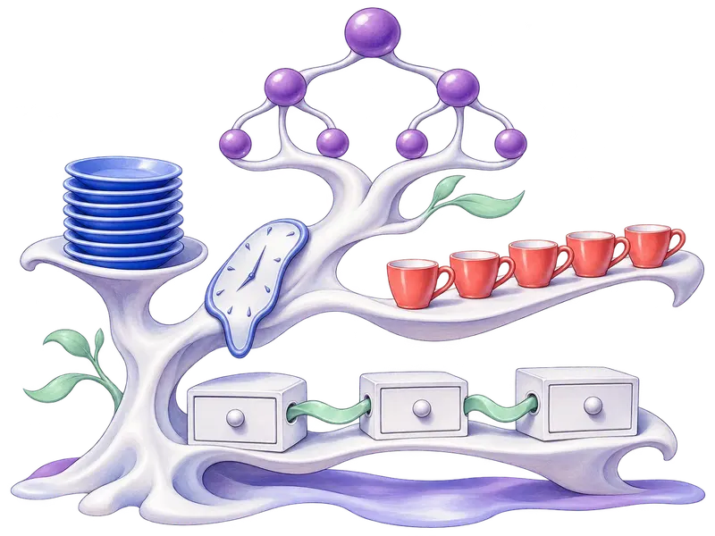

{: .align-left width="200" height="150" style="float: left; margin-right: 10px;"} 
Data structures provide systematic ways to organize, store, and access data. Choosing an appropriate structure directly affects the efficiency of operations such as searching, insertion, deletion, and traversal. This course examines algorithm analysis, arrays, recursion, linked lists, lists, stacks, queues, trees, search trees, priority queues and heaps, hash tables, sets and disjoint sets, and graphs, with an emphasis on their implementations, complexity, and practical applications.

---

## Ders Kitabı

[📕 Veri Yapıları (PDF, 19 MB)](https://sercankulcu.github.io/courses-pdfs/data_structures/Veri-Yapilari.pdf)

---

## Başlangıç Kaynakları

* [Veri Yapılarında Önemli İsimler (HTML)](/files/data_structures/Onemli_Isimler.html)
* [Veri Yapıları İçin Ön Bilgiler (HTML)](/files/data_structures/On_Bilgiler.html)
* [Dersin Haritası (HTML)](/files/data_structures/Ders_Haritasi.html)
* [Terim Sözlüğü (HTML)](/files/data_structures/Sozluk.html)

---

## Kısım I: Temeller

### Bölüm 1: Giriş

Veri yapıları, verinin bellekte nasıl düzenleneceğini ve ona nasıl erişileceğini belirler. Bu bölümde verinin sayısal ortamda nasıl temsil edildiği, Java'daki ilkel ve referans tipler, referans kopyalama ve jenerikler ele alınır. Soyut veri tipi (hangi işlemlerin sunulduğu) ile veri yapısı (bu işlemlerin nasıl gerçeklendiği) arasındaki ayrım bir yığın örneğiyle gösterilir. Bölüm, veri yapısı seçimi ve dersteki temel yapıların kısa bir karşılaştırma tablosuyla kapanır.

- [🖼️ Sunum](/files/data_structures/sunumlar/Bolum_01_Giris.html) · [📄 PDF](https://sercankulcu.github.io/courses-pdfs/data_structures/pdf/Bolum_01_Giris.pdf) · [📖 Ders notu](/files/data_structures/notlar/Bolum_01_Giris_Ders_Notu.html) · [📝 Sorular](/files/data_structures/sunumlar/Bolum_01_Giris_Calisma_Sorulari.html) · [💻 Kod](https://github.com/sercankulcu/data-structures-java/tree/main/Bolum01/src)

---

### Bölüm 2: Algoritma Analizi

Algoritma analizi, çözümleri uygulamadan önce karşılaştırmayı sağlar. Deneysel ölçüm ve katlama deneyi çalışma süresinin pratikte nasıl büyüdüğünü gösterir; ilkel işlemleri saymak ise makineden bağımsız bir ölçü verir. Büyük O, Büyük Omega ve Büyük Teta üst, alt ve sıkı sınırları anlatır; en iyi, ortalama ve en kötü durum ayrı ayrı incelenir. Döngü kalıpları, doğrusal ve ikili arama ile önek ortalamaları kodun yapısının karmaşıklığı nasıl belirlediğini gösterir. Alan karmaşıklığı, doğruluk ve sağlamlık da bu bölümdedir.

- [🖼️ Sunum](/files/data_structures/sunumlar/Bolum_02_Algoritma_Analizi.html) · [📄 PDF](https://sercankulcu.github.io/courses-pdfs/data_structures/pdf/Bolum_02_Algoritma_Analizi.pdf) · [📖 Ders notu](/files/data_structures/notlar/Bolum_02_Algoritma_Analizi_Ders_Notu.html) · [📝 Sorular](/files/data_structures/sunumlar/Bolum_02_Algoritma_Analizi_Calisma_Sorulari.html) · [💻 Kod](https://github.com/sercankulcu/data-structures-java/tree/main/Bolum02/src)

---

### Bölüm 3: Diziler

Dizi, öğeleri bellekte ardışık yerleşen en temel veri yapısıdır; her öğeye indisiyle sabit sürede erişilir. Java'da dizi tanımlama, kopyalama, java.util.Arrays ve çok boyutlu diziler; ortalama, ortanca, mod ve tersine çevirme gibi temel dizi algoritmaları; matris işlemleri ve küçük bir XOX oyunu bu bölümde yer alır. Erişimin O(1), araya ekleme ve silmenin ise öğe kaydırma yüzünden O(n) olduğu gösterilir; seçimli ve eklemeli sıralama da dizi üzerinde incelenir.

- [🖼️ Sunum](/files/data_structures/sunumlar/Bolum_03_Diziler.html) · [📄 PDF](https://sercankulcu.github.io/courses-pdfs/data_structures/pdf/Bolum_03_Diziler.pdf) · [📖 Ders notu](/files/data_structures/notlar/Bolum_03_Diziler_Ders_Notu.html) · [📝 Sorular](/files/data_structures/sunumlar/Bolum_03_Diziler_Calisma_Sorulari.html) · [💻 Kod](https://github.com/sercankulcu/data-structures-java/tree/main/Bolum03/src)
- 🕹️ **Simülatörler:** [Dizi Simülatörü](/files/data_structures/sunumlar/Bolum_03_Dizi_Simulatoru.html)

---

### Bölüm 4: Özyineleme

Özyineleme, bir problemi taban durumuna ulaşana kadar aynı problemin daha küçük örneklerine indirger. Her özyinelemeli çağrı çağrı yığınında kendi çerçevesini alır; bir özyinelemeli metodu izlemek bu çerçevelerin eklenip çıkarılmasını izlemektir. Doğrusal özyineleme (toplam, tersine çevirme, hızlı üs alma), ikili özyineleme (Fibonacci, ikili arama), Hanoi Kuleleri ve geri izleme örnekleri (alt kümeler, permütasyonlar) adım adım incelenir. Yineleme bağıntıları özyinelemeli algoritmaların zaman ve alan maliyetini verir; kuyruk özyinelemesi ve döngüye çevirme ile bölüm tamamlanır.

- [🖼️ Sunum](/files/data_structures/sunumlar/Bolum_04_Ozyineleme.html) · [📄 PDF](https://sercankulcu.github.io/courses-pdfs/data_structures/pdf/Bolum_04_Ozyineleme.pdf) · [📖 Ders notu](/files/data_structures/notlar/Bolum_04_Ozyineleme_Ders_Notu.html) · [📝 Sorular](/files/data_structures/sunumlar/Bolum_04_Ozyineleme_Calisma_Sorulari.html) · [💻 Kod](https://github.com/sercankulcu/data-structures-java/tree/main/Bolum04/src)
- 🕹️ **Simülatörler:** [Hanoi Kuleleri Simülatörü](/files/data_structures/sunumlar/Bolum_04_Hanoi_Kuleleri_Simulatoru.html)

---

## Kısım II: Doğrusal Yapılar

### Bölüm 5: Bağlı Listeler

Bağlı liste, her biri veri ve bir sonraki düğüme referans taşıyan düğümlerden oluşur. Ardışık bellek gerektirmediği için başa ekleme ve silme sabit sürede yapılır; buna karşılık rastgele erişim yoktur ve bir öğeye ulaşmak için baştan gezinmek gerekir. Tek yönlü listede gezinme, ekleme, silme, tersine çevirme, tekrarları kaldırma ve sıralı listeleri birleştirme; çift yönlü listede bekçi düğümler; dairesel listede döngü tespiti ve döndürme bu bölümün konularıdır.

- [🖼️ Sunum](/files/data_structures/sunumlar/Bolum_05_Bagli_Listeler.html) · [📄 PDF](https://sercankulcu.github.io/courses-pdfs/data_structures/pdf/Bolum_05_Bagli_Listeler.pdf) · [📖 Ders notu](/files/data_structures/notlar/Bolum_05_Bagli_Listeler_Ders_Notu.html) · [📝 Sorular](/files/data_structures/sunumlar/Bolum_05_Bagli_Listeler_Calisma_Sorulari.html) · [💻 Kod](https://github.com/sercankulcu/data-structures-java/tree/main/Bolum05/src)
- 🕹️ **Simülatörler:** [Bağlı Liste Simülatörü](/files/data_structures/sunumlar/Bolum_05_Bagli_Liste_Simulatoru.html) · [Çift Yönlü Bağlı Liste Simülatörü](/files/data_structures/sunumlar/Bolum_05_Cift_Yonlu_Bagli_Liste_Simulatoru.html) · [Dairesel Bağlı Liste Simülatörü](/files/data_structures/sunumlar/Bolum_05_Dairesel_Bagli_Liste_Simulatoru.html)

---

### Bölüm 6: Liste ADT ve Java Koleksiyonları

Liste, öğelerin sıralı bir dizisini temsil eden soyut veri tipidir; büyüyüp küçülebilir ve ekleme, silme, erişim ve gezinme işlemlerini destekler. Java'nın koleksiyon hiyerarşisi (Iterable, Collection, List), Iterator ve ListIterator ile gezinme ve gezinirken güvenli silme bu bölümde ele alınır. ArrayList'in dinamik dizi olarak büyümesi ve amortize analizi, LinkedList ile karşılaştırması, konumsal liste ADT'si, Vector, CopyOnWriteArrayList ve Arrays.asList de incelenir.

- [🖼️ Sunum](/files/data_structures/sunumlar/Bolum_06_Liste_ADT_ve_Java_Koleksiyonlari.html) · [📄 PDF](https://sercankulcu.github.io/courses-pdfs/data_structures/pdf/Bolum_06_Liste_ADT_ve_Java_Koleksiyonlari.pdf) · [📖 Ders notu](/files/data_structures/notlar/Bolum_06_Liste_ADT_ve_Java_Koleksiyonlari_Ders_Notu.html) · [📝 Sorular](/files/data_structures/sunumlar/Bolum_06_Liste_ADT_ve_Java_Koleksiyonlari_Calisma_Sorulari.html) · [💻 Kod](https://github.com/sercankulcu/data-structures-java/tree/main/Bolum06/src)
- 🕹️ **Simülatörler:** [Liste ADT Simülatörü](/files/data_structures/sunumlar/Bolum_06_Liste_ADT_Simulatoru.html)

---

### Bölüm 7: Yığınlar

Yığın, son giren ilk çıkar (LIFO) ilkesiyle çalışır: ekleme (push) ve çıkarma (pop) yalnızca üstten yapılır. Yığın ADT'si, dizi ve bağlı liste ile gerçeklenmesi ve işlemlerin maliyeti ele alınır. Geri/ileri gezinme, çağrı yığını, parantez kontrolü, sonraki büyük öğe, en küçük öğeyi tutan yığın, Hanoi Kulelerinin yığınla çözümü ve stock span problemi yığının uygulamalarıdır. Ara ek (infix), önek (prefix) ve sonek (postfix) gösterimleri arasında dönüşüm ve sonek ifadelerin değerlendirilmesi bölümü tamamlar.

- [🖼️ Sunum](/files/data_structures/sunumlar/Bolum_07_Yiginlar.html) · [📄 PDF](https://sercankulcu.github.io/courses-pdfs/data_structures/pdf/Bolum_07_Yiginlar.pdf) · [📖 Ders notu](/files/data_structures/notlar/Bolum_07_Yiginlar_Ders_Notu.html) · [📝 Sorular](/files/data_structures/sunumlar/Bolum_07_Yiginlar_Calisma_Sorulari.html) · [💻 Kod](https://github.com/sercankulcu/data-structures-java/tree/main/Bolum07/src)
- 🕹️ **Simülatörler:** [Yığın Simülatörü](/files/data_structures/sunumlar/Bolum_07_Yigin_Simulatoru.html) · [Stock Span Simülatörü](/files/data_structures/sunumlar/Bolum_07_Stock_Span_Simulatoru.html) · [Infix → Prefix Simülatörü](/files/data_structures/sunumlar/Bolum_07_Infix_Prefix_Simulatoru.html) · [Infix → Postfix Simülatörü](/files/data_structures/sunumlar/Bolum_07_Infix_Postfix_Simulatoru.html)

---

### Bölüm 8: Kuyruklar ve Deque

Kuyruk, ilk giren ilk çıkar (FIFO) ilkesiyle çalışır: öğeler bir uçtan eklenir (enqueue), öbür uçtan çıkarılır (dequeue). Basit dizi kuyruğunun sorunu, dairesel kuyruk ve indis formülleri, dolu/boş ayrımı, kuyruğun büyütülmesi ve bağlı liste ile gerçekleme bu bölümdedir. İki uçtan da ekleme ve çıkarmaya izin veren deque, kayan pencere maksimumu gibi problemlerde kullanılır. Round robin çizelgeleme, Josephus problemi, ikilik sayıların üretilmesi ve iki yığınla kuyruk uygulama örnekleridir.

- [🖼️ Sunum](/files/data_structures/sunumlar/Bolum_08_Kuyruklar_ve_Deque.html) · [📄 PDF](https://sercankulcu.github.io/courses-pdfs/data_structures/pdf/Bolum_08_Kuyruklar_ve_Deque.pdf) · [📖 Ders notu](/files/data_structures/notlar/Bolum_08_Kuyruklar_ve_Deque_Ders_Notu.html) · [📝 Sorular](/files/data_structures/sunumlar/Bolum_08_Kuyruklar_ve_Deque_Calisma_Sorulari.html) · [💻 Kod](https://github.com/sercankulcu/data-structures-java/tree/main/Bolum08/src)
- 🕹️ **Simülatörler:** [Kuyruk Simülatörü](/files/data_structures/sunumlar/Bolum_08_Kuyruk_Simulatoru.html) · [Deque Simülatörü](/files/data_structures/sunumlar/Bolum_08_Deque_Simulatoru.html) · [Dairesel Kuyruk Simülatörü](/files/data_structures/sunumlar/Bolum_08_Dairesel_Kuyruk_Simulatoru.html) · [Round Robin Çizelgeleyici Simülatörü](/files/data_structures/sunumlar/Bolum_08_Round_Robin_Cizelgeleyici_Simulatoru.html)

---

## Kısım III: Ağaçlar

### Bölüm 9: Ağaçlar

Ağaç, düğümlerin kenarlarla bağlandığı hiyerarşik bir yapıdır: bir kökten başlar, her düğümün tek ebeveyni ve birden çok çocuğu olabilir. Dosya sistemleri, kurum şemaları ve HTML belgeleri ağaçla temsil edilir. Derece, derinlik ve yükseklik gibi temel kavramlar, ikili ağaç türleri (dolu, tam, mükemmel) ve özellikleri, dizi ve bağlı gösterimler incelenir. Kök önde, kök ortada, kök sonda ve düzey sırası gezinmeleri hem özyinelemeli hem yığın ve kuyrukla gerçeklenir; ifade ağaçları ve özyinelemeli ağaç fonksiyonları (boyut, yükseklik, yaprak sayısı) uygulamalardır.

- [🖼️ Sunum](/files/data_structures/sunumlar/Bolum_09_Agaclar.html) · [📄 PDF](https://sercankulcu.github.io/courses-pdfs/data_structures/pdf/Bolum_09_Agaclar.pdf) · [📖 Ders notu](/files/data_structures/notlar/Bolum_09_Agaclar_Ders_Notu.html) · [📝 Sorular](/files/data_structures/sunumlar/Bolum_09_Agaclar_Calisma_Sorulari.html) · [💻 Kod](https://github.com/sercankulcu/data-structures-java/tree/main/Bolum09/src)
- 🕹️ **Simülatörler:** [Genel Ağaç Simülatörü](/files/data_structures/sunumlar/Bolum_09_Genel_Agac_Simulatoru.html)

---

### Bölüm 10: Arama Ağaçları

İkili arama ağacında (BST) her düğümün sol alt ağacındaki anahtarlar düğümünkinden küçük, sağ alt ağacındakiler büyüktür. Arama, ekleme ve silme O(h) sürer; h ağacın yüksekliğidir. Dengeli ağaçta bu O(log n) olur, en kötü durumda O(n)'ye düşer. BST'de arama, ekleme, ardıl ve öncül, üç durumlu silme ve aralık sorguları incelendikten sonra yüksekliği sınırlı tutan AVL, kırmızı-siyah ve splay ağaçları ele alınır. Diskteki veriler için B-ağacı ve B+ ağacı gibi çok yollu arama ağaçları düğüm başına çok sayıda anahtar tutarak ağacı sığ tutar.

- [🖼️ Sunum](/files/data_structures/sunumlar/Bolum_10_Arama_Agaclari.html) · [📄 PDF](https://sercankulcu.github.io/courses-pdfs/data_structures/pdf/Bolum_10_Arama_Agaclari.pdf) · [📖 Ders notu](/files/data_structures/notlar/Bolum_10_Arama_Agaclari_Ders_Notu.html) · [📝 Sorular](/files/data_structures/sunumlar/Bolum_10_Arama_Agaclari_Calisma_Sorulari.html) · [💻 Kod](https://github.com/sercankulcu/data-structures-java/tree/main/Bolum10/src)
- 🕹️ **Simülatörler:** [İkili Arama Ağacı Simülatörü](/files/data_structures/sunumlar/Bolum_10_Ikili_Arama_Agaci_Simulatoru.html) · [İkili Arama Ağacı Gezinme Simülatörü](/files/data_structures/sunumlar/Bolum_10_Ikili_Arama_Agaci_Gezinme_Simulatoru.html) · [Kırmızı-Siyah Ağaç Simülatörü](/files/data_structures/sunumlar/Bolum_10_Kirmizi_Siyah_Agac_Simulatoru.html) · [AVL Ağacı Simülatörü](/files/data_structures/sunumlar/Bolum_10_AVL_Agaci_Simulatoru.html) · [Splay Ağacı Simülatörü](/files/data_structures/sunumlar/Bolum_10_Splay_Agaci_Simulatoru.html) · [B-Ağacı Simülatörü](/files/data_structures/sunumlar/Bolum_10_B_Agaci_Simulatoru.html) · [B+ Ağacı Simülatörü](/files/data_structures/sunumlar/Bolum_10_B_Arti_Agaci_Simulatoru.html)

---

### Bölüm 11: Öncelikli Kuyruklar ve Heap

Öncelikli kuyruk, her seferinde en yüksek (ya da en düşük) öncelikli öğeyi çıkaran soyut veri tipidir. Sırasız ve sıralı listeyle gerçeklemenin maliyetleri karşılaştırıldıktan sonra ikili heap incelenir: max-heap'te her ebeveyn çocuklarından büyük ya da onlara eşittir. Dizi gösterimi, yukarı ve aşağı süzmeyle (up-heap, down-heap) ekleme ve silme, uyarlanabilir öncelikli kuyruk, O(n) sürede heap oluşturma ve heap sort bu bölümdedir. Java'nın PriorityQueue sınıfı, k'ıncı en büyük öğe ve öncelikli çizelgeleyici uygulama örnekleridir.

- [🖼️ Sunum](/files/data_structures/sunumlar/Bolum_11_Oncelikli_Kuyruklar_ve_Heap.html) · [📄 PDF](https://sercankulcu.github.io/courses-pdfs/data_structures/pdf/Bolum_11_Oncelikli_Kuyruklar_ve_Heap.pdf) · [📖 Ders notu](/files/data_structures/notlar/Bolum_11_Oncelikli_Kuyruklar_ve_Heap_Ders_Notu.html) · [📝 Sorular](/files/data_structures/sunumlar/Bolum_11_Oncelikli_Kuyruklar_ve_Heap_Calisma_Sorulari.html) · [💻 Kod](https://github.com/sercankulcu/data-structures-java/tree/main/Bolum11/src)
- 🕹️ **Simülatörler:** [İkili Heap Simülatörü](/files/data_structures/sunumlar/Bolum_11_Ikili_Heap_Simulatoru.html) · [Öncelikli Kuyruk Simülatörü](/files/data_structures/sunumlar/Bolum_11_Oncelikli_Kuyruk_Simulatoru.html) · [Öncelikli Çizelgeleyici Simülatörü](/files/data_structures/sunumlar/Bolum_11_Oncelikli_Cizelgeleyici_Simulatoru.html)

---

## Kısım IV: Eşlemeler, Kümeler ve Çizgeler

### Bölüm 12: Eşlemeler ve Hash Tabloları

Eşleme (map), anahtarları değerlere bağlayan soyut veri tipidir. Hash tablosu, bir hash fonksiyonuyla anahtardan bir kova indisi hesaplar ve iyi dağılan anahtarlarla ekleme, silme ve aramayı ortalamada O(1) sürede yapar; en kötü durumda bu O(n)'ye çıkabilir. İyi bir hash fonksiyonunun özellikleri, Java'daki equals/hashCode sözleşmesi, çakışmaları çözmek için ayrı zincirleme ve açık adresleme (doğrusal yoklama, karesel yoklama, çift hash), yük faktörü ve yeniden boyutlandırma bu bölümün konularıdır. Java HashMap'in iç yapısı ve iki toplam gibi uygulamalarla bölüm tamamlanır.

- [🖼️ Sunum](/files/data_structures/sunumlar/Bolum_12_Eslemeler_ve_Hash_Tablolari.html) · [📄 PDF](https://sercankulcu.github.io/courses-pdfs/data_structures/pdf/Bolum_12_Eslemeler_ve_Hash_Tablolari.pdf) · [📖 Ders notu](/files/data_structures/notlar/Bolum_12_Eslemeler_ve_Hash_Tablolari_Ders_Notu.html) · [📝 Sorular](/files/data_structures/sunumlar/Bolum_12_Eslemeler_ve_Hash_Tablolari_Calisma_Sorulari.html) · [💻 Kod](https://github.com/sercankulcu/data-structures-java/tree/main/Bolum12/src)
- 🕹️ **Simülatörler:** [Hash Tablosu Simülatörü](/files/data_structures/sunumlar/Bolum_12_Hash_Tablosu_Simulatoru.html) · [Eşleme Simülatörü](/files/data_structures/sunumlar/Bolum_12_Esleme_Simulatoru.html) · [Açık Adresleme Simülatörü](/files/data_structures/sunumlar/Bolum_12_Acik_Adresleme_Simulatoru.html)

---

### Bölüm 13: Kümeler ve Ayrık Kümeler

Küme, birbirinden farklı öğelerin sırasız topluluğudur; tekrar eden öğe içermez. Birleşim, kesişim ve fark işlemleri, Java'nın Set arayüzü ve hash tabanlı, ağaç tabanlı ve bit vektörü ile gerçeklemeler karşılaştırılır; çoklu küme ve çoklu eşleme de ele alınır. Ayrık kümeler (union-find) yapısı, boyuta ya da rütbeye göre birleştirme ve yol kısaltmayla bağlantı sorgularını neredeyse sabit amortize sürede yanıtlar; bağlantılı bileşen sayma bunun bir uygulamasıdır.

- [🖼️ Sunum](/files/data_structures/sunumlar/Bolum_13_Kumeler_ve_Ayrik_Kumeler.html) · [📄 PDF](https://sercankulcu.github.io/courses-pdfs/data_structures/pdf/Bolum_13_Kumeler_ve_Ayrik_Kumeler.pdf) · [📖 Ders notu](/files/data_structures/notlar/Bolum_13_Kumeler_ve_Ayrik_Kumeler_Ders_Notu.html) · [📝 Sorular](/files/data_structures/sunumlar/Bolum_13_Kumeler_ve_Ayrik_Kumeler_Calisma_Sorulari.html) · [💻 Kod](https://github.com/sercankulcu/data-structures-java/tree/main/Bolum13/src)
- 🕹️ **Simülatörler:** [Küme ADT Simülatörü](/files/data_structures/sunumlar/Bolum_13_Kume_ADT_Simulatoru.html) · [Ayrık Kümeler Simülatörü](/files/data_structures/sunumlar/Bolum_13_Ayrik_Kumeler_Simulatoru.html)

---

### Bölüm 14: Çizgeler

Çizge, nesneler arasındaki ilişkileri düğümler ve kenarlarla temsil eder. Ağaçlardan farklı olarak döngü ve iki düğüm arasında birden çok yol içerebilir; yönlü ya da yönsüz, ağırlıklı ya da ağırlıksız olabilir. Sosyal ağlar, yol haritaları ve bilgisayar ağları çizgeyle modellenir. Komşuluk matrisi ve komşuluk listesi gösterimleri, genişlik öncelikli (BFS) ve derinlik öncelikli (DFS) arama, bağlantılı bileşenler, iki parçalı çizgeler, topolojik sıralama ve yönlü döngü tespiti incelenir. Ağırlıksız en kısa yol ve Dijkstra algoritmasından sonra minimum kapsayan ağaç problemi ayrık kümelerle Kruskal, öncelikli kuyrukla Prim algoritması üzerinden çözülür.

- [🖼️ Sunum](/files/data_structures/sunumlar/Bolum_14_Cizgeler.html) · [📄 PDF](https://sercankulcu.github.io/courses-pdfs/data_structures/pdf/Bolum_14_Cizgeler.pdf) · [📖 Ders notu](/files/data_structures/notlar/Bolum_14_Cizgeler_Ders_Notu.html) · [📝 Sorular](/files/data_structures/sunumlar/Bolum_14_Cizgeler_Calisma_Sorulari.html) · [💻 Kod](https://github.com/sercankulcu/data-structures-java/tree/main/Bolum14/src)
- 🕹️ **Simülatörler:** [Yönsüz Çizge Simülatörü](/files/data_structures/sunumlar/Bolum_14_Yonsuz_Cizge_Simulatoru.html) · [Yönlü Çizge Simülatörü](/files/data_structures/sunumlar/Bolum_14_Yonlu_Cizge_Simulatoru.html) · [Dijkstra Algoritması Simülatörü](/files/data_structures/sunumlar/Bolum_14_Dijkstra_Algoritmasi_Simulatoru.html) · [Ders Ön Koşul Planlayıcı Simülatörü](/files/data_structures/sunumlar/Bolum_14_Ders_On_Kosul_Planlayici_Simulatoru.html)

---

## Textbook

[📕 Data Structures — the course book (PDF, 17 MB)](https://sercankulcu.github.io/courses-pdfs/data_structures/Data-Structures.pdf)

---

## Getting Started

* [Important People in Data Structures (HTML)](/files/data_structures/Important_People.html)
* [Prerequisites for Data Structures (HTML)](/files/data_structures/Prerequisites.html)
* [Course Map (HTML)](/files/data_structures/Course_Map.html)
* [Dictionary of Terms (HTML)](/files/data_structures/Dictionary.html)

---

## Part I: Foundations

### Chapter 1: Introduction

A data structure decides how data sits in memory and how we get at it. This chapter starts with how text, numbers, images and sound become bits, then turns to Java: primitive and reference types, what copying a reference really copies, and how generics let one class hold any type. A stack example draws the line between an abstract data type, which says what the operations are, and a data structure, which says how they are carried out. The chapter ends with how to choose a structure and a side-by-side look at the ones covered in the course.

- [🖼️ Slides](/files/data_structures/slides/Chapter_01_Introduction.html) · [📄 PDF](https://sercankulcu.github.io/courses-pdfs/data_structures/pdf/Chapter_01_Introduction.pdf) · [📖 Notes](/files/data_structures/notes/Chapter_01_Introduction_Lecture_Notes.html) · [📝 Questions](/files/data_structures/slides/Chapter_01_Introduction_Study_Questions.html) · [💻 Code](https://github.com/sercankulcu/data-structures-java-en/tree/main/Chapter01/src)

---

### Chapter 2: Algorithm Analysis

Algorithm analysis lets us compare solutions before we write them. Timing experiments and the doubling test show how running time grows in practice, while counting primitive operations gives a measure that doesn't depend on the machine. Big O, Big Omega and Big Theta express upper, lower and tight bounds, and we look at best, average and worst cases separately. Loop patterns, linear and binary search, and prefix averages show how the shape of the code sets its cost. The chapter also covers space complexity, correctness and robustness.

- [🖼️ Slides](/files/data_structures/slides/Chapter_02_Algorithm_Analysis.html) · [📄 PDF](https://sercankulcu.github.io/courses-pdfs/data_structures/pdf/Chapter_02_Algorithm_Analysis.pdf) · [📖 Notes](/files/data_structures/notes/Chapter_02_Algorithm_Analysis_Lecture_Notes.html) · [📝 Questions](/files/data_structures/slides/Chapter_02_Algorithm_Analysis_Study_Questions.html) · [💻 Code](https://github.com/sercankulcu/data-structures-java-en/tree/main/Chapter02/src)

---

### Chapter 3: Arrays

The array is the simplest data structure: its elements sit side by side in memory, and any of them can be reached by index in constant time. We declare and copy arrays in Java, use java.util.Arrays and multidimensional arrays, and write the everyday array algorithms — mean, median, mode, reversal — along with matrix operations and a small tic-tac-toe game. Access is O(1), but inserting or deleting in the middle is O(n) because the other elements have to shift; selection sort and insertion sort round out the chapter.

- [🖼️ Slides](/files/data_structures/slides/Chapter_03_Arrays.html) · [📄 PDF](https://sercankulcu.github.io/courses-pdfs/data_structures/pdf/Chapter_03_Arrays.pdf) · [📖 Notes](/files/data_structures/notes/Chapter_03_Arrays_Lecture_Notes.html) · [📝 Questions](/files/data_structures/slides/Chapter_03_Arrays_Study_Questions.html) · [💻 Code](https://github.com/sercankulcu/data-structures-java-en/tree/main/Chapter03/src)
- 🕹️ **Simulators:** [Array Simulator](/files/data_structures/slides/Chapter_03_Array_Simulator.html)

---

### Chapter 4: Recursion

Recursion solves a problem by reducing it to smaller copies of itself until it reaches a base case. Each call gets its own frame on the call stack, so tracing a recursive method means watching frames being pushed and popped. We work step by step through linear recursion (summing, reversing, fast exponentiation), binary recursion (Fibonacci, binary search), the Towers of Hanoi and backtracking (subsets, permutations). Recurrence relations give the time and space a recursive algorithm needs, and the chapter closes with tail recursion and turning recursion into a loop.

- [🖼️ Slides](/files/data_structures/slides/Chapter_04_Recursion.html) · [📄 PDF](https://sercankulcu.github.io/courses-pdfs/data_structures/pdf/Chapter_04_Recursion.pdf) · [📖 Notes](/files/data_structures/notes/Chapter_04_Recursion_Lecture_Notes.html) · [📝 Questions](/files/data_structures/slides/Chapter_04_Recursion_Study_Questions.html) · [💻 Code](https://github.com/sercankulcu/data-structures-java-en/tree/main/Chapter04/src)
- 🕹️ **Simulators:** [Tower of Hanoi Simulator](/files/data_structures/slides/Chapter_04_Towers_of_Hanoi_Simulator.html)

---

## Part II: Linear Structures

### Chapter 5: Linked Lists

A linked list is a chain of nodes, each holding a value and a reference to the next node. Because it needs no contiguous block of memory, inserting or removing at the front takes constant time; the price is that there is no random access, so reaching an element means walking from the head. For singly linked lists we cover traversal, insertion, deletion, reversal, removing duplicates and merging sorted lists; for doubly linked lists, sentinel nodes; and for circular lists, cycle detection and rotation.

- [🖼️ Slides](/files/data_structures/slides/Chapter_05_Linked_Lists.html) · [📄 PDF](https://sercankulcu.github.io/courses-pdfs/data_structures/pdf/Chapter_05_Linked_Lists.pdf) · [📖 Notes](/files/data_structures/notes/Chapter_05_Linked_Lists_Lecture_Notes.html) · [📝 Questions](/files/data_structures/slides/Chapter_05_Linked_Lists_Study_Questions.html) · [💻 Code](https://github.com/sercankulcu/data-structures-java-en/tree/main/Chapter05/src)
- 🕹️ **Simulators:** [Linked List Simulator](/files/data_structures/slides/Chapter_05_Linked_List_Simulator.html) · [Doubly Linked List Simulator](/files/data_structures/slides/Chapter_05_Doubly_Linked_List_Simulator.html) · [Circular Linked List Simulator](/files/data_structures/slides/Chapter_05_Circular_Linked_List_Simulator.html)

---

### Chapter 6: The List ADT and Java Collections

The list is the abstract data type for an ordered sequence that can grow and shrink, with operations to add, remove, get and traverse elements. This chapter walks through Java's collection hierarchy (Iterable, Collection, List), iterating with Iterator and ListIterator, and removing elements safely while iterating. We look at how ArrayList grows as a dynamic array and why its appends are cheap on average, compare it with LinkedList, and cover the positional list ADT, Vector, CopyOnWriteArrayList and Arrays.asList.

- [🖼️ Slides](/files/data_structures/slides/Chapter_06_The_List_ADT_and_Java_Collections.html) · [📄 PDF](https://sercankulcu.github.io/courses-pdfs/data_structures/pdf/Chapter_06_The_List_ADT_and_Java_Collections.pdf) · [📖 Notes](/files/data_structures/notes/Chapter_06_The_List_ADT_and_Java_Collections_Lecture_Notes.html) · [📝 Questions](/files/data_structures/slides/Chapter_06_The_List_ADT_and_Java_Collections_Study_Questions.html) · [💻 Code](https://github.com/sercankulcu/data-structures-java-en/tree/main/Chapter06/src)
- 🕹️ **Simulators:** [List ADT Simulator](/files/data_structures/slides/Chapter_06_List_ADT_Simulator.html)

---

### Chapter 7: Stacks

A stack is last in, first out (LIFO): items are added (push) and removed (pop) only at the top. We define the stack ADT, implement it with an array and with a linked list, and analyze the cost of each operation. The applications are many: back and forward navigation, the call stack, bracket matching, the next greater element, a stack that tracks its minimum, the Towers of Hanoi with an explicit stack, and the stock span problem. The chapter ends with converting between infix, prefix and postfix notation and evaluating postfix expressions.

- [🖼️ Slides](/files/data_structures/slides/Chapter_07_Stacks.html) · [📄 PDF](https://sercankulcu.github.io/courses-pdfs/data_structures/pdf/Chapter_07_Stacks.pdf) · [📖 Notes](/files/data_structures/notes/Chapter_07_Stacks_Lecture_Notes.html) · [📝 Questions](/files/data_structures/slides/Chapter_07_Stacks_Study_Questions.html) · [💻 Code](https://github.com/sercankulcu/data-structures-java-en/tree/main/Chapter07/src)
- 🕹️ **Simulators:** [Stack Simulator](/files/data_structures/slides/Chapter_07_Stack_Simulator.html) · [Stock Span Simulator](/files/data_structures/slides/Chapter_07_Stock_Span_Simulator.html) · [Infix → Prefix Simulator](/files/data_structures/slides/Chapter_07_Infix_to_Prefix_Simulator.html) · [Infix → Postfix Simulator](/files/data_structures/slides/Chapter_07_Infix_to_Postfix_Simulator.html)

---

### Chapter 8: Queues and Deques

A queue is first in, first out (FIFO): items join at one end (enqueue) and leave from the other (dequeue). We see why a simple array queue runs into trouble, then build a circular queue with its index formulas, tell a full queue from an empty one, grow it when needed, and implement it with a linked list. The deque, which allows adding and removing at both ends, solves problems such as the sliding-window maximum. Round-robin scheduling, the Josephus problem, generating binary numbers and a queue built from two stacks are worked examples.

- [🖼️ Slides](/files/data_structures/slides/Chapter_08_Queues_and_Deques.html) · [📄 PDF](https://sercankulcu.github.io/courses-pdfs/data_structures/pdf/Chapter_08_Queues_and_Deques.pdf) · [📖 Notes](/files/data_structures/notes/Chapter_08_Queues_and_Deques_Lecture_Notes.html) · [📝 Questions](/files/data_structures/slides/Chapter_08_Queues_and_Deques_Study_Questions.html) · [💻 Code](https://github.com/sercankulcu/data-structures-java-en/tree/main/Chapter08/src)
- 🕹️ **Simulators:** [Queue Simulator](/files/data_structures/slides/Chapter_08_Queue_Simulator.html) · [Deque Simulator](/files/data_structures/slides/Chapter_08_Deque_Simulator.html) · [Circular Queue Simulator](/files/data_structures/slides/Chapter_08_Circular_Queue_Simulator.html) · [Round-Robin Scheduler Simulator](/files/data_structures/slides/Chapter_08_Round_Robin_Scheduler_Simulator.html)

---

## Part III: Trees

### Chapter 9: Trees

A tree is a hierarchy of nodes joined by edges: it starts at a root, and every other node has exactly one parent and any number of children. File systems, organization charts and HTML documents are all trees. We cover the basic vocabulary (degree, depth, height), the kinds of binary trees (full, complete, perfect) and their properties, and how to store a tree in an array or with linked nodes. Preorder, inorder, postorder and level-order traversals are written both recursively and with an explicit stack or queue; expression trees and recursive tree functions such as size, height and leaf count put them to use.

- [🖼️ Slides](/files/data_structures/slides/Chapter_09_Trees.html) · [📄 PDF](https://sercankulcu.github.io/courses-pdfs/data_structures/pdf/Chapter_09_Trees.pdf) · [📖 Notes](/files/data_structures/notes/Chapter_09_Trees_Lecture_Notes.html) · [📝 Questions](/files/data_structures/slides/Chapter_09_Trees_Study_Questions.html) · [💻 Code](https://github.com/sercankulcu/data-structures-java-en/tree/main/Chapter09/src)
- 🕹️ **Simulators:** [General Tree Simulator](/files/data_structures/slides/Chapter_09_General_Tree_Simulator.html)

---

### Chapter 10: Search Trees

In a binary search tree (BST), every key in a node's left subtree is smaller than the node's key and every key in its right subtree is larger. Search, insertion and deletion take O(h), where h is the height of the tree — O(log n) when the tree is balanced, but O(n) in the worst case. After search, insertion, successor and predecessor, three-case deletion and range queries on a plain BST, we study the AVL, red-black and splay trees, which keep the height in check. For data on disk, multiway trees such as the B-tree and B+ tree pack many keys into each node so the tree stays shallow.

- [🖼️ Slides](/files/data_structures/slides/Chapter_10_Search_Trees.html) · [📄 PDF](https://sercankulcu.github.io/courses-pdfs/data_structures/pdf/Chapter_10_Search_Trees.pdf) · [📖 Notes](/files/data_structures/notes/Chapter_10_Search_Trees_Lecture_Notes.html) · [📝 Questions](/files/data_structures/slides/Chapter_10_Search_Trees_Study_Questions.html) · [💻 Code](https://github.com/sercankulcu/data-structures-java-en/tree/main/Chapter10/src)
- 🕹️ **Simulators:** [Binary Search Tree Simulator](/files/data_structures/slides/Chapter_10_Binary_Search_Tree_Simulator.html) · [Binary Search Tree Traversal Simulator](/files/data_structures/slides/Chapter_10_Binary_Search_Tree_Traversal_Simulator.html) · [Red-Black Tree Simulator](/files/data_structures/slides/Chapter_10_Red_Black_Tree_Simulator.html) · [AVL Tree Simulator](/files/data_structures/slides/Chapter_10_AVL_Tree_Simulator.html) · [Splay Tree Simulator](/files/data_structures/slides/Chapter_10_Splay_Tree_Simulator.html) · [B-Tree Simulator](/files/data_structures/slides/Chapter_10_B_Tree_Simulator.html) · [B+ Tree Simulator](/files/data_structures/slides/Chapter_10_B_Plus_Tree_Simulator.html)

---

### Chapter 11: Priority Queues and Heaps

A priority queue always removes the element with the highest (or lowest) priority. After comparing what unsorted and sorted lists cost, we turn to the binary heap: in a max-heap every parent is at least as large as its children. We store the heap in an array, insert and remove with up-heap and down-heap, update priorities in an adaptable priority queue, build a heap in O(n) time and use it for heap sort. Java's PriorityQueue class, finding the k-th largest element and a priority scheduler are worked examples.

- [🖼️ Slides](/files/data_structures/slides/Chapter_11_Priority_Queues_and_Heaps.html) · [📄 PDF](https://sercankulcu.github.io/courses-pdfs/data_structures/pdf/Chapter_11_Priority_Queues_and_Heaps.pdf) · [📖 Notes](/files/data_structures/notes/Chapter_11_Priority_Queues_and_Heaps_Lecture_Notes.html) · [📝 Questions](/files/data_structures/slides/Chapter_11_Priority_Queues_and_Heaps_Study_Questions.html) · [💻 Code](https://github.com/sercankulcu/data-structures-java-en/tree/main/Chapter11/src)
- 🕹️ **Simulators:** [Binary Heap Simulator](/files/data_structures/slides/Chapter_11_Binary_Heap_Simulator.html) · [Priority Queue Simulator](/files/data_structures/slides/Chapter_11_Priority_Queue_Simulator.html) · [Priority Scheduler Simulator](/files/data_structures/slides/Chapter_11_Priority_Scheduler_Simulator.html)

---

## Part IV: Maps, Sets and Graphs

### Chapter 12: Maps and Hash Tables

A map associates keys with values. A hash table turns a key into a bucket index with a hash function, and with well-spread keys it inserts, deletes and looks up in O(1) time on average, though the worst case can reach O(n). We discuss what makes a good hash function, Java's equals/hashCode contract, and the two ways to resolve collisions — separate chaining and open addressing (linear probing, quadratic probing, double hashing) — along with the load factor and resizing. The chapter ends with a look inside Java's HashMap and applications such as two-sum.

- [🖼️ Slides](/files/data_structures/slides/Chapter_12_Maps_and_Hash_Tables.html) · [📄 PDF](https://sercankulcu.github.io/courses-pdfs/data_structures/pdf/Chapter_12_Maps_and_Hash_Tables.pdf) · [📖 Notes](/files/data_structures/notes/Chapter_12_Maps_and_Hash_Tables_Lecture_Notes.html) · [📝 Questions](/files/data_structures/slides/Chapter_12_Maps_and_Hash_Tables_Study_Questions.html) · [💻 Code](https://github.com/sercankulcu/data-structures-java-en/tree/main/Chapter12/src)
- 🕹️ **Simulators:** [Hash Table Simulator](/files/data_structures/slides/Chapter_12_Hash_Table_Simulator.html) · [Map Simulator](/files/data_structures/slides/Chapter_12_Map_Simulator.html) · [Open Addressing Simulator](/files/data_structures/slides/Chapter_12_Open_Addressing_Simulator.html)

---

### Chapter 13: Sets and Disjoint Sets

A set is an unordered collection of distinct elements. We implement union, intersection and difference, use Java's Set interface, and compare hash-based, tree-based and bit-vector implementations, then extend the idea to multisets and multimaps. The disjoint-set (union-find) structure, with union by size or rank and path compression, answers "are these two connected?" in nearly constant amortized time; counting connected components is one application.

- [🖼️ Slides](/files/data_structures/slides/Chapter_13_Sets_and_Disjoint_Sets.html) · [📄 PDF](https://sercankulcu.github.io/courses-pdfs/data_structures/pdf/Chapter_13_Sets_and_Disjoint_Sets.pdf) · [📖 Notes](/files/data_structures/notes/Chapter_13_Sets_and_Disjoint_Sets_Lecture_Notes.html) · [📝 Questions](/files/data_structures/slides/Chapter_13_Sets_and_Disjoint_Sets_Study_Questions.html) · [💻 Code](https://github.com/sercankulcu/data-structures-java-en/tree/main/Chapter13/src)
- 🕹️ **Simulators:** [Set ADT Simulator](/files/data_structures/slides/Chapter_13_Set_ADT_Simulator.html) · [Disjoint Sets Simulator](/files/data_structures/slides/Chapter_13_Disjoint_Sets_Simulator.html)

---

### Chapter 14: Graphs

A graph models relationships between objects with vertices and edges. Unlike a tree, it can have cycles and several paths between two vertices, and its edges may be directed or undirected, weighted or unweighted. Social networks, road maps and computer networks are all graphs. We cover adjacency-matrix and adjacency-list representations, breadth-first (BFS) and depth-first (DFS) search, connected components, bipartite graphs, topological sorting and directed cycle detection. After unweighted shortest paths and Dijkstra's algorithm, we solve the minimum spanning tree problem with Kruskal's algorithm, using disjoint sets, and Prim's algorithm, using a priority queue.

- [🖼️ Slides](/files/data_structures/slides/Chapter_14_Graphs.html) · [📄 PDF](https://sercankulcu.github.io/courses-pdfs/data_structures/pdf/Chapter_14_Graphs.pdf) · [📖 Notes](/files/data_structures/notes/Chapter_14_Graphs_Lecture_Notes.html) · [📝 Questions](/files/data_structures/slides/Chapter_14_Graphs_Study_Questions.html) · [💻 Code](https://github.com/sercankulcu/data-structures-java-en/tree/main/Chapter14/src)
- 🕹️ **Simulators:** [Undirected Graph Simulator](/files/data_structures/slides/Chapter_14_Undirected_Graph_Simulator.html) · [Directed Graph Simulator](/files/data_structures/slides/Chapter_14_Directed_Graph_Simulator.html) · [Dijkstra's Algorithm Simulator](/files/data_structures/slides/Chapter_14_Dijkstras_Algorithm_Simulator.html) · [Course Prerequisite Planner Simulator](/files/data_structures/slides/Chapter_14_Course_Prerequisite_Planner_Simulator.html)

