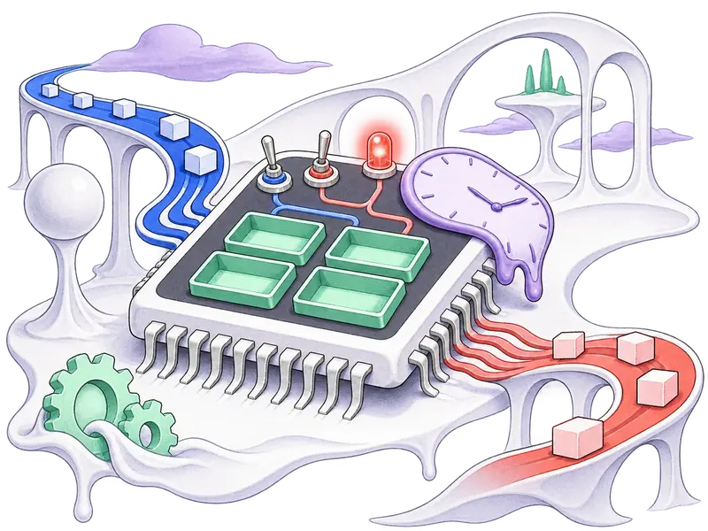

{: .align-left width="200" height="150" style="float: left; margin-right: 10px;"} 
Microprocessors execute instructions, process data, and coordinate the operations of modern computing systems. The 8086 architecture provides a useful foundation for studying processor organization, registers, memory access, instruction execution, and low-level programming. The 8086 is an early member of the x86 family. Although modern x86-64 processors are substantially more complex, the 8086 remains useful for introducing registers, segmentation, instruction execution, addressing modes, interrupts, and assembly programming.

---

## Ders Kitabı

[📕 Mikroişlemciler (PDF, 16 MB)](https://sercankulcu.github.io/courses-pdfs/microprocessors/Mikroislemciler.pdf)

---

## Başlangıç Kaynakları

* [Mikroişlemcilerde Önemli İsimler (HTML)](/files/microprocessors/Microprocessors_Important_People.html)
* [Mikroişlemciler İçin Ön Bilgiler (HTML)](/files/microprocessors/Microprocessors_Prerequisites.html)
* [Dersin Haritası (HTML)](/files/microprocessors/Ders_Haritasi.html)
* [Terim Sözlüğü (HTML)](/files/microprocessors/Sozluk.html)

---

## Araçlar

- [8086 Emülatörü (ZIP)](/files/microprocessors/8086emulator.zip)
- [🕹️ İşlemci Simülatörü](/files/microprocessors/sunumlar/CPU_Simulator.html)

---

## Kısım I: Temeller

### Bölüm 1: Mikroişlemcilere Giriş ve Sayı Sistemleri

Mikroişlemci, komutları bellekten getirip çözen ve yürüten bir bilgisayar sisteminin merkezidir. Bölüm mikroişlemci ile mikrodenetleyici ayrımı, getir–çöz–yürüt döngüsü, işlemcinin iç yapısı ve saat hızıyla başlar; CISC, RISC ve EPIC tasarımları, özel amaçlı işlemciler ve 4004'ten günümüze Intel x86 ailesinin gelişimi ele alınır. Sayı sistemleri kısmında onluk, ikili ve onaltılık tabanlar, taban dönüşümleri, birler tümleyeni ve ikiye tümleyen ile işaretli sayılar ve ikili aritmetik işlenir. IEEE 754 kayan nokta biçimi, BCD, Gray kodu ve bayt sıralaması gibi kodlamalarla bölüm tamamlanır.

- **1.1 Giriş** — [🖼️ Sunum](/files/microprocessors/sunumlar/Bolum_01_01_Giris.html) · [📄 PDF](https://sercankulcu.github.io/courses-pdfs/microprocessors/pdf/Bolum_01_01_Giris.pdf) · [📖 Ders notu](/files/microprocessors/notlar/Bolum_01_01_Giris_Ders_Notu.html) · [📝 Sorular](/files/microprocessors/sunumlar/Bolum_01_01_Giris_Calisma_Sorulari.html)
- **1.2 Sayı Sistemleri** — [🖼️ Sunum](/files/microprocessors/sunumlar/Bolum_01_02_Sayi_Sistemleri.html) · [📄 PDF](https://sercankulcu.github.io/courses-pdfs/microprocessors/pdf/Bolum_01_02_Sayi_Sistemleri.pdf) · [📖 Ders notu](/files/microprocessors/notlar/Bolum_01_02_Sayi_Sistemleri_Ders_Notu.html) · [📝 Sorular](/files/microprocessors/sunumlar/Bolum_01_02_Sayi_Sistemleri_Calisma_Sorulari.html) · [💻 Kod (8086)](https://github.com/sercankulcu/microprocessors-8086/tree/main/Bolum01)
- 🕹️ **Simülatörler:** [İşlemci Simülatörü](/files/microprocessors/sunumlar/CPU_Simulator.html) · [İkiye Tümleyen Laboratuvarı](/files/microprocessors/sunumlar/Bolum_01_Twos-Complement-Lab.html)

---

### Bölüm 2: 8086 Mimarisi ve Yazmaçlar

Intel 8086, 1978'de tanıtılan ve x86 ailesini başlatan 16 bitlik bir mikroişlemcidir. Bölümde sistem yolları, yol arayüz birimi (BIU) ile yürütme birimi (EU), önden getirme kuyruğu ve kesimli bellek düzeninde 20 bitlik fiziksel adresin hesaplanması anlatılır. Ardından 8086'nın on dört yazmacı gruplarıyla incelenir: AX, BX, CX ve DX genel amaçlı yazmaçları, SP, BP, SI ve DI işaretçi ve indis yazmaçları, kesim yazmaçları ve IP. Durum ve kontrol bayraklarını taşıyan bayrak yazmacı ile bu bayrakları değiştiren komutlar da ele alınır.

- **2.1 8086 Mimarisi** — [🖼️ Sunum](/files/microprocessors/sunumlar/Bolum_02_01_8086_Mimarisi.html) · [📄 PDF](https://sercankulcu.github.io/courses-pdfs/microprocessors/pdf/Bolum_02_01_8086_Mimarisi.pdf) · [📖 Ders notu](/files/microprocessors/notlar/Bolum_02_01_8086_Mimarisi_Ders_Notu.html) · [📝 Sorular](/files/microprocessors/sunumlar/Bolum_02_01_8086_Mimarisi_Calisma_Sorulari.html)
- **2.2 8086 Yazmaçları** — [🖼️ Sunum](/files/microprocessors/sunumlar/Bolum_02_02_8086_Yazmaclari.html) · [📄 PDF](https://sercankulcu.github.io/courses-pdfs/microprocessors/pdf/Bolum_02_02_8086_Yazmaclari.pdf) · [📖 Ders notu](/files/microprocessors/notlar/Bolum_02_02_8086_Yazmaclari_Ders_Notu.html) · [📝 Sorular](/files/microprocessors/sunumlar/Bolum_02_02_8086_Yazmaclari_Calisma_Sorulari.html) · [💻 Kod (8086)](https://github.com/sercankulcu/microprocessors-8086/tree/main/Bolum02)
- 🕹️ **Simülatörler:** [Yazmaç Gezgini](/files/microprocessors/sunumlar/Bolum_02_Register-Explorer.html)

---

### Bölüm 3: Assembly Dili

Yazılım, makine dilinden yüksek düzeyli dillere uzanan farklı soyutlama düzeylerinde yazılabilir. Bölümde makine dili ve komut biçimi, assembler ile bağlayıcının rolü, farklı platformlardaki assembly dilleri ile derlenen ve yorumlanan diller karşılaştırılır. Assembly kısmında komut satırının etiket, komut, işlenen ve açıklamadan oluşan yapısı, komut ile direktif ayrımı, işlenen türleri ve örtük işlenenler işlenir. Komut süreleri, IP'nin ilerleyişi, bayraklar ve emu8086 ile yazılan ilk programla bölüm tamamlanır.

- **3.1 Programlama Dilleri** — [🖼️ Sunum](/files/microprocessors/sunumlar/Bolum_03_01_Programlama_Dilleri.html) · [📄 PDF](https://sercankulcu.github.io/courses-pdfs/microprocessors/pdf/Bolum_03_01_Programlama_Dilleri.pdf) · [📖 Ders notu](/files/microprocessors/notlar/Bolum_03_01_Programlama_Dilleri_Ders_Notu.html) · [📝 Sorular](/files/microprocessors/sunumlar/Bolum_03_01_Programlama_Dilleri_Calisma_Sorulari.html)
- **3.2 Assembly** — [🖼️ Sunum](/files/microprocessors/sunumlar/Bolum_03_02_Assembly.html) · [📄 PDF](https://sercankulcu.github.io/courses-pdfs/microprocessors/pdf/Bolum_03_02_Assembly.pdf) · [📖 Ders notu](/files/microprocessors/notlar/Bolum_03_02_Assembly_Ders_Notu.html) · [📝 Sorular](/files/microprocessors/sunumlar/Bolum_03_02_Assembly_Calisma_Sorulari.html) · [💻 Kod (8086)](https://github.com/sercankulcu/microprocessors-8086/tree/main/Bolum03)

---

## Kısım II: Bellek ve Sistem Hizmetleri

### Bölüm 4: Bellek Erişimi ve Değişkenler

8086 belleğe kesim ve bağıl konum değerlerinin birleşimiyle erişir. Bölümde BX, SI, DI ve BP yazmaçlarıyla kurulan adresleme modları, etkin adres ve fiziksel adres hesabı, byte ptr ve word ptr ile veri boyutunun belirtilmesi anlatılır; MOV ve XCHG komutlarının geçerli işlenen bileşimleri örneklerle işlenir. Değişkenler kısmında DB, DW ve DD tanımları, bellek yerleşimi, ORG 100h ve .COM programları, DUP ile diziler, LEA ve OFFSET ile adres alma ve EQU sabitleri ele alınır. Değişkenler üzerinde taşıma, toplama ve karşılaştırma yapan örnek programlarla bölüm tamamlanır.

- **4.1 Bellek Erişimi** — [🖼️ Sunum](/files/microprocessors/sunumlar/Bolum_04_01_Bellek_Erisimi.html) · [📄 PDF](https://sercankulcu.github.io/courses-pdfs/microprocessors/pdf/Bolum_04_01_Bellek_Erisimi.pdf) · [📖 Ders notu](/files/microprocessors/notlar/Bolum_04_01_Bellek_Erisimi_Ders_Notu.html) · [📝 Sorular](/files/microprocessors/sunumlar/Bolum_04_01_Bellek_Erisimi_Calisma_Sorulari.html)
- **4.2 Değişkenler** — [🖼️ Sunum](/files/microprocessors/sunumlar/Bolum_04_02_Degiskenler.html) · [📄 PDF](https://sercankulcu.github.io/courses-pdfs/microprocessors/pdf/Bolum_04_02_Degiskenler.pdf) · [📖 Ders notu](/files/microprocessors/notlar/Bolum_04_02_Degiskenler_Ders_Notu.html) · [📝 Sorular](/files/microprocessors/sunumlar/Bolum_04_02_Degiskenler_Calisma_Sorulari.html) · [💻 Kod (8086)](https://github.com/sercankulcu/microprocessors-8086/tree/main/Bolum04)
- 🕹️ **Simülatörler:** [Kesim:Bağıl Konum Hesaplayıcı](/files/microprocessors/sunumlar/Bolum_04_Segment-Offset.html) · [Adresleme Modları](/files/microprocessors/sunumlar/Bolum_04_Addressing-Modes.html)

---

### Bölüm 5: Kesmeler ve BIOS/DOS Hizmetleri

Kesme, işlemcinin o anki işini geçici olarak bırakıp özel bir hizmet yordamını çalıştırmasını sağlayan olaydır. Bölümde kesme türleri, kesme vektör tablosu, INT ve IRET sırasında FLAGS, CS ve IP'nin yığına yazılıp geri alınması, işlemci istisnaları ve 8259A ile donanım kesmelerinin maskelenmesi anlatılır. BIOS ve DOS hizmetleri kısmında INT 10h ile ekran çıktısı, INT 16h ile klavye girişi, INT 21h ile karakter ve dizgi işlemleri, tarih ve saat okuma ile INT 1Ah işlenir. Programın doğru biçimde sonlandırılması ve hizmetleri bir araya getiren bir uygulama ile bölüm tamamlanır.

- **5.1 Kesmeler** — [🖼️ Sunum](/files/microprocessors/sunumlar/Bolum_05_01_Kesmeler.html) · [📄 PDF](https://sercankulcu.github.io/courses-pdfs/microprocessors/pdf/Bolum_05_01_Kesmeler.pdf) · [📖 Ders notu](/files/microprocessors/notlar/Bolum_05_01_Kesmeler_Ders_Notu.html) · [📝 Sorular](/files/microprocessors/sunumlar/Bolum_05_01_Kesmeler_Calisma_Sorulari.html)
- **5.2 Kesme Fonksiyonları** — [🖼️ Sunum](/files/microprocessors/sunumlar/Bolum_05_02_Kesme_Fonksiyonlari.html) · [📄 PDF](https://sercankulcu.github.io/courses-pdfs/microprocessors/pdf/Bolum_05_02_Kesme_Fonksiyonlari.pdf) · [📖 Ders notu](/files/microprocessors/notlar/Bolum_05_02_Kesme_Fonksiyonlari_Ders_Notu.html) · [📝 Sorular](/files/microprocessors/sunumlar/Bolum_05_02_Kesme_Fonksiyonlari_Calisma_Sorulari.html) · [💻 Kod (8086)](https://github.com/sercankulcu/microprocessors-8086/tree/main/Bolum05)
- 🕹️ **Simülatörler:** [Kesme Vektör Tablosu](/files/microprocessors/sunumlar/Bolum_05_Interrupt-Vector.html)

---

## Kısım III: Komutlar ve Programlama

### Bölüm 6: Aritmetik, Mantık ve Kaydırma Komutları

Aritmetik ve mantık komutları, işlemcinin veri üzerinde hesap yapmasını ve sonuca göre bayrakları kurmasını sağlar. Bölüm CF, ZF, SF, OF, PF ve AF bayraklarının hangi sonuçta kurulduğuyla başlar; iki işlenenli ADD, SUB, CMP, AND, OR, XOR ve TEST komutları, MUL, IMUL, DIV ve IDIV ile çarpma ve bölme ve INC, DEC, NOT ve NEG gibi tek işlenenli komutlar gruplar hâlinde incelenir. Kaydırma ve döndürme komutlarının bitlere ve CF bayrağına etkisi adım adım gösterilir. BCD aritmetiği, dizi toplama ve sıcaklık dönüşümü örnekleriyle bölüm tamamlanır.

- [🖼️ Sunum](/files/microprocessors/sunumlar/Bolum_06_Aritmetik_Mantik_ve_Kaydirma_Komutlari.html) · [📄 PDF](https://sercankulcu.github.io/courses-pdfs/microprocessors/pdf/Bolum_06_Aritmetik_Mantik_ve_Kaydirma_Komutlari.pdf) · [📖 Ders notu](/files/microprocessors/notlar/Bolum_06_Aritmetik_Mantik_ve_Kaydirma_Komutlari_Ders_Notu.html) · [📝 Sorular](/files/microprocessors/sunumlar/Bolum_06_Aritmetik_Mantik_ve_Kaydirma_Komutlari_Calisma_Sorulari.html) · [💻 Kod (8086)](https://github.com/sercankulcu/microprocessors-8086/tree/main/Bolum06)
- 🕹️ **Simülatörler:** [Bayrak Laboratuvarı](/files/microprocessors/sunumlar/Bolum_06_Flags-Lab.html) · [Kaydırma ve Döndürme](/files/microprocessors/sunumlar/Bolum_06_Shift-Rotate.html)

---

### Bölüm 7: Akış Kontrolü

Program akışı, IP'nin sıralı ilerleyişinin atlama ve döngü komutlarıyla değiştirilmesiyle yönlendirilir. Bölümde JMP ile koşulsuz atlama, bağıl konumun hesaplanması ve tek bir bayrağı test eden koşullu atlamalar anlatılır. CMP ile karşılaştırmanın ardından işaretsiz sayılar için JA/JB, işaretli sayılar için JG/JL ailesinin seçimi işlenir. LOOP ailesi, JCXZ ve iç içe döngüler örnek programlar üzerinde izlenir.

- [🖼️ Sunum](/files/microprocessors/sunumlar/Bolum_07_Akis_Kontrolu.html) · [📄 PDF](https://sercankulcu.github.io/courses-pdfs/microprocessors/pdf/Bolum_07_Akis_Kontrolu.pdf) · [📖 Ders notu](/files/microprocessors/notlar/Bolum_07_Akis_Kontrolu_Ders_Notu.html) · [📝 Sorular](/files/microprocessors/sunumlar/Bolum_07_Akis_Kontrolu_Calisma_Sorulari.html) · [💻 Kod (8086)](https://github.com/sercankulcu/microprocessors-8086/tree/main/Bolum07)
- 🕹️ **Simülatörler:** [Koşullu Atlamalar](/files/microprocessors/sunumlar/Bolum_07_Jump-Conditions.html)

---

### Bölüm 8: Yığın ve Prosedürler

8086 yığını SS:SP çifti ile adreslenir ve bellekte aşağı doğru büyüyen bir LIFO yapısıdır. Bölümde PUSH ve POP komutları, SP'nin değişimi, yazmaçların saklanması ve takası, PUSHF ve POPF ile bayrakların korunması ve yığın güvenliği anlatılır. Prosedürler kısmında PROC ve ENDP ile tanımlama, CALL ve RET sırasında dönüş adresinin yığına yazılıp geri alınması, yazmaçlar, bellek ve yığın üzerinden parametre geçirme ve BP ile kurulan yığın çerçevesi işlenir. Özyineleme örnekleri ve sık yapılan hatalarla bölüm tamamlanır.

- **8.1 Yığın** — [🖼️ Sunum](/files/microprocessors/sunumlar/Bolum_08_01_Yigin.html) · [📄 PDF](https://sercankulcu.github.io/courses-pdfs/microprocessors/pdf/Bolum_08_01_Yigin.pdf) · [📖 Ders notu](/files/microprocessors/notlar/Bolum_08_01_Yigin_Ders_Notu.html) · [📝 Sorular](/files/microprocessors/sunumlar/Bolum_08_01_Yigin_Calisma_Sorulari.html)
- **8.2 Prosedürler** — [🖼️ Sunum](/files/microprocessors/sunumlar/Bolum_08_02_Prosedurler.html) · [📄 PDF](https://sercankulcu.github.io/courses-pdfs/microprocessors/pdf/Bolum_08_02_Prosedurler.pdf) · [📖 Ders notu](/files/microprocessors/notlar/Bolum_08_02_Prosedurler_Ders_Notu.html) · [📝 Sorular](/files/microprocessors/sunumlar/Bolum_08_02_Prosedurler_Calisma_Sorulari.html) · [💻 Kod (8086)](https://github.com/sercankulcu/microprocessors-8086/tree/main/Bolum08)
- 🕹️ **Simülatörler:** [Yığın, CALL ve RET](/files/microprocessors/sunumlar/Bolum_08_Stack-Call.html)

---

### Bölüm 9: Makrolar ve emu8086.inc Kütüphanesi

Makrolar, tekrar eden bir kod parçasına ad verir; prosedürlerden farklı olarak assembler tarafından kullanıldıkları her noktada metin olarak açılır. Bölümde MACRO ve ENDM ile parametreli makro tanımı, genişletme, parametre tuzakları, LOCAL ile etiket çakışmalarının önlenmesi ve makro ile prosedürün boyut ve hız açısından karşılaştırılması anlatılır; PUTC ve POWER makroları adım adım çalıştırılır. emu8086.inc kütüphanesi kısmında INCLUDE direktifi, PUTC, GOTOXY, PRINT ve PRINTN gibi makrolar ile sayı okuma ve yazma prosedürleri işlenir. Kütüphane makro ve prosedürleriyle yazılmış örnek programlarla bölüm tamamlanır.

- **9.1 Makrolar** — [🖼️ Sunum](/files/microprocessors/sunumlar/Bolum_09_01_Makrolar.html) · [📄 PDF](https://sercankulcu.github.io/courses-pdfs/microprocessors/pdf/Bolum_09_01_Makrolar.pdf) · [📖 Ders notu](/files/microprocessors/notlar/Bolum_09_01_Makrolar_Ders_Notu.html) · [📝 Sorular](/files/microprocessors/sunumlar/Bolum_09_01_Makrolar_Calisma_Sorulari.html)
- **9.2 emu8086.inc Kütüphanesi** — [🖼️ Sunum](/files/microprocessors/sunumlar/Bolum_09_02_emu8086_inc_Kutuphanesi.html) · [📄 PDF](https://sercankulcu.github.io/courses-pdfs/microprocessors/pdf/Bolum_09_02_emu8086_inc_Kutuphanesi.pdf) · [📖 Ders notu](/files/microprocessors/notlar/Bolum_09_02_emu8086_inc_Kutuphanesi_Ders_Notu.html) · [📝 Sorular](/files/microprocessors/sunumlar/Bolum_09_02_emu8086_inc_Kutuphanesi_Calisma_Sorulari.html) · [💻 Kod (8086)](https://github.com/sercankulcu/microprocessors-8086/tree/main/Bolum09)

---

## Kısım IV: Donanım ve Komut Kodlama

### Bölüm 10: 8086 Donanımı ve Aygıt Kontrolü

8086, 40 pinli bir DIP paket içinde adres, veri, kontrol, durum ve kesme sinyallerini taşır. Bölümde adres ve veri hatlarının çoklanması, ALE ve adres kilitleri, BHE' ile bellek bankaları, T1–T4 durumlarından oluşan okuma ve yazma döngüleri, minimum ve maksimum mod ile 8284A ve 8288 yongaları anlatılır. Aygıt kontrolü kısmında IN ve OUT komutları, yoklama, INT 15h ile bekleme ve yazılımla gecikme işlenir. Trafik ışıkları, step motor, LED ekran, termometre, yazıcı ve robot gibi emu8086 aygıtlarının programlanmasıyla bölüm tamamlanır.

- **10.1 8086 Pinleri** — [🖼️ Sunum](/files/microprocessors/sunumlar/Bolum_10_01_8086_Pinleri.html) · [📄 PDF](https://sercankulcu.github.io/courses-pdfs/microprocessors/pdf/Bolum_10_01_8086_Pinleri.pdf) · [📖 Ders notu](/files/microprocessors/notlar/Bolum_10_01_8086_Pinleri_Ders_Notu.html) · [📝 Sorular](/files/microprocessors/sunumlar/Bolum_10_01_8086_Pinleri_Calisma_Sorulari.html)
- **10.2 Aygıt Kontrolü** — [🖼️ Sunum](/files/microprocessors/sunumlar/Bolum_10_02_Aygit_Kontrolu.html) · [📄 PDF](https://sercankulcu.github.io/courses-pdfs/microprocessors/pdf/Bolum_10_02_Aygit_Kontrolu.pdf) · [📖 Ders notu](/files/microprocessors/notlar/Bolum_10_02_Aygit_Kontrolu_Ders_Notu.html) · [📝 Sorular](/files/microprocessors/sunumlar/Bolum_10_02_Aygit_Kontrolu_Calisma_Sorulari.html) · [💻 Kod (8086)](https://github.com/sercankulcu/microprocessors-8086/tree/main/Bolum10)
- 🕹️ **Simülatörler:** [Port ile Aygıt Kontrolü](/files/microprocessors/sunumlar/Bolum_10_IO-Ports.html)

---

### Bölüm 11: Komut Kodlama ve Dizgi Komutları

8086 komut kümesi veri taşıma, aritmetik ve mantık, kontrol aktarma, dizgi işleme ve işlemci kontrolü gibi işlevsel sınıflara ayrılır. Bölümde bir komutun makine kodunun işlem kodu, D ve W bitleri ve ModR/M baytından nasıl oluştuğu MOV biçimleri ve JMP kodlaması üzerinden anlatılır. MOVS, CMPS, SCAS, LODS ve STOS dizgi komutları REP önekleriyle birlikte DF, SI, DI ve CX değişimi izlenerek işlenir. XLAT, LEA, LDS ve LES komutları, işlemci kontrol komutları ve bayrak etkileri tablosuyla bölüm tamamlanır.

- [🖼️ Sunum](/files/microprocessors/sunumlar/Bolum_11_Komut_Kodlama_ve_Dizgi_Komutlari.html) · [📄 PDF](https://sercankulcu.github.io/courses-pdfs/microprocessors/pdf/Bolum_11_Komut_Kodlama_ve_Dizgi_Komutlari.pdf) · [📖 Ders notu](/files/microprocessors/notlar/Bolum_11_Komut_Kodlama_ve_Dizgi_Komutlari_Ders_Notu.html) · [📝 Sorular](/files/microprocessors/sunumlar/Bolum_11_Komut_Kodlama_ve_Dizgi_Komutlari_Calisma_Sorulari.html) · [💻 Kod (8086)](https://github.com/sercankulcu/microprocessors-8086/tree/main/Bolum11)
- 🕹️ **Simülatörler:** [Komut Kodlama](/files/microprocessors/sunumlar/Bolum_11_Instruction-Encoding.html)

---

## Tools

- [8086 Emulator (ZIP)](/files/microprocessors/8086emulator.zip)

---

## Part I: Foundations

### Chapter 1: Introduction to Microprocessors and Number Systems

The microprocessor is the heart of a computer system: it fetches instructions from memory, decodes them and executes them. The chapter begins with the difference between microprocessors and microcontrollers, the fetch–decode–execute cycle, the internal structure of a processor and clock speed, then compares CISC, RISC and EPIC designs, special-purpose processors and the evolution of the Intel x86 family from the 4004 to today. The number-systems part covers decimal, binary and hexadecimal bases, base conversion, signed numbers in ones' and two's complement, and binary arithmetic. It ends with encodings such as IEEE 754 floating point, BCD, Gray code and byte order.

- **1.1 Introduction** — [🖼️ Slides](/files/microprocessors/slides/Chapter_01_01_Introduction.html) · [📄 PDF](https://sercankulcu.github.io/courses-pdfs/microprocessors/pdf/Chapter_01_01_Introduction.pdf)
- **1.2 Number Systems** — [🖼️ Slides](/files/microprocessors/slides/Chapter_01_02_Number_Systems.html) · [📄 PDF](https://sercankulcu.github.io/courses-pdfs/microprocessors/pdf/Chapter_01_02_Number_Systems.pdf)

---

### Chapter 2: 8086 Architecture and Registers

The Intel 8086, introduced in 1978, is the 16-bit microprocessor that launched the x86 family. This chapter describes the system buses, the bus interface unit (BIU) and execution unit (EU), the prefetch queue, and how a 20-bit physical address is formed in segmented memory. It then studies the fourteen registers of the 8086 by group: the general-purpose registers AX, BX, CX and DX, the pointer and index registers SP, BP, SI and DI, the segment registers and IP. The flags register, with its status and control flags, and the instructions that change those flags complete the chapter.

- **2.1 8086 Architecture** — [🖼️ Slides](/files/microprocessors/slides/Chapter_02_01_8086_Architecture.html) · [📄 PDF](https://sercankulcu.github.io/courses-pdfs/microprocessors/pdf/Chapter_02_01_8086_Architecture.pdf)
- **2.2 8086 Registers** — [🖼️ Slides](/files/microprocessors/slides/Chapter_02_02_8086_Registers.html) · [📄 PDF](https://sercankulcu.github.io/courses-pdfs/microprocessors/pdf/Chapter_02_02_8086_Registers.pdf)

---

### Chapter 3: Assembly Language

Software can be written at different levels of abstraction, from machine language up to high-level languages. The chapter looks at machine language and instruction formats, the roles of the assembler and the linker, assembly languages on different platforms, and compiled versus interpreted languages. The assembly part covers the structure of a source line (label, mnemonic, operands and comment), the difference between instructions and directives, operand types and implicit operands. Instruction timing, how IP advances, the flags and a first program written in emu8086 close the chapter.

- **3.1 Programming Languages** — [🖼️ Slides](/files/microprocessors/slides/Chapter_03_01_Programming_Languages.html) · [📄 PDF](https://sercankulcu.github.io/courses-pdfs/microprocessors/pdf/Chapter_03_01_Programming_Languages.pdf)
- **3.2 Assembly Language** — [🖼️ Slides](/files/microprocessors/slides/Chapter_03_02_Assembly_Language.html) · [📄 PDF](https://sercankulcu.github.io/courses-pdfs/microprocessors/pdf/Chapter_03_02_Assembly_Language.pdf)

---

## Part II: Memory and System Services

### Chapter 4: Memory Access and Variables

The 8086 reaches memory by combining a segment value with an offset. This chapter presents the addressing modes built from the BX, SI, DI and BP registers, effective and physical address calculation, specifying data size with byte ptr and word ptr, and the valid operand combinations of MOV and XCHG. The variables part covers DB, DW and DD definitions, memory layout, ORG 100h and .COM programs, arrays with DUP, taking addresses with LEA and OFFSET, and EQU constants. Sample programs that move, add and compare variables complete the chapter.

- **4.1 Memory Access** — [🖼️ Slides](/files/microprocessors/slides/Chapter_04_01_Memory_Access.html) · [📄 PDF](https://sercankulcu.github.io/courses-pdfs/microprocessors/pdf/Chapter_04_01_Memory_Access.pdf)
- **4.2 Variables** — [🖼️ Slides](/files/microprocessors/slides/Chapter_04_02_Variables.html) · [📄 PDF](https://sercankulcu.github.io/courses-pdfs/microprocessors/pdf/Chapter_04_02_Variables.pdf)

---

### Chapter 5: Interrupts and BIOS/DOS Services

An interrupt is an event that makes the processor set aside its current work and run a special service routine. The chapter explains the types of interrupts, the interrupt vector table, how INT and IRET save and restore FLAGS, CS and IP on the stack, processor exceptions, and masking hardware interrupts with the 8259A. The BIOS and DOS services part covers screen output with INT 10h, keyboard input with INT 16h, character and string handling with INT 21h, and reading the date and time, including INT 1Ah. Terminating a program correctly and an application that combines these services close the chapter.

- **5.1 Interrupts** — [🖼️ Slides](/files/microprocessors/slides/Chapter_05_01_Interrupts.html) · [📄 PDF](https://sercankulcu.github.io/courses-pdfs/microprocessors/pdf/Chapter_05_01_Interrupts.pdf)
- **5.2 Interrupt Functions** — [🖼️ Slides](/files/microprocessors/slides/Chapter_05_02_Interrupt_Functions.html) · [📄 PDF](https://sercankulcu.github.io/courses-pdfs/microprocessors/pdf/Chapter_05_02_Interrupt_Functions.pdf)

---

## Part III: Instructions and Programming

### Chapter 6: Arithmetic, Logic and Shift Instructions

Arithmetic and logic instructions let the processor compute on data and set the flags according to the result. The chapter starts with the results that set CF, ZF, SF, OF, PF and AF, then studies the instructions in groups: the two-operand ADD, SUB, CMP, AND, OR, XOR and TEST; multiplication and division with MUL, IMUL, DIV and IDIV; and single-operand instructions such as INC, DEC, NOT and NEG. The effect of shift and rotate instructions on the bits and on CF is shown step by step, and examples on BCD arithmetic, summing an array and temperature conversion complete the chapter.

- [🖼️ Slides](/files/microprocessors/slides/Chapter_06_Arithmetic_Logic_and_Shift_Instructions.html) · [📄 PDF](https://sercankulcu.github.io/courses-pdfs/microprocessors/pdf/Chapter_06_Arithmetic_Logic_and_Shift_Instructions.pdf)

---

### Chapter 7: Flow Control

Program flow is steered by changing the sequential progress of IP with jump and loop instructions. This chapter covers unconditional jumps with JMP, how the relative offset is computed, and conditional jumps that test a single flag. After a CMP, students learn when to choose the JA/JB family for unsigned numbers and the JG/JL family for signed numbers. The LOOP family, JCXZ and nested loops are traced in sample programs.

- [🖼️ Slides](/files/microprocessors/slides/Chapter_07_Flow_Control.html) · [📄 PDF](https://sercankulcu.github.io/courses-pdfs/microprocessors/pdf/Chapter_07_Flow_Control.pdf)

---

### Chapter 8: The Stack and Procedures

The 8086 stack is addressed by the SS:SP pair and is a LIFO structure that grows downward in memory. The chapter covers PUSH and POP, how SP changes, saving and swapping registers, preserving the flags with PUSHF and POPF, and stack safety. The procedures part explains defining procedures with PROC and ENDP, how CALL and RET push and pop the return address, passing parameters in registers, in memory and on the stack, and setting up a stack frame with BP. Recursive examples and common mistakes close the chapter.

- **8.1 The Stack** — [🖼️ Slides](/files/microprocessors/slides/Chapter_08_01_The_Stack.html) · [📄 PDF](https://sercankulcu.github.io/courses-pdfs/microprocessors/pdf/Chapter_08_01_The_Stack.pdf)
- **8.2 Procedures** — [🖼️ Slides](/files/microprocessors/slides/Chapter_08_02_Procedures.html) · [📄 PDF](https://sercankulcu.github.io/courses-pdfs/microprocessors/pdf/Chapter_08_02_Procedures.pdf)

---

### Chapter 9: Macros and the emu8086.inc Library

A macro gives a name to a repeated piece of code; unlike a procedure, the assembler expands it as text at every place it is used. This chapter covers defining parameterized macros with MACRO and ENDM, expansion, parameter pitfalls, avoiding label clashes with LOCAL, and comparing macros with procedures in size and speed, running the PUTC and POWER macros step by step. The emu8086.inc part presents the INCLUDE directive, macros such as PUTC, GOTOXY, PRINT and PRINTN, and the procedures for reading and printing numbers. Sample programs built from the library's macros and procedures complete the chapter.

- **9.1 Macros** — [🖼️ Slides](/files/microprocessors/slides/Chapter_09_01_Macros.html) · [📄 PDF](https://sercankulcu.github.io/courses-pdfs/microprocessors/pdf/Chapter_09_01_Macros.pdf)
- **9.2 The emu8086.inc Library** — [🖼️ Slides](/files/microprocessors/slides/Chapter_09_02_The_emu8086_inc_Library.html) · [📄 PDF](https://sercankulcu.github.io/courses-pdfs/microprocessors/pdf/Chapter_09_02_The_emu8086_inc_Library.pdf)

---

## Part IV: Hardware and Instruction Encoding

### Chapter 10: 8086 Hardware and Device Control

The 8086 carries its address, data, control, status and interrupt signals on the 40 pins of a DIP package. This chapter explains the multiplexing of address and data lines, ALE and address latches, memory banks with BHE', read and write bus cycles made of the T1–T4 states, minimum and maximum mode, and the 8284A and 8288 chips. The device-control part covers the IN and OUT instructions, polling, waiting with INT 15h and software delays. The chapter ends by programming emu8086 devices such as traffic lights, a stepper motor, an LED display, a thermometer, a printer and a robot.

- **10.1 8086 Pins** — [🖼️ Slides](/files/microprocessors/slides/Chapter_10_01_8086_Pins.html) · [📄 PDF](https://sercankulcu.github.io/courses-pdfs/microprocessors/pdf/Chapter_10_01_8086_Pins.pdf)
- **10.2 Device Control** — [🖼️ Slides](/files/microprocessors/slides/Chapter_10_02_Device_Control.html) · [📄 PDF](https://sercankulcu.github.io/courses-pdfs/microprocessors/pdf/Chapter_10_02_Device_Control.pdf)

---

### Chapter 11: Instruction Encoding and String Instructions

The 8086 instruction set falls into functional classes: data transfer, arithmetic and logic, control transfer, string processing and processor control. This chapter shows how an instruction's machine code is built from the opcode, the D and W bits and the ModR/M byte, using the forms of MOV and the encoding of JMP as examples. The string instructions MOVS, CMPS, SCAS, LODS and STOS are studied with the REP prefixes while tracing changes in DF, SI, DI and CX. XLAT, LEA, LDS and LES, the processor control instructions and a table of flag effects complete the chapter.

- [🖼️ Slides](/files/microprocessors/slides/Chapter_11_Instruction_Encoding_and_String_Instructions.html) · [📄 PDF](https://sercankulcu.github.io/courses-pdfs/microprocessors/pdf/Chapter_11_Instruction_Encoding_and_String_Instructions.pdf)

