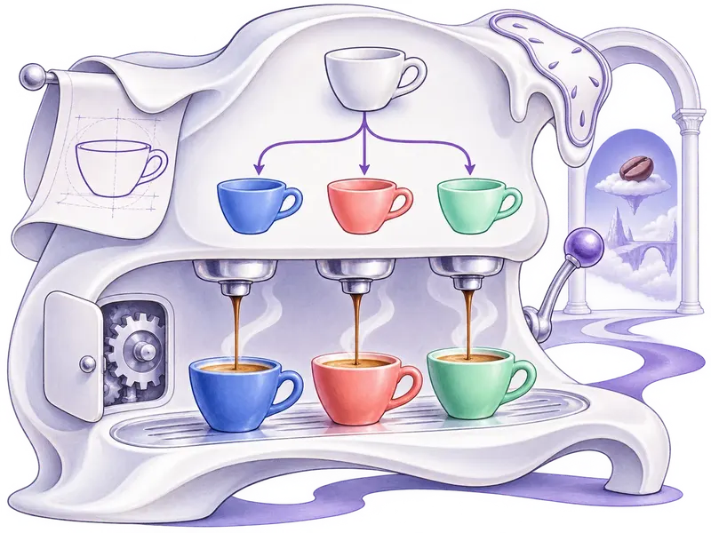

{: .align-left width="200" style="float: left; margin-right: 10px;"} 
Java is one of the most popular programming languages, extensively used in various fields such as web development, mobile app development, and game development. It encompasses key concepts like classes, objects, inheritance, polymorphism, encapsulation, and abstraction, which form the foundation of its Object-Oriented Programming (OOP) paradigm. These principles enable developers to create modular, reusable, and efficient code, fostering better software design and maintainability. Java's platform independence, achieved through the Java Virtual Machine (JVM), allows applications to run on any device equipped with a JVM, making it a versatile choice for cross-platform development. Additionally, Java's extensive standard library provides a wide range of tools and functionalities, simplifying many common programming tasks and enhancing productivity.

---

## Ders Kitabı

[📕 Java ile Nesne Yönelimli Programlama (PDF, 29 MB)](https://sercankulcu.github.io/courses-pdfs/java/Java-ile-Nesne-Yonelimli-Programlama.pdf)

---

## Başlangıç Kaynakları

* [Java ve Nesne Yönelimli Programlamada Önemli İsimler (HTML)](/files/java/Java_Important_People.html)
* [Java ile Nesne Yönelimli Programlama İçin Ön Bilgiler (HTML)](/files/java/Java_Prerequisites.html)
* [Dersin Haritası (HTML)](/files/java/Ders_Haritasi.html)
* [Terim Sözlüğü (HTML)](/files/java/Sozluk.html)

---

## Kısım I: Programlama Temelleri

### Bölüm 1: Bilgisayarlar, Hesaplama ve Algoritmalar

Programlamanın zemini, bilgisayarın bilgiyi nasıl temsil ettiği ve işlediğidir. Bölüm sayıların, harflerin ve dizgilerin bellekte gösterimiyle, saklanan program fikri ve von Neumann mimarisiyle başlar. Ardından bilgisayar biliminin tarihine, Turing makinelerine ve hesaplamanın sınırlarına değinilir; problem çözme süreci algoritma kavramı ve basit arama ve sıralama örnekleri üzerinden ele alınır. Son kısımda akış diyagramlarının sembolleri ile sıralı, koşullu ve tekrarlı akışlar örnek problemler üzerinde işlenir.

- [🖼️Sunum-Bilgisayarlar (HTML)](/files/java/sunumlar/Bolum_01_01_Bilgisayarlar.html)
- [📄Sunum-Bilgisayarlar (PDF)](https://sercankulcu.github.io/courses-pdfs/java/pdf/Bolum_01_01_Bilgisayarlar.pdf)
- [📖Ders Notu - Bilgisayarlar (HTML)](/files/java/notlar/Bolum_01_01_Bilgisayarlar_Ders_Notu.html)
- [📝Çalışma Soruları - Bilgisayarlar (HTML)](/files/java/sunumlar/Bolum_01_01_Bilgisayarlar_Calisma_Sorulari.html)
  - [🕹️ASCII Tablosu (HTML)](/files/java/sunumlar/Bolum_01_ASCII-Table.html)
- [🖼️Sunum-Hesaplama ve Hesaplamalı Düşünme (HTML)](/files/java/sunumlar/Bolum_01_02_Hesaplama_ve_Hesaplamali_Dusunme.html)
- [📄Sunum-Hesaplama ve Hesaplamalı Düşünme (PDF)](https://sercankulcu.github.io/courses-pdfs/java/pdf/Bolum_01_02_Hesaplama_ve_Hesaplamali_Dusunme.pdf)
- [📖Ders Notu - Hesaplama ve Hesaplamalı Düşünme (HTML)](/files/java/notlar/Bolum_01_02_Hesaplama_ve_Hesaplamali_Dusunme_Ders_Notu.html)
- [📝Çalışma Soruları - Hesaplama ve Hesaplamalı Düşünme (HTML)](/files/java/sunumlar/Bolum_01_02_Hesaplama_ve_Hesaplamali_Dusunme_Calisma_Sorulari.html)
- [🖼️Sunum-Algoritmalar (HTML)](/files/java/sunumlar/Bolum_01_03_Algoritmalar.html)
- [📄Sunum-Algoritmalar (PDF)](https://sercankulcu.github.io/courses-pdfs/java/pdf/Bolum_01_03_Algoritmalar.pdf)
- [📖Ders Notu - Algoritmalar (HTML)](/files/java/notlar/Bolum_01_03_Algoritmalar_Ders_Notu.html)
- [📝Çalışma Soruları - Algoritmalar (HTML)](/files/java/sunumlar/Bolum_01_03_Algoritmalar_Calisma_Sorulari.html)
- [🖼️Sunum-Akış Diyagramları (HTML)](/files/java/sunumlar/Bolum_01_04_Akis_Diyagramlari.html)
- [📄Sunum-Akış Diyagramları (PDF)](https://sercankulcu.github.io/courses-pdfs/java/pdf/Bolum_01_04_Akis_Diyagramlari.pdf)
- [📖Ders Notu - Akış Diyagramları (HTML)](/files/java/notlar/Bolum_01_04_Akis_Diyagramlari_Ders_Notu.html)
- [📝Çalışma Soruları - Akış Diyagramları (HTML)](/files/java/sunumlar/Bolum_01_04_Akis_Diyagramlari_Calisma_Sorulari.html)
- [💻Kod Örnekleri (GitHub)](https://github.com/sercankulcu/object-oriented-programming-java/tree/main/Bolum01/src)

---

### Bölüm 2: Programlama ve Java Söz Dizimi

Bir programlama dili, belirli söz dizimi ve anlam kurallarına uyan ifadelerden oluşur. Bölümde programlama dillerinin gelişimi, söz dizimi ile anlam arasındaki fark, ifadeler, değişkenler ve tipler genel bir çerçevede tanıtılır. Java tarafında kaynak kodun derlenip çalıştırılması, ilkel veri tipleri, tanımlayıcılar ve anahtar sözcükler, atama, sabitler ve tip dönüşümleri ile işleçler ayrıntılı olarak işlenir. Kontrol akışına kısa bir girişle bölüm tamamlanır.

- [🖼️Sunum-Programlama (HTML)](/files/java/sunumlar/Bolum_02_01_Programlama.html)
- [📄Sunum-Programlama (PDF)](https://sercankulcu.github.io/courses-pdfs/java/pdf/Bolum_02_01_Programlama.pdf)
- [📖Ders Notu - Programlama (HTML)](/files/java/notlar/Bolum_02_01_Programlama_Ders_Notu.html)
- [📝Çalışma Soruları - Programlama (HTML)](/files/java/sunumlar/Bolum_02_01_Programlama_Calisma_Sorulari.html)
- [🖼️Sunum-Söz Dizimi Kuralları (HTML)](/files/java/sunumlar/Bolum_02_02_Soz_Dizimi_Kurallari.html)
- [📄Sunum-Söz Dizimi Kuralları (PDF)](https://sercankulcu.github.io/courses-pdfs/java/pdf/Bolum_02_02_Soz_Dizimi_Kurallari.pdf)
- [📖Ders Notu - Söz Dizimi Kuralları (HTML)](/files/java/notlar/Bolum_02_02_Soz_Dizimi_Kurallari_Ders_Notu.html)
- [📝Çalışma Soruları - Söz Dizimi Kuralları (HTML)](/files/java/sunumlar/Bolum_02_02_Soz_Dizimi_Kurallari_Calisma_Sorulari.html)
  - [🕹️İlkel Tipler Laboratuvarı (HTML)](/files/java/sunumlar/Bolum_02_Primitive-Types-Lab.html)
- [💻Kod Örnekleri (GitHub)](https://github.com/sercankulcu/object-oriented-programming-java/tree/main/Bolum02/src)

---

### Bölüm 3: Kontrol Yapıları, Fonksiyonlar, Diziler ve Dizgiler

Programın akışı karar yapıları ve döngülerle yönlendirilir. Bölümde if ve switch yapıları, iç içe döngüler, break ve continue deyimleri ile metotların tanımlanması, çağrılması, kapsam kuralları ve soyutlamadaki rolü anlatılır. Dizilerin bellekteki yerleşimi, sık görülen dizi hataları, temel dizi algoritmaları ve çok boyutlu diziler Tic Tac Toe uygulamasıyla pekiştirilir. Dizgilerde değiştirilemezlik, karşılaştırma ve biçimli çıktı incelenir; özyineleme ise faktöriyel ve seri örnekleriyle başlayıp verimlilik, kuyruk özyinelemesi ve bellekleme konularıyla tamamlanır.

- [🖼️Sunum-Kontrol Yapıları (HTML)](/files/java/sunumlar/Bolum_03_01_Kontrol_Yapilari.html)
- [📄Sunum-Kontrol Yapıları (PDF)](https://sercankulcu.github.io/courses-pdfs/java/pdf/Bolum_03_01_Kontrol_Yapilari.pdf)
- [📖Ders Notu - Kontrol Yapıları (HTML)](/files/java/notlar/Bolum_03_01_Kontrol_Yapilari_Ders_Notu.html)
- [📝Çalışma Soruları - Kontrol Yapıları (HTML)](/files/java/sunumlar/Bolum_03_01_Kontrol_Yapilari_Calisma_Sorulari.html)
- [🖼️Sunum-Fonksiyonlar (HTML)](/files/java/sunumlar/Bolum_03_02_Fonksiyonlar.html)
- [📄Sunum-Fonksiyonlar (PDF)](https://sercankulcu.github.io/courses-pdfs/java/pdf/Bolum_03_02_Fonksiyonlar.pdf)
- [📖Ders Notu - Fonksiyonlar (HTML)](/files/java/notlar/Bolum_03_02_Fonksiyonlar_Ders_Notu.html)
- [📝Çalışma Soruları - Fonksiyonlar (HTML)](/files/java/sunumlar/Bolum_03_02_Fonksiyonlar_Calisma_Sorulari.html)
  - [🕹️Değer ile Aktarım Laboratuvarı (HTML)](/files/java/sunumlar/Bolum_03_Pass-By-Value-Lab.html)
- [🖼️Sunum-Diziler (HTML)](/files/java/sunumlar/Bolum_03_03_Diziler.html)
- [📄Sunum-Diziler (PDF)](https://sercankulcu.github.io/courses-pdfs/java/pdf/Bolum_03_03_Diziler.pdf)
- [📖Ders Notu - Diziler (HTML)](/files/java/notlar/Bolum_03_03_Diziler_Ders_Notu.html)
- [📝Çalışma Soruları - Diziler (HTML)](/files/java/sunumlar/Bolum_03_03_Diziler_Calisma_Sorulari.html)
- [🖼️Sunum-Dizgiler (HTML)](/files/java/sunumlar/Bolum_03_04_Dizgiler.html)
- [📄Sunum-Dizgiler (PDF)](https://sercankulcu.github.io/courses-pdfs/java/pdf/Bolum_03_04_Dizgiler.pdf)
- [📖Ders Notu - Dizgiler (HTML)](/files/java/notlar/Bolum_03_04_Dizgiler_Ders_Notu.html)
- [📝Çalışma Soruları - Dizgiler (HTML)](/files/java/sunumlar/Bolum_03_04_Dizgiler_Calisma_Sorulari.html)
  - [🕹️Dizgi Havuzu (HTML)](/files/java/sunumlar/Bolum_03_String-Pool.html)
- [🖼️Sunum-Özyineleme (HTML)](/files/java/sunumlar/Bolum_03_05_Ozyineleme.html)
- [📄Sunum-Özyineleme (PDF)](https://sercankulcu.github.io/courses-pdfs/java/pdf/Bolum_03_05_Ozyineleme.pdf)
- [📖Ders Notu - Özyineleme (HTML)](/files/java/notlar/Bolum_03_05_Ozyineleme_Ders_Notu.html)
- [📝Çalışma Soruları - Özyineleme (HTML)](/files/java/sunumlar/Bolum_03_05_Ozyineleme_Calisma_Sorulari.html)
- [💻Kod Örnekleri (GitHub)](https://github.com/sercankulcu/object-oriented-programming-java/tree/main/Bolum03/src)

---

## Kısım II: Nesne Yönelimli Programlama

### Bölüm 4: Nesneler ve Sınıflar, Kalıtım ve Çok Biçimlilik

Nesne yönelimli programlama, veriyi ve bu veri üzerinde çalışan davranışı sınıflar içinde bir araya getirir. Bölüm sınıf ve nesne, yapıcılar, static üyeler, this referansı, kayıtlar, enum tipleri ve iç sınıflarla başlar; sarmalama, erişim belirleyiciler, değiştirilemez sınıflar ve paketlerle sürer. Kalıtımda super, geçersiz kılma ve Object sınıfı, çok biçimlilikte ise referans tipleri, tip dönüşümü, dinamik bağlama ve aşırı yükleme ele alınır. Son kısım soyut sınıfları, arayüzleri, lambda ifadelerini, mühürlü tipleri, jenerikleri, etiketleri ve yaygın tasarım desenlerini kapsar.

- [🖼️Sunum-Nesneler ve Sınıflar (HTML)](/files/java/sunumlar/Bolum_04_01_Nesneler_ve_Siniflar.html)
- [📄Sunum-Nesneler ve Sınıflar (PDF)](https://sercankulcu.github.io/courses-pdfs/java/pdf/Bolum_04_01_Nesneler_ve_Siniflar.pdf)
- [📖Ders Notu - Nesneler ve Sınıflar (HTML)](/files/java/notlar/Bolum_04_01_Nesneler_ve_Siniflar_Ders_Notu.html)
- [📝Çalışma Soruları - Nesneler ve Sınıflar (HTML)](/files/java/sunumlar/Bolum_04_01_Nesneler_ve_Siniflar_Calisma_Sorulari.html)
  - [🕹️Yığın ve Heap Gezgini (HTML)](/files/java/sunumlar/Bolum_04_Heap-Stack-Explorer.html)
- [🖼️Sunum-Sarmalama (HTML)](/files/java/sunumlar/Bolum_04_02_Sarmalama.html)
- [📄Sunum-Sarmalama (PDF)](https://sercankulcu.github.io/courses-pdfs/java/pdf/Bolum_04_02_Sarmalama.pdf)
- [📖Ders Notu - Sarmalama (HTML)](/files/java/notlar/Bolum_04_02_Sarmalama_Ders_Notu.html)
- [📝Çalışma Soruları - Sarmalama (HTML)](/files/java/sunumlar/Bolum_04_02_Sarmalama_Calisma_Sorulari.html)
  - [🕹️Erişim Belirleyiciler (HTML)](/files/java/sunumlar/Bolum_04_Access-Modifiers.html)
- [🖼️Sunum-Kalıtım (HTML)](/files/java/sunumlar/Bolum_04_03_Kalitim.html)
- [📄Sunum-Kalıtım (PDF)](https://sercankulcu.github.io/courses-pdfs/java/pdf/Bolum_04_03_Kalitim.pdf)
- [📖Ders Notu - Kalıtım (HTML)](/files/java/notlar/Bolum_04_03_Kalitim_Ders_Notu.html)
- [📝Çalışma Soruları - Kalıtım (HTML)](/files/java/sunumlar/Bolum_04_03_Kalitim_Calisma_Sorulari.html)
- [🖼️Sunum-Çok Biçimlilik (HTML)](/files/java/sunumlar/Bolum_04_04_Cok_Bicimlilik.html)
- [📄Sunum-Çok Biçimlilik (PDF)](https://sercankulcu.github.io/courses-pdfs/java/pdf/Bolum_04_04_Cok_Bicimlilik.pdf)
- [📖Ders Notu - Çok Biçimlilik (HTML)](/files/java/notlar/Bolum_04_04_Cok_Bicimlilik_Ders_Notu.html)
- [📝Çalışma Soruları - Çok Biçimlilik (HTML)](/files/java/sunumlar/Bolum_04_04_Cok_Bicimlilik_Calisma_Sorulari.html)
  - [🕹️Dinamik Bağlama (HTML)](/files/java/sunumlar/Bolum_04_Dynamic-Dispatch.html)
- [🖼️Sunum-Soyut Sınıflar ve Arayüzler (HTML)](/files/java/sunumlar/Bolum_04_05_Soyut_Siniflar_ve_Arayuzler.html)
- [📄Sunum-Soyut Sınıflar ve Arayüzler (PDF)](https://sercankulcu.github.io/courses-pdfs/java/pdf/Bolum_04_05_Soyut_Siniflar_ve_Arayuzler.pdf)
- [📖Ders Notu - Soyut Sınıflar ve Arayüzler (HTML)](/files/java/notlar/Bolum_04_05_Soyut_Siniflar_ve_Arayuzler_Ders_Notu.html)
- [📝Çalışma Soruları - Soyut Sınıflar ve Arayüzler (HTML)](/files/java/sunumlar/Bolum_04_05_Soyut_Siniflar_ve_Arayuzler_Calisma_Sorulari.html)
- [💻Kod Örnekleri (GitHub)](https://github.com/sercankulcu/object-oriented-programming-java/tree/main/Bolum04/src)

---

### Bölüm 5: Koleksiyonlar

Java koleksiyon çerçevesi, nesne gruplarını saklamak ve işlemek için ortak arayüzler ve hazır sınıflar sunar. Bölümde ArrayList, LinkedList, Stack, PriorityQueue ve ArrayDeque gibi liste ve kuyruk yapıları, HashSet ve TreeSet kümeleri ile HashMap ve TreeMap eşlemeleri iç yapılarıyla birlikte incelenir. Yineleyiciyle gezinme, Comparable ve Comparator ile sıralama ve Collections sınıfının algoritmaları örneklerle işlenir. Akış API'sinde ara ve uç işlemler ile tembel değerlendirme anlatılır; uygun koleksiyonun seçimi ve değiştirilemez koleksiyonlarla bölüm tamamlanır.

- [🖼️Sunum-Koleksiyonlar (HTML)](/files/java/sunumlar/Bolum_05_Koleksiyonlar.html)
- [📄Sunum-Koleksiyonlar (PDF)](https://sercankulcu.github.io/courses-pdfs/java/pdf/Bolum_05_Koleksiyonlar.pdf)
- [📖Ders Notu - Koleksiyonlar (HTML)](/files/java/notlar/Bolum_05_Koleksiyonlar_Ders_Notu.html)
- [📝Çalışma Soruları - Koleksiyonlar (HTML)](/files/java/sunumlar/Bolum_05_Koleksiyonlar_Calisma_Sorulari.html)
- [💻Kod Örnekleri (GitHub)](https://github.com/sercankulcu/object-oriented-programming-java/tree/main/Bolum05/src)

- [🕹️Koleksiyonların İç Yapısı (HTML)](/files/java/sunumlar/Bolum_05_Collections-Internals.html)
- [🕹️Akış Boru Hattı (HTML)](/files/java/sunumlar/Bolum_05_Stream-Pipeline.html)

---

## Kısım III: Sağlam Program

### Bölüm 6: İstisnalar

İstisnalar, program çalışırken ortaya çıkan olağan dışı durumları normal akıştan ayırarak ele almayı sağlar. Bölümde try, catch ve finally blokları, istisna hiyerarşisi, kontrol edilen ve kontrol edilmeyen istisnalar ile Error sınıfları anlatılır. İstisna fırlatma, sık karşılaşılan çalışma zamanı istisnaları ve özel istisna sınıflarının tanımlanması örneklerle işlenir. Bir istisnanın çağrı yığını boyunca nasıl yayıldığı yığın izi üzerinden gösterilir.

- [🖼️Sunum-İstisnalar (HTML)](/files/java/sunumlar/Bolum_06_Istisnalar.html)
- [📄Sunum-İstisnalar (PDF)](https://sercankulcu.github.io/courses-pdfs/java/pdf/Bolum_06_Istisnalar.pdf)
- [📖Ders Notu - İstisnalar (HTML)](/files/java/notlar/Bolum_06_Istisnalar_Ders_Notu.html)
- [📝Çalışma Soruları - İstisnalar (HTML)](/files/java/sunumlar/Bolum_06_Istisnalar_Calisma_Sorulari.html)
- [💻Kod Örnekleri (GitHub)](https://github.com/sercankulcu/object-oriented-programming-java/tree/main/Bolum06/src)

- [🕹️İstisna Akışı (HTML)](/files/java/sunumlar/Bolum_06_Exception-Flow.html)

---

### Bölüm 7: Test ve Hata Ayıklama

Test, bir programın beklenen biçimde çalıştığını sınamak; hata ayıklama ise ortaya çıkan kusurun kaynağını bulmaktır. Bölümde test türleri ve düzeyleri, JUnit 5 ile birim testleri, doğrulama metotları, parametreli testler, sınır değerleri ve iyi bir testin özellikleri ele alınır. Regresyon testi, otomatik testler ve test güdümlü geliştirme tanıtılır; hata ayıklayıcıda kesme noktaları ve adım komutlarının kullanımı gösterilir. Profil oluşturucu, kod kapsamı, statik analiz ve bellek çözümleme araçlarıyla bölüm tamamlanır.

- [🖼️Sunum-Test ve Hata Ayıklama (HTML)](/files/java/sunumlar/Bolum_07_Test_ve_Hata_Ayiklama.html)
- [📄Sunum-Test ve Hata Ayıklama (PDF)](https://sercankulcu.github.io/courses-pdfs/java/pdf/Bolum_07_Test_ve_Hata_Ayiklama.pdf)
- [📖Ders Notu - Test ve Hata Ayıklama (HTML)](/files/java/notlar/Bolum_07_Test_ve_Hata_Ayiklama_Ders_Notu.html)
- [📝Çalışma Soruları - Test ve Hata Ayıklama (HTML)](/files/java/sunumlar/Bolum_07_Test_ve_Hata_Ayiklama_Calisma_Sorulari.html)
- [💻Kod Örnekleri (GitHub)](https://github.com/sercankulcu/object-oriented-programming-java/tree/main/Bolum07/src)

---

## Kısım IV: Java ile Uygulamalar

### Bölüm 8: Giriş Çıkış İşlemleri

Java'da veri okuma ve yazma işlemleri akış kavramı üzerine kuruludur. Bölümde bayt ve karakter akışları, dosya kodlamaları, dosya sistemiyle çalışma, metin dosyalarının okunup yazılması ve tamponlamanın sağladığı kazanç anlatılır. Dosya kopyalama, rastgele erişimli dosyalar ve nesnelerin serileştirilmesi örneklerle işlenir. NIO kütüphanesinin sunduğu yeni dosya ve kanal arayüzleriyle bölüm tamamlanır.

- [🖼️Sunum-Giriş Çıkış İşlemleri (HTML)](/files/java/sunumlar/Bolum_08_Giris_Cikis_Islemleri.html)
- [📄Sunum-Giriş Çıkış İşlemleri (PDF)](https://sercankulcu.github.io/courses-pdfs/java/pdf/Bolum_08_Giris_Cikis_Islemleri.pdf)
- [📖Ders Notu - Giriş Çıkış İşlemleri (HTML)](/files/java/notlar/Bolum_08_Giris_Cikis_Islemleri_Ders_Notu.html)
- [📝Çalışma Soruları - Giriş Çıkış İşlemleri (HTML)](/files/java/sunumlar/Bolum_08_Giris_Cikis_Islemleri_Calisma_Sorulari.html)
- [💻Kod Örnekleri (GitHub)](https://github.com/sercankulcu/object-oriented-programming-java/tree/main/Bolum08/src)

---

### Bölüm 9: Grafikler ve Kullanıcı Arayüzleri

Grafik kullanıcı arayüzü, programla kullanıcı arasındaki etkileşimi pencereler, düğmeler ve çizimler üzerinden kurar. Bölümde AWT ve Swing kütüphaneleri, JFrame ve JPanel sınıfları, paintComponent ile çizim, renk ve yazı tipleri ile FlowLayout ve BorderLayout yerleşim yöneticileri anlatılır. Fare olayları, dinleyici arayüzleri ve olay iş parçacığı basit bir çizim programıyla gösterilir. JButton, JLabel ve metin bileşenleri ise metin dönüştürücü ve para üstü hesaplama uygulamalarıyla işlenir.

- [🖼️Sunum-Grafikler ve Kullanıcı Arayüzleri (HTML)](/files/java/sunumlar/Bolum_09_Grafikler_ve_Kullanici_Arayuzleri.html)
- [📄Sunum-Grafikler ve Kullanıcı Arayüzleri (PDF)](https://sercankulcu.github.io/courses-pdfs/java/pdf/Bolum_09_Grafikler_ve_Kullanici_Arayuzleri.pdf)
- [📖Ders Notu - Grafikler ve Kullanıcı Arayüzleri (HTML)](/files/java/notlar/Bolum_09_Grafikler_ve_Kullanici_Arayuzleri_Ders_Notu.html)
- [📝Çalışma Soruları - Grafikler ve Kullanıcı Arayüzleri (HTML)](/files/java/sunumlar/Bolum_09_Grafikler_ve_Kullanici_Arayuzleri_Calisma_Sorulari.html)
- [💻Kod Örnekleri (GitHub)](https://github.com/sercankulcu/object-oriented-programming-java/tree/main/Bolum09/src)

- [🕹️Swing Yerleşim Yöneticileri (HTML)](/files/java/sunumlar/Bolum_09_Swing-Layouts.html)

---

### Bölüm 10: İş Parçacıkları

İş parçacıkları, bir programın birden çok işi eş zamanlı yürütmesini sağlar. Bölümde süreç ve iş parçacığı ayrımı, Thread sınıfı ve Runnable arayüzü, iş parçacığının yaşam döngüsü ile sleep, join ve güvenli durdurma yöntemleri anlatılır. Yarış durumu, synchronized ile karşılıklı dışlama, volatile ile görünürlük, açık kilitler, kilitlenme ve wait/notify ile üretici–tüketici problemi adım adım işlenir. CountDownLatch, Semaphore ve atomik sınıflar gibi senkronizasyon nesneleri ile iş parçacığı havuzları ve ExecutorService de ele alınır.

- [🖼️Sunum-İş Parçacıkları (HTML)](/files/java/sunumlar/Bolum_10_Is_Parcaciklari.html)
- [📄Sunum-İş Parçacıkları (PDF)](https://sercankulcu.github.io/courses-pdfs/java/pdf/Bolum_10_Is_Parcaciklari.pdf)
- [📖Ders Notu - İş Parçacıkları (HTML)](/files/java/notlar/Bolum_10_Is_Parcaciklari_Ders_Notu.html)
- [📝Çalışma Soruları - İş Parçacıkları (HTML)](/files/java/sunumlar/Bolum_10_Is_Parcaciklari_Calisma_Sorulari.html)
- [💻Kod Örnekleri (GitHub)](https://github.com/sercankulcu/object-oriented-programming-java/tree/main/Bolum10/src)

- [🕹️İş Parçacığı Yarışı (HTML)](/files/java/sunumlar/Bolum_10_Thread-Race.html)

---

### Bölüm 11: Veri Tabanı Programlama

Veri tabanları, verinin kalıcı, tutarlı ve sorgulanabilir biçimde saklanmasını sağlar. Bölümde ilişkisel model, SQLite, temel SQL komutları, normalleştirme, yabancı anahtarlar, gruplama ve indeksler anlatılır. JDBC ile bağlantı kurma, tablo oluşturma ve kayıt ekleme, okuma, güncelleme ve silme işlemleri örnek bir kişi programı üzerinde gösterilir; SQL enjeksiyonu ve PreparedStatement ile korunma da işlenir. DAO deseni, MySQL'e geçiş, işlemler ve ACID özellikleri ile toplu işlemlerle bölüm tamamlanır.

- [🖼️Sunum-Veri Tabanı Programlama (HTML)](/files/java/sunumlar/Bolum_11_Veri_Tabani_Programlama.html)
- [📄Sunum-Veri Tabanı Programlama (PDF)](https://sercankulcu.github.io/courses-pdfs/java/pdf/Bolum_11_Veri_Tabani_Programlama.pdf)
- [📖Ders Notu - Veri Tabanı Programlama (HTML)](/files/java/notlar/Bolum_11_Veri_Tabani_Programlama_Ders_Notu.html)
- [📝Çalışma Soruları - Veri Tabanı Programlama (HTML)](/files/java/sunumlar/Bolum_11_Veri_Tabani_Programlama_Calisma_Sorulari.html)
- [💻Öğrenci Yönetimi Uygulaması (GitHub)](https://github.com/sercankulcu/StudentManagement)
- [💻Kod Örnekleri (GitHub)](https://github.com/sercankulcu/object-oriented-programming-java/tree/main/Bolum11/src)

---

## Part I: Programming Fundamentals

### Chapter 1: Computers, Computation and Algorithms

Programming rests on how a computer represents and processes information. The chapter opens with the representation of numbers, characters and strings in memory, the stored-program idea and the von Neumann architecture. It then touches on the history of computer science, Turing machines and the limits of computation, and approaches problem solving through the notion of an algorithm with simple searching and sorting examples. The last part introduces flowchart symbols and works through sequential, conditional and repeated flow on sample problems.

- [🖼️Slides – 1.1 Computers (HTML)](/files/java/slides/Chapter_01_01_Computers.html)
- [🖼️Slides – 1.2 Computation and Computational Thinking (HTML)](/files/java/slides/Chapter_01_02_Computation_and_Computational_Thinking.html)
- [🖼️Slides – 1.3 Algorithms (HTML)](/files/java/slides/Chapter_01_03_Algorithms.html)
- [🖼️Slides – 1.4 Flowcharts (HTML)](/files/java/slides/Chapter_01_04_Flowcharts.html)

---

### Chapter 2: Programming and Java Syntax

A programming language is made of statements that follow precise rules of syntax and meaning. The chapter first gives a general picture of how programming languages evolved, the difference between syntax and semantics, and the roles of expressions, variables and types. On the Java side it covers compiling and running source code, primitive data types, identifiers and keywords, assignment, constants, type conversions and operators in detail. A short introduction to control flow closes the chapter.

- [🖼️Slides – 2.1 Programming (HTML)](/files/java/slides/Chapter_02_01_Programming.html)
- [🖼️Slides – 2.2 Syntax Rules (HTML)](/files/java/slides/Chapter_02_02_Syntax_Rules.html)

---

### Chapter 3: Control Structures, Methods, Arrays and Strings

Decisions and loops steer the flow of a program. This chapter covers if and switch, nested loops, break and continue, and then methods: how to define and call them, scope rules and their role in abstraction. Arrays are examined through their memory layout, common mistakes, basic array algorithms and multidimensional arrays, reinforced with a Tic Tac Toe program. Strings are studied for immutability, comparison and formatted output, and recursion starts from factorial and series examples before moving on to efficiency, tail recursion and memoization.

- [🖼️Slides – 3.1 Control Structures (HTML)](/files/java/slides/Chapter_03_01_Control_Structures.html)
- [🖼️Slides – 3.2 Methods (HTML)](/files/java/slides/Chapter_03_02_Methods.html)
- [🖼️Slides – 3.3 Arrays (HTML)](/files/java/slides/Chapter_03_03_Arrays.html)
- [🖼️Slides – 3.4 Strings (HTML)](/files/java/slides/Chapter_03_04_Strings.html)
- [🖼️Slides – 3.5 Recursion (HTML)](/files/java/slides/Chapter_03_05_Recursion.html)

---

## Part II: Object-Oriented Programming

### Chapter 4: Objects and Classes, Inheritance and Polymorphism

Object-oriented programming brings data and the behavior that operates on it together in classes. The chapter starts with classes and objects, constructors, static members, the this reference, records, enum types and inner classes, and continues with encapsulation, access modifiers, immutable classes and packages. Inheritance is treated through super, overriding and the Object class, and polymorphism through reference types, casting, dynamic binding and overloading. The final part covers abstract classes, interfaces, lambda expressions, sealed types, generics, annotations and widely used design patterns.

- [🖼️Slides – 4.1 Objects and Classes (HTML)](/files/java/slides/Chapter_04_01_Objects_and_Classes.html)
- [🖼️Slides – 4.2 Encapsulation (HTML)](/files/java/slides/Chapter_04_02_Encapsulation.html)
- [🖼️Slides – 4.3 Inheritance (HTML)](/files/java/slides/Chapter_04_03_Inheritance.html)
- [🖼️Slides – 4.4 Polymorphism (HTML)](/files/java/slides/Chapter_04_04_Polymorphism.html)
- [🖼️Slides – 4.5 Abstract Classes and Interfaces (HTML)](/files/java/slides/Chapter_04_05_Abstract_Classes_and_Interfaces.html)

---

### Chapter 5: Collections

The Java Collections Framework provides common interfaces and ready-made classes for storing and processing groups of objects. We study lists and queues such as ArrayList, LinkedList, Stack, PriorityQueue and ArrayDeque, the HashSet and TreeSet sets, and the HashMap and TreeMap maps, together with how each works internally. Iteration with iterators, ordering with Comparable and Comparator, and the algorithms of the Collections class are illustrated with examples. The Stream API is introduced with intermediate and terminal operations and lazy evaluation, and the chapter ends with choosing the right collection and with unmodifiable collections.

- [🖼️Slides – Collections (HTML)](/files/java/slides/Chapter_05_Collections.html)

---

## Part III: Robust Programs

### Chapter 6: Exceptions

Exceptions let a program handle unusual situations that arise at run time separately from its normal flow. The chapter covers try, catch and finally blocks, the exception hierarchy, checked and unchecked exceptions, and the Error classes. Throwing exceptions, the most common run-time exceptions and defining custom exception classes are shown through examples. A stack trace is used to show how an exception propagates up the call stack.

- [🖼️Slides – Exceptions (HTML)](/files/java/slides/Chapter_06_Exceptions.html)

---

### Chapter 7: Testing and Debugging

Testing checks that a program behaves as expected, and debugging finds the source of a defect once it appears. The chapter covers kinds and levels of testing, unit testing with JUnit 5, assertion methods, parameterized tests, boundary values and the qualities of a good test. Regression testing, automated testing and test-driven development are introduced, and we show how to use breakpoints and stepping commands in a debugger. Profilers, code coverage, static analysis and memory analysis tools round out the chapter.

- [🖼️Slides – Testing and Debugging (HTML)](/files/java/slides/Chapter_07_Testing_and_Debugging.html)

---

## Part IV: Applications in Java

### Chapter 8: Input and Output

Reading and writing data in Java is built on the concept of streams. The chapter covers byte and character streams, file encodings, working with the file system, reading and writing text files, and the gains that buffering brings. File copying, random-access files and object serialization are shown through examples. The newer file and channel interfaces of the NIO library close the chapter.

- [🖼️Slides – Input and Output (HTML)](/files/java/slides/Chapter_08_Input_and_Output.html)

---

### Chapter 9: Graphics and User Interfaces

A graphical user interface lets the user interact with a program through windows, buttons and drawings. The chapter introduces the AWT and Swing libraries, the JFrame and JPanel classes, drawing with paintComponent, colors and fonts, and the FlowLayout and BorderLayout layout managers. Mouse events, listener interfaces and the event dispatch thread are demonstrated with a simple drawing program. JButton, JLabel and text components are then put to work in a text converter and a change calculator.

- [🖼️Slides – Graphics and User Interfaces (HTML)](/files/java/slides/Chapter_09_Graphics_and_User_Interfaces.html)

---

### Chapter 10: Threads

Threads let a program carry out several tasks concurrently. The chapter explains the difference between processes and threads, the Thread class and the Runnable interface, the thread life cycle, and sleep, join and safe ways to stop a thread. Race conditions, mutual exclusion with synchronized, visibility with volatile, explicit locks, deadlock and the producer–consumer problem with wait and notify are worked through step by step. Synchronizers such as CountDownLatch, Semaphore and the atomic classes, as well as thread pools and ExecutorService, are also covered.

- [🖼️Slides – Threads (HTML)](/files/java/slides/Chapter_10_Threads.html)

---

### Chapter 11: Database Programming

Databases store data so that it stays persistent, consistent and easy to query. The chapter covers the relational model, SQLite, basic SQL commands, normalization, foreign keys, grouping and indexes. Connecting with JDBC, creating tables, and inserting, reading, updating and deleting records are shown on a sample contacts program, along with SQL injection and how PreparedStatement prevents it. The DAO pattern, moving to MySQL, transactions and the ACID properties, and batch operations complete the chapter.

- [🖼️Slides – Database Programming (HTML)](/files/java/slides/Chapter_11_Database_Programming.html)

